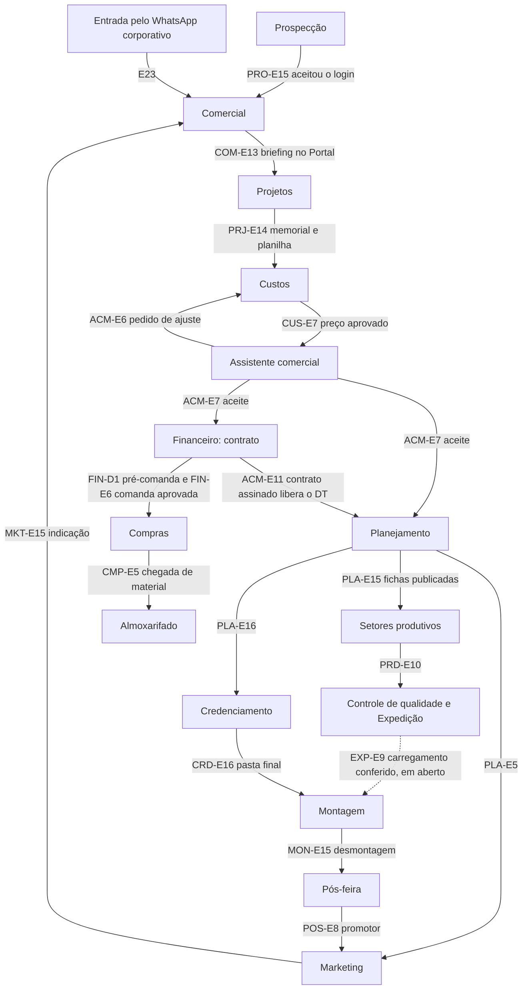

# Visão geral dos fluxos

O caminho de um projeto na Imagine, da prospecção à próxima feira. Cada passagem é um evento do sistema: a etapa que termina libera a seguinte e notifica o próximo responsável.

Este caminho parte da seção 2 da Especificação e foi corrigido pelas decisões de Diego. A montagem é do Claude e de agentes, sem revisão de Diego nem do Pedro. As dúvidas estão em `ERP-CRM/ANDAMENTO/DUVIDAS.md`.

## As passagens

| # | Passagem | Gatilho | Decisões |
|---:|---|---|---|
| 1 | Prospecção → Comercial | O cliente aceita o login do Portal (`PRO-E15`) e entra na organização de clientes (`COM-E6`). | |
| 2 | Entrada pelo WhatsApp | Só pelo número corporativo integrado ao ERP. Depois da conferência (`E23`), segue o fluxo principal. | `item-6` |
| 3 | Comercial → Projetos | Briefing no Portal (`COM-E13`). O arquiteto é definido em `PRJ-E1`. | `item-15` |
| 4 | Projetos → Custos | Memorial gerado e planilha aberta (`PRJ-E14`). | `item-2` |
| 5 | Custos → Assistente comercial | A IA gera a planilha, e Custos confere e aprova. A IA propõe logística e operação, a Diretoria financeira valida, a IA gera o preço, e só as duas diretorias aprovam o preço de venda (`CUS-E5`, `CUS-E6`, `CUS-E7`). | `item-1`, `item-19` |
| 6 | Envio da proposta | O assistente envia só com autorização do vendedor que fez a proposta. Validade de 7 dias. | `item-7`, `item-4`, `item-24` |
| 7 | Aceite | O aceite (`ACM-E7`) avisa o Financeiro (`FIN-E1`), que gera o contrato (`FIN-E2`), e **o projeto já entra no Planejamento** (`PLA-E1`). | `item-8` |
| 8 | Contrato assinado | A assinatura (`ACM-E11`) **libera o detalhamento técnico** (`PLA-E7`, `PRJ-E13`). | `ponto-1` |
| 9 | Planejamento → todos | Cronograma publicado (`PLA-E4`) e setores notificados (`PLA-E5`). Prazos fixos: proposta até 30 dias e produção até 20 dias antes do evento. | `item-11` |
| 10 | Em paralelo | Credenciamento recebe o formulário do evento (`PLA-E16` → `CRD-E1`), e Marketing recebe as datas (`MKT-E1`). | `item-3`, `item-18` |
| 11 | Materiais | O sistema gera a pré-comanda (`FIN-D1`), os setores só conferem e ajustam (`FIN-D2`), toda comanda passa pelo Financeiro (`FIN-E5`, `FIN-E6`) e vai para Compras (`CMP-E1`). | `item-21`, `ponto-3` |
| 12 | Compras | Vale o alerta de preço (`CMP-D2`). O comprador não vê o orçado, e o sistema compara por trás (`CMP-D3`). | `item-5`, `ponto-2`, `item-14` |
| 13 | Planejamento → Produção | Ficha publicada (`PLA-E15`) entra no app do setor (`PRD-E1`). | `item-12` |
| 14 | Produção → Qualidade → Expedição → Logística | Concluída no último setor (`PRD-E10`), a peça passa pelo Controle de qualidade (`EXP-E3`, `EXP-E4`), pela Expedição e pela Logística (`EXP-D1`). | `item-22` |
| 15 | Expedição → Montagem | Pela Especificação, o carregamento conferido (`EXP-E9`) libera a montagem (`MON-E1`). Como a Logística fica entre as duas, isso está em aberto (DUV-028). A pasta do Credenciamento (`CRD-E16`) também chega à Montagem. | `item-22` |
| 16 | Montagem → Pós-feira | A desmontagem (`MON-E15`) abre o dossiê do evento (`POS-E1`). | `item-18` |
| 17 | Pós-feira → Marketing → Comercial | Cliente promotor é convidado para indicação e case (`POS-E8`, `MKT-E15`). A indicação volta como origem de cliente. | `item-18` |

## Como ler cada fluxo

- **Ordem:** a numeração das seções é a ordem de execução, que pode diferir do número da etapa.
- **Situação:** `vigente`, `ajustada`, `substituida` ou `nova-por-decisao`, explicadas em `ERP-CRM/TAXONOMIA.md`.
- **Códigos `XXX-Dn`:** etapas que só existem por causa de uma decisão de Diego.
- **Seta contínua no diagrama:** o documento diz o caminho. **Seta pontilhada:** é só a sequência da lista, então confirme antes de travar no sistema.
- **Itens:** cada etapa lista os `UNI-` ligados a ela. Regras, campos e notificações estão neles.
- **Dados:** `ERP-CRM/dados/fluxos.jsonl` traz as mesmas etapas, para gerar estados e transições.

## O que ainda não tem fluxo

- **Controle de qualidade:** não tem etapas próprias. `EXP-E3` e `EXP-E4` foram colocadas nele por leitura do item-22.
- **Logística:** `EXP-D1` só marca a posição. O fluxo do setor não foi mapeado.
- **Decoração, Criação gráfica, Impressão 3D, Tecnologia e Produção de evento:** têm regras nos módulos, mas sem etapas com código na Especificação. Veja `ERP-CRM/MODULOS/`.
- **Pós-feira e Marketing:** seguem sem responsável definido.
