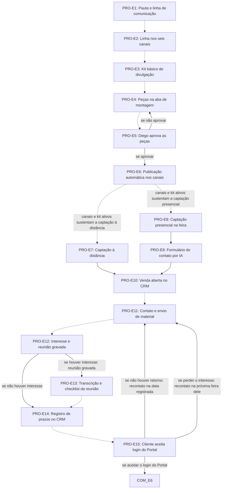

# Fluxo PRO · Prospecção

15 etapas em ordem de execução, com as decisões de Diego aplicadas. Montado por agentes a partir da Especificação e dos documentos de setor, e ainda não revisado por Diego nem pelo Pedro. Como ler: `ERP-CRM/FLUXOS/00_VISAO-GERAL.md`.

## 1. PRO-E7 · Captação à distância `vigente`

- **O que acontece:** Caminho à distância: acessa a base do CRM, levanta a planta da feira, pesquisa expositores e decisores e filtra por categoria, porte, verba, tipo de cliente e demanda. Usa também tráfego pago e representantes.
- **Responsável:** Prospecção ou representante
- **Perfis:** `PERF-PROSPECCAO`
- **Prazo:** não informado
- **Gatilho:** Início de um lead pelo caminho à distância; canais e kit ativos (PRO-E6) sustentam a captação
- **Próxima:** `PRO-E10`
- **Itens:** `UNI-00348`
- **Fonte:** DOC-091 §5 01 Prospecção ativa; PLANDEM_SET01_PROSPECCAO_MAPEAMENTO_V02.md §5 Fase 3; PLANDEM_FLX-SET01_PROSPECCAO_V01.md §02

## 2. PRO-E8 · Captação presencial na feira `vigente`

- **O que acontece:** Caminho presencial: contato com o cliente em feira ou evento.
- **Responsável:** Prospecção ou representante
- **Perfis:** `PERF-PROSPECCAO`
- **Prazo:** não informado
- **Gatilho:** Início de um lead pelo caminho presencial, em feira ou evento
- **Próxima:** `PRO-E9`
- **Em aberto:** Divergência: o §5 registra o contato pelo WhatsApp (PRO-E9), feito por Prospecção ou representante; o §19 registra cada estande no app, feito pelo vendedor, e o lead entra direto no RD Station. A Especificação não diz se um substitui o outro.
- **Itens:** `UNI-00349`
- **Fonte:** DOC-091 §5 01 Prospecção ativa e §19; PLANDEM_FLX-SET01_PROSPECCAO_V01.md §02

## 3. PRO-E9 · Formulário do contato por IA `vigente`

- **O que acontece:** Quem fez o contato manda mensagem ao agente de IA no WhatsApp, com fotos e anotações. O agente gera o formulário do contato: contatos, onde foi o contato, fotos, pontos fortes, pontos fracos, necessidades e próximo contato.
- **Responsável:** Agente de IA, com mensagem de quem fez o contato (Prospecção ou representante)
- **Perfis:** `AGENTE-IA`, `PERF-PROSPECCAO`
- **Prazo:** no mesmo dia
- **Gatilho:** Contato presencial feito (PRO-E8)
- **Próxima:** `PRO-E10`
- **Em aberto:** O documento não diz de qual número sai a mensagem; o item-6 proíbe o número pessoal.
- **Itens:** `UNI-00002.02`, `UNI-00350`, `UNI-00350.01`, `UNI-01098`
- **Fonte:** DOC-091 §5 01 Prospecção ativa; PLANDEM_FLX-SET01_PROSPECCAO_V01.md §04

## 4. PRO-E10 · Venda aberta no CRM `vigente`

- **O que acontece:** Abre a nova venda no CRM; os dois caminhos se juntam aqui. No presencial, o formulário cria a venda sozinho e a Prospecção revisa em seguida.
- **Responsável:** Presencial: Sistema abre e Prospecção revisa. À distância: Prospecção ou representante
- **Perfis:** `SISTEMA`, `PERF-PROSPECCAO`
- **Prazo:** não informado
- **Gatilho:** Alvo identificado (PRO-E7) ou formulário do contato gerado (PRO-E9)
- **Próxima:** `PRO-E11` _(pela ordem do documento)_
- **Itens:** `UNI-00351`
- **Fonte:** DOC-091 §5 01 Prospecção ativa; PLANDEM_SET01_PROSPECCAO_MAPEAMENTO_V02.md §5 Fase 4

## 5. PRO-E11 · Contato e envio de material `vigente`

- **O que acontece:** Quem captou o lead faz o contato, envia o material e registra no CRM o que foi enviado.
- **Responsável:** Quem captou o lead (Prospecção ou representante)
- **Perfis:** `PERF-PROSPECCAO`
- **Prazo:** não informado
- **Gatilho:** Venda aberta (PRO-E10) ou data de recontato vencida (PRO-E15)
- **Próxima:** `PRO-E12` _(pela ordem do documento)_
- **Itens:** `UNI-00352`
- **Fonte:** DOC-091 §5 01 Prospecção ativa; PLANDEM_SET01_PROSPECCAO_MAPEAMENTO_V02.md §5 Fase 4

## 6. PRO-E12 · Interesse e reunião gravada `vigente`

- **O que acontece:** Verifica se o cliente demonstrou interesse. Se houver, faz a reunião de prospecção online, gravada pela IA.
- **Responsável:** Quem captou o lead; Agente de IA grava
- **Perfis:** `AGENTE-IA`
- **Prazo:** não informado
- **Gatilho:** Contato e material enviados (PRO-E11)
- **Próxima:** se houver interesse: reunião gravada: `PRO-E13`; se não houver interesse: `PRO-E14`
- **Itens:** `UNI-00353`, `UNI-00353.01`, `UNI-00550`
- **Fonte:** DOC-091 §5 01 Prospecção ativa; PLANDEM_SET01_PROSPECCAO_MAPEAMENTO_V02.md §5 Fase 4

## 7. PRO-E13 · Transcrição e checklist da reunião `vigente`

- **O que acontece:** A IA transcreve a reunião e gera o checklist do que o cliente pediu; a reunião fica registrada no CRM e o Comercial confere.
- **Responsável:** Agente de IA; Comercial confere
- **Perfis:** `AGENTE-IA`, `PERF-VENDEDOR`
- **Prazo:** não informado
- **Gatilho:** Reunião de prospecção gravada (PRO-E12)
- **Próxima:** `PRO-E14` _(pela ordem do documento)_
- **Itens:** `UNI-00354`
- **Fonte:** DOC-091 §5 01 Prospecção ativa; PLANDEM_SET01_PROSPECCAO_MAPEAMENTO_V02.md §5 Fase 4

## 8. PRO-E14 · Registro de prazos no CRM `vigente`

- **O que acontece:** Registra no CRM os prazos de retorno do cliente, de envio de material e a nova data de recontato.
- **Responsável:** Quem conduz o lead (Prospecção ou representante)
- **Perfis:** `PERF-PROSPECCAO`
- **Prazo:** Sem prazo fixo: data combinada com o cliente a cada contato
- **Gatilho:** Checklist conferido (PRO-E13) ou cliente sem interesse (PRO-E12)
- **Próxima:** `PRO-E15` _(pela ordem do documento)_
- **Itens:** `UNI-00069`, `UNI-00591.01`
- **Fonte:** DOC-091 §5 01 Prospecção ativa; PLANDEM_SET01_PROSPECCAO_MAPEAMENTO_V02.md §5 Fase 4

## 9. PRO-E15 · Cliente aceita login do Portal `vigente`

- **O que acontece:** Acompanha os prazos. Se o cliente aceita receber o login do Portal, a venda passa ao Comercial. Sem retorno, faz recontato na data registrada. Se perdeu o interesse, recebe data de recontato na próxima feira dele.
- **Responsável:** Quem conduz o lead (Prospecção ou representante); cliente responde
- **Perfis:** `PERF-PROSPECCAO`, `PERF-CLIENTE`
- **Prazo:** Data combinada com o cliente; o CRM avisa quando o prazo vence
- **Gatilho:** Prazos registrados (PRO-E14)
- **Próxima:** se aceitar o login do Portal: `COM-E6`; se não houver retorno: recontato na data registrada: `PRO-E11`; se perder o interesse: recontato na próxima feira dele: `PRO-E11`
- **Itens:** `UNI-00070`, `UNI-00551`, `UNI-00551.01`, `UNI-00551.02`
- **Fonte:** DOC-091 §2 item 1 e §5 01 Prospecção ativa; PLANDEM_SET01_PROSPECCAO_MAPEAMENTO_V02.md §4 e §5

## 10. PRO-E1 · Pauta e linha de comunicação `vigente`

- **O que acontece:** Define e registra em documento-guia a pauta e a linha de comunicação para o perfil de venda; a linha precisa da aprovação do Diego.
- **Responsável:** Marketing, com aprovação da diretoria (Diego)
- **Perfis:** `PERF-DIRETORIA-COMERCIAL`, `PERF-MARKETING`
- **Prazo:** não informado
- **Gatilho:** Contínua: frente de comunicação, roda o tempo todo, independente de cada lead
- **Próxima:** `PRO-E2` _(pela ordem do documento)_
- **Decisões aplicadas:** `item-18`
- **Em aberto:** Quem mantém a pauta e com que frequência não foi informado (UNI-00904, UNI-00906). Diego define o responsável de Marketing depois (item-18), embora a Especificação cite a Érika nas respostas de 31/10. Caminho se a linha não for aprovada: não informado.
- **Itens:** `UNI-00343`, `UNI-00343.01`, `UNI-00904`, `UNI-00906.01`
- **Fonte:** DOC-091 §5 01 Prospecção ativa; PLANDEM_FLX-SET01_PROSPECCAO_V01.md §03

## 11. PRO-E2 · Linha nos seis canais `vigente`

- **O que acontece:** Aplica a mesma linha, perfil e abordagem nos seis canais: LinkedIn, Instagram, site, blog, newsletter (CRM) e WhatsApp.
- **Responsável:** Marketing (inferido)
- **Perfis:** `PERF-MARKETING`
- **Prazo:** não informado
- **Gatilho:** Contínua: frente de comunicação; linha aprovada (PRO-E1)
- **Próxima:** `PRO-E3` _(pela ordem do documento)_
- **Decisões aplicadas:** `item-18`
- **Em aberto:** Frequência de publicação por canal não informada (UNI-00907). Diego define o responsável de Marketing depois (item-18).
- **Itens:** `UNI-00059`, `UNI-00344`, `UNI-00344.01`
- **Fonte:** DOC-091 §5 01 Prospecção ativa; PLANDEM_SET01_PROSPECCAO_MAPEAMENTO_V02.md §6

## 12. PRO-E3 · Kit básico de divulgação `vigente`

- **O que acontece:** Monta o kit de divulgação: apresentação da empresa em PDF ou link HTML no Portal.
- **Responsável:** Marketing (inferido)
- **Perfis:** `PERF-MARKETING`
- **Prazo:** não informado
- **Gatilho:** Contínua: frente de comunicação; linha aplicada (PRO-E2)
- **Próxima:** `PRO-E4` _(pela ordem do documento)_
- **Decisões aplicadas:** `item-18`
- **Em aberto:** Não foi informado se o kit inclui algo além da apresentação (UNI-00905). Diego define o responsável de Marketing depois (item-18).
- **Itens:** `UNI-00345`, `UNI-00905`
- **Fonte:** DOC-091 §5 01 Prospecção ativa; PLANDEM_SET01_PROSPECCAO_MAPEAMENTO_V02.md §5 Fase 2

## 13. PRO-E4 · Peças na aba de montagem `vigente`

- **O que acontece:** Edita e gera as peças de cada canal na aba de montagem do Portal, no formato técnico de cada canal.
- **Responsável:** Marketing
- **Perfis:** `PERF-MARKETING`
- **Prazo:** não informado
- **Gatilho:** Contínua: frente de comunicação; kit pronto (PRO-E3) ou peça reprovada (PRO-E5)
- **Próxima:** `PRO-E5` _(pela ordem do documento)_
- **Decisões aplicadas:** `item-18`
- **Em aberto:** Diego define o responsável de Marketing depois (item-18).
- **Itens:** `UNI-00346`, `UNI-01096`
- **Fonte:** DOC-091 §5 01 Prospecção ativa; PLANDEM_SET01_PROSPECCAO_MAPEAMENTO_V02.md §5 Fase 2

## 14. PRO-E5 · Diego aprova as peças `vigente`

- **O que acontece:** O Diego aprova as peças. Se não aprovar, voltam para ajuste.
- **Responsável:** Diretoria (Diego)
- **Perfis:** `PERF-DIRETORIA-COMERCIAL`
- **Prazo:** não informado
- **Gatilho:** Contínua: frente de comunicação; peças geradas (PRO-E4)
- **Próxima:** se aprovar: `PRO-E6`; se não aprovar: `PRO-E4`
- **Itens:** `UNI-00549`, `UNI-01097`
- **Fonte:** DOC-091 §5 01 Prospecção ativa; PLANDEM_FLX-SET01_PROSPECCAO_V01.md §02

## 15. PRO-E6 · Publicação automática nos canais `vigente`

- **O que acontece:** Publicação automática nos seis canais. O WhatsApp vai só para a lista segmentada do CRM (feira, porte, categoria).
- **Responsável:** Sistema
- **Perfis:** `SISTEMA`
- **Prazo:** não informado
- **Gatilho:** Contínua: frente de comunicação; peças aprovadas (PRO-E5)
- **Próxima:** canais e kit ativos sustentam a captação à distância: `PRO-E7` _(pela ordem do documento)_; canais e kit ativos sustentam a captação presencial: `PRO-E8` _(pela ordem do documento)_
- **Itens:** `UNI-00347`, `UNI-01096`
- **Fonte:** DOC-091 §5 01 Prospecção ativa; PLANDEM_FLX-SET01_PROSPECCAO_V01.md §02

