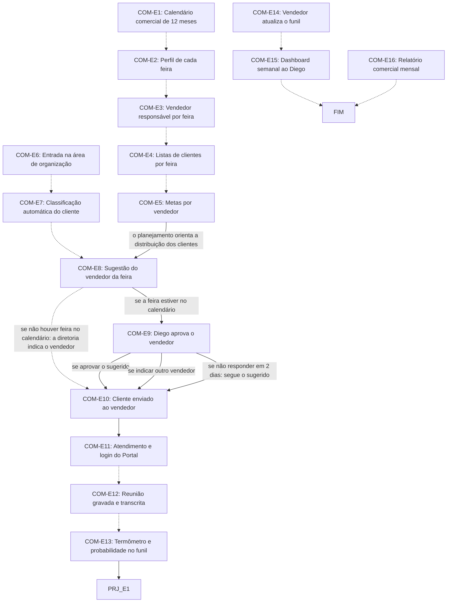

# Fluxo COM · Comercial

16 etapas em ordem de execução, com as decisões de Diego aplicadas. Montado por agentes a partir da Especificação e dos documentos de setor, e ainda não revisado por Diego nem pelo Pedro. Como ler: `ERP-CRM/FLUXOS/00_VISAO-GERAL.md`.

## 1. COM-E6 · Entrada na área de organização `vigente`

- **O que acontece:** O cliente entra na área de organização, com origem registrada: Prospecção (com formulário, transcrição e checklist), LinkedIn, Instagram, WhatsApp (relatório completado pela Prospecção, proposta) ou cliente antigo (com histórico). A indicação volta como origem de cliente.
- **Responsável:** Sistema
- **Perfis:** `SISTEMA`
- **Prazo:** não informado
- **Gatilho:** Cliente aceita o login (PRO-E15), ou chega por LinkedIn, Instagram, WhatsApp, cliente antigo ou indicação
- **Próxima:** `COM-E7` _(pela ordem do documento)_
- **Em aberto:** O documento não diz como a origem WhatsApp daqui se liga à entrada E17 a E27.
- **Itens:** `UNI-00358`, `UNI-00836`
- **Fonte:** DOC-091 §2 itens 1 e 12 e §5 02 Comercial; PLANDEM_FLX-SET02_COMERCIAL_V03.md §03

## 2. COM-E7 · Classificação automática do cliente `vigente`

- **O que acontece:** Classifica o cliente: Prioridade (50 m² ou mais e R$ 1.500/m² ou mais), Secundária (o resto) ou Pacote (exceção).
- **Responsável:** Sistema
- **Perfis:** `SISTEMA`
- **Prazo:** não informado
- **Gatilho:** Cliente registrado na área de organização (COM-E6)
- **Próxima:** `COM-E8` _(pela ordem do documento)_
- **Itens:** `UNI-00623`, `UNI-00623.01`
- **Fonte:** DOC-091 §5 02 Comercial; PLANDEM_FLX-SET02_COMERCIAL_V03.md §03

## 3. COM-E8 · Sugestão do vendedor da feira `vigente`

- **O que acontece:** O sistema sugere o vendedor responsável pela feira no planejamento. Cliente sem feira no calendário não recebe sugestão: a diretoria avalia e indica o vendedor.
- **Responsável:** Sistema; sem feira no calendário, Diretoria
- **Perfis:** `SISTEMA`, `PERF-DIRETORIA-COMERCIAL`
- **Prazo:** não informado
- **Gatilho:** Cliente classificado (COM-E7)
- **Próxima:** se a feira estiver no calendário: `COM-E9`; se não houver feira no calendário: a diretoria indica o vendedor: `COM-E10` _(pela ordem do documento)_
- **Itens:** `UNI-00359`, `UNI-00552`, `UNI-01594`
- **Fonte:** DOC-091 §5 02 Comercial; PLANDEM_FLX-SET02_COMERCIAL_V03.md §03

## 4. COM-E9 · Diego aprova o vendedor `vigente`

- **O que acontece:** O Diego recebe cliente, feira, perfil, classe e vendedor sugerido, e aprova ou indica outro. Sem resposta em 2 dias, segue o sugerido.
- **Responsável:** Diretoria (Diego)
- **Perfis:** `PERF-DIRETORIA-COMERCIAL`
- **Prazo:** 2 dias
- **Gatilho:** Vendedor sugerido; notificação ao Diego (COM-E8)
- **Próxima:** se aprovar o sugerido: `COM-E10`; se indicar outro vendedor: `COM-E10`; se não responder em 2 dias: segue o sugerido: `COM-E10`
- **Itens:** `UNI-00071`, `UNI-00553`, `UNI-00592`
- **Fonte:** DOC-091 §5 02 Comercial e §6; PLANDEM_FLX-SET02_COMERCIAL_V03.md §02

## 5. COM-E10 · Cliente enviado ao vendedor `vigente`

- **O que acontece:** O cliente aparece no usuário do vendedor no Portal, com o relatório da Prospecção.
- **Responsável:** Sistema
- **Perfis:** `SISTEMA`
- **Prazo:** não informado
- **Gatilho:** Vendedor definido (COM-E8 ou COM-E9)
- **Próxima:** `COM-E11`
- **Itens:** `UNI-00115`, `UNI-00358.01`
- **Fonte:** DOC-091 §5 02 Comercial; PLANDEM_FLX-SET02_COMERCIAL_V03.md §02

## 6. COM-E11 · Atendimento e login do Portal `vigente`

- **O que acontece:** O vendedor faz o primeiro contato e envia o login do Portal ao cliente.
- **Responsável:** Vendedor
- **Perfis:** `PERF-VENDEDOR`
- **Prazo:** não informado
- **Gatilho:** Cliente visível no usuário do vendedor (COM-E10)
- **Próxima:** `COM-E12` _(pela ordem do documento)_
- **Itens:** `UNI-00360`
- **Fonte:** DOC-091 §5 02 Comercial; PLANDEM_FLX-SET02_COMERCIAL_V03.md §07

## 7. COM-E12 · Reunião gravada e transcrita `vigente`

- **O que acontece:** Reunião com o cliente, gravada e transcrita pela IA.
- **Responsável:** Vendedor; Agente de IA grava e transcreve
- **Perfis:** `AGENTE-IA`, `PERF-VENDEDOR`
- **Prazo:** não informado
- **Gatilho:** Atendimento iniciado (COM-E11)
- **Próxima:** `COM-E13` _(pela ordem do documento)_
- **Itens:** `UNI-00361`
- **Fonte:** DOC-091 §5 02 Comercial; PLANDEM_FLX-SET02_COMERCIAL_V03.md §02

## 8. COM-E13 · Termômetro e probabilidade no funil `vigente`

- **O que acontece:** A IA preenche o Termômetro da Reunião e a probabilidade de fechamento no funil; o vendedor confere. O briefing fica no Portal e o projeto segue para Projetos.
- **Responsável:** Agente de IA; vendedor confere
- **Perfis:** `AGENTE-IA`, `PERF-VENDEDOR`
- **Prazo:** não informado
- **Gatilho:** Reunião transcrita (COM-E12)
- **Próxima:** `PRJ-E1`
- **Decisões aplicadas:** `item-15`
- **Em aberto:** Formulário de briefing adiado: quantos blocos e quem preenche (item-15). O §20 só libera o briefing para o Planejamento com os campos obrigatórios preenchidos.
- **Itens:** `UNI-00269.01`, `UNI-00655`, `UNI-01100`, `UNI-01100.01`
- **Fonte:** DOC-091 §2 item 2, §5 02 Comercial e §20; PLANDEM_FLX-SET02_COMERCIAL_V03.md §02

## 9. COM-E1 · Calendário comercial de 12 meses `vigente`

- **O que acontece:** Monta o calendário comercial de 12 meses, com as feiras e eventos de cada mês.
- **Responsável:** Time de vendas (Simone, Luca, Rita e Fran)
- **Perfis:** `PERF-VENDEDOR`
- **Prazo:** não informado
- **Gatilho:** Contínua: planejamento comercial do ano
- **Próxima:** `COM-E2` _(pela ordem do documento)_
- **Em aberto:** Não foi informado em que mês o time fecha o planejamento do ano seguinte (UNI-00908).
- **Itens:** `UNI-00355`, `UNI-00908`, `UNI-01426`
- **Fonte:** DOC-091 §5 02 Comercial; PLANDEM_FLX-SET02_COMERCIAL_V03.md §07

## 10. COM-E2 · Perfil de cada feira `vigente`

- **O que acontece:** Define tipo, perfil e histórico de vendas de cada feira, com mínimo de 200 m² vendidos pela Imagine.
- **Responsável:** Time de vendas (Simone, Luca, Rita e Fran)
- **Perfis:** `PERF-VENDEDOR`
- **Prazo:** não informado
- **Gatilho:** Contínua: planejamento comercial do ano; calendário pronto (COM-E1)
- **Próxima:** `COM-E3` _(pela ordem do documento)_
- **Em aberto:** Inferido: os 200 m² somam todos os estandes da Imagine na feira, e clientes Pacote podem ficar fora do mínimo (UNI-01099).
- **Itens:** `UNI-00203`, `UNI-00356`, `UNI-00356.01`, `UNI-00908`, `UNI-01099`, `UNI-01426`
- **Fonte:** DOC-091 §5 02 Comercial; PLANDEM_FLX-SET02_COMERCIAL_V03.md §08

## 11. COM-E3 · Vendedor responsável por feira `vigente`

- **O que acontece:** Define o vendedor responsável por feira, por perfil, tipo de evento e histórico.
- **Responsável:** Time de vendas (Simone, Luca, Rita e Fran)
- **Perfis:** `PERF-VENDEDOR`
- **Prazo:** não informado
- **Gatilho:** Contínua: planejamento comercial do ano; perfil definido (COM-E2)
- **Próxima:** `COM-E4` _(pela ordem do documento)_
- **Itens:** `UNI-00357`, `UNI-00908`, `UNI-01426`
- **Fonte:** DOC-091 §5 02 Comercial; PLANDEM_FLX-SET02_COMERCIAL_V03.md §02

## 12. COM-E4 · Listas de clientes por feira `vigente`

- **O que acontece:** Preenche as listas por feira: A conhecidos, B potenciais novos (prospecção ativa antes da feira), C reserva e Pacote.
- **Responsável:** Time de vendas (Simone, Luca, Rita e Fran)
- **Perfis:** `PERF-VENDEDOR`
- **Prazo:** não informado
- **Gatilho:** Contínua: planejamento comercial do ano; vendedor definido (COM-E3)
- **Próxima:** `COM-E5` _(pela ordem do documento)_
- **Itens:** `UNI-00621`, `UNI-00908`, `UNI-01426`
- **Fonte:** DOC-091 §5 02 Comercial; PLANDEM_FLX-SET02_COMERCIAL_V03.md §03

## 13. COM-E5 · Metas por vendedor `vigente`

- **O que acontece:** Lança as metas do período: R$ 500 mil por mês por vendedor, contadas pelo mês do evento.
- **Responsável:** Time de vendas (Simone, Luca, Rita e Fran)
- **Perfis:** `PERF-VENDEDOR`
- **Prazo:** não informado
- **Gatilho:** Contínua: planejamento comercial do ano; listas prontas (COM-E4)
- **Próxima:** o planejamento orienta a distribuição dos clientes: `COM-E8`
- **Itens:** `UNI-00908`, `UNI-01427`
- **Fonte:** DOC-091 §5 02 Comercial; PLANDEM_FLX-SET02_COMERCIAL_V03.md §02 e §05

## 14. COM-E14 · Vendedor atualiza o funil `vigente`

- **O que acontece:** O vendedor atualiza no funil reuniões, propostas e status.
- **Responsável:** Vendedor
- **Perfis:** `PERF-VENDEDOR`
- **Prazo:** até sexta-feira
- **Gatilho:** Contínua: toda semana
- **Próxima:** `COM-E15` _(pela ordem do documento)_
- **Itens:** `UNI-00072`, `UNI-00072.01`, `UNI-01101`, `UNI-01101.01`
- **Fonte:** DOC-091 §5 02 Comercial e §7; PLANDEM_FLX-SET02_COMERCIAL_V03.md §08

## 15. COM-E15 · Dashboard semanal ao Diego `vigente`

- **O que acontece:** O dashboard semanal é enviado ao Diego: meta x realizado, funil, m² e R$/m², classes, reuniões e previsão ponderada.
- **Responsável:** Sistema
- **Perfis:** `SISTEMA`
- **Prazo:** toda sexta-feira
- **Gatilho:** Contínua: toda sexta-feira, depois da atualização do funil (COM-E14)
- **Próxima:** `FIM` _(pela ordem do documento)_
- **Itens:** `UNI-00014.01`, `UNI-00593`
- **Fonte:** DOC-091 §5 02 Comercial e §10; PLANDEM_FLX-SET02_COMERCIAL_V03.md §05

## 16. COM-E16 · Relatório comercial mensal `vigente`

- **O que acontece:** O sistema gera o relatório com dashboard e envia ao Diego: volumes por vendedor e da equipe, taxa de conversão e análise da IA sobre perdas e fechamentos. O vendedor registra o motivo ao marcar proposta como perdida; sem ele, o status não muda. Com o relatório, o Diego convoca a reunião mensal com os vendedores.
- **Responsável:** Sistema; Diretoria (Diego) convoca a reunião
- **Perfis:** `SISTEMA`, `PERF-DIRETORIA-COMERCIAL`
- **Prazo:** a cada 30 dias
- **Gatilho:** Contínua: a cada 30 dias
- **Próxima:** `FIM` _(pela ordem do documento)_
- **Itens:** `UNI-01524`
- **Fonte:** DOC-091 §5 Relatório comercial mensal (COM-E16)

