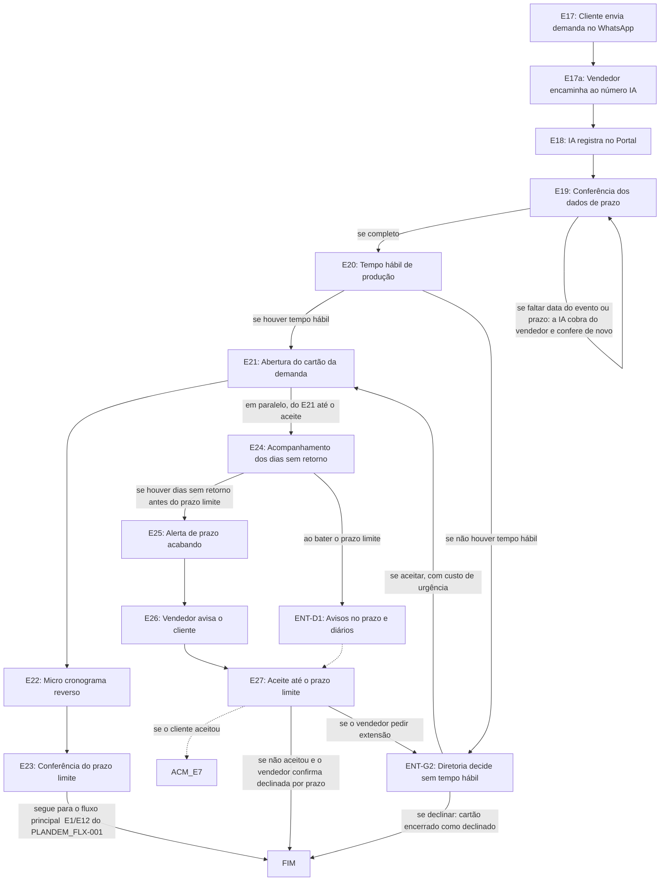

# Fluxo ENT · Entrada pelo WhatsApp

14 etapas em ordem de execução, com as decisões de Diego aplicadas. Montado por agentes a partir da Especificação e dos documentos de setor, e ainda não revisado por Diego nem pelo Pedro. Como ler: `ERP-CRM/FLUXOS/00_VISAO-GERAL.md`.

## 1. E17 · Cliente envia demanda no WhatsApp `ajustada`

- **O que acontece:** Cliente conhecido envia pedido, projeto pronto, arquivos ou fotos de referência para o número corporativo de WhatsApp do vendedor, integrado ao ERP.
- **Responsável:** Cliente
- **Perfis:** `PERF-CLIENTE`
- **Prazo:** não informado
- **Gatilho:** Cliente conhecido tem uma demanda
- **Próxima:** `E17a`
- **Mudou em relação ao documento:** O documento dizia WhatsApp pessoal do vendedor. O número pessoal é proibido; vale o número corporativo integrado ao ERP.
- **Decisões aplicadas:** `item-6`
- **Em aberto:** Validação da POL-001 pela Maitê (item-6).
- **Itens:** `UNI-00506`
- **Fonte:** PLANDEM_FLX-001_ENTRADA-WHATSAPP_MAPEAMENTO_V01.md Fase W1

## 2. E17a · Vendedor encaminha ao número IA `ajustada`

- **O que acontece:** O vendedor encaminha a conversa e os anexos, a partir do número corporativo, ao número da IA, informando data do evento e prazo.
- **Responsável:** Vendedor
- **Perfis:** `PERF-VENDEDOR`
- **Prazo:** não informado
- **Gatilho:** Demanda recebida no número corporativo (E17)
- **Próxima:** `E18`
- **Mudou em relação ao documento:** A conversa encaminhada sai do número corporativo, não mais do pessoal.
- **Decisões aplicadas:** `item-6`
- **Em aberto:** Com o número integrado ao ERP, o encaminhamento manual continua ou a captura fica automática? A decisão não diz. Demanda não encaminhada fica invisível para o Portal (UNI-01129). Ferramenta de WhatsApp com IA a definir (UNI-00972).
- **Fonte:** PLANDEM_FLX-001_ENTRADA-WHATSAPP_MAPEAMENTO_V01.md Fase W1 e Validar

## 3. E18 · IA registra no Portal `vigente`

- **O que acontece:** A IA recebe a conversa e registra tudo no Portal.
- **Responsável:** Agente de IA
- **Perfis:** `AGENTE-IA`
- **Prazo:** não informado
- **Gatilho:** Conversa encaminhada ao número da IA (E17a)
- **Próxima:** `E19`
- **Em aberto:** O documento não diz se esta demanda passa pela distribuição COM-E6 a COM-E10.
- **Itens:** `UNI-00508`
- **Fonte:** PLANDEM_FLX-001_ENTRADA-WHATSAPP_MAPEAMENTO_V01.md Fase W1

## 4. E19 · Conferência dos dados de prazo `vigente`

- **O que acontece:** Confere data do evento e prazo. Se faltar dado, a IA cobra do vendedor (inferido). Se estiver completo, segue.
- **Responsável:** Agente de IA
- **Perfis:** `AGENTE-IA`
- **Prazo:** não informado
- **Gatilho:** Demanda registrada (E18)
- **Próxima:** se completo: `E20`; se faltar data do evento ou prazo: a IA cobra do vendedor e confere de novo: `E19`
- **Em aberto:** Inferido que a cobrança vai ao vendedor, não ao cliente (UNI-01117).
- **Itens:** `UNI-00509`, `UNI-01117`
- **Fonte:** PLANDEM_FLX-001_ENTRADA-WHATSAPP_MAPEAMENTO_V01.md Fase W1 e Validar

## 5. E20 · Tempo hábil de produção `vigente`

- **O que acontece:** O sistema verifica se há tempo hábil até o evento, pela regra fixa: proposta fechada até 30 dias antes e produção até 20 dias antes.
- **Responsável:** Sistema
- **Perfis:** `SISTEMA`
- **Prazo:** Proposta até 30 dias e produção até 20 dias antes do evento
- **Gatilho:** Dados de prazo completos (E19)
- **Próxima:** se houver tempo hábil: `E21`; se não houver tempo hábil: `ENT-G2`
- **Decisões aplicadas:** `item-11`
- **Em aberto:** O documento prevê trocar a regra fixa por tabela por tipo de item, a definir (UNI-00973); o item-11 diz que os prazos dependem do projeto, mas mantém 30 e 20 dias como fixos.
- **Itens:** `UNI-00587`, `UNI-00845`
- **Fonte:** PLANDEM_FLX-001_ENTRADA-WHATSAPP_MAPEAMENTO_V01.md Fase W2

## 6. ENT-G2 · Diretoria decide sem tempo hábil `vigente`

- **O que acontece:** A Diretoria decide a demanda sem tempo hábil: aceita, com custo de urgência, ou declina, encerrando o cartão como declinado.
- **Responsável:** Diretoria
- **Perfis:** `PERF-DIRETORIA-COMERCIAL`, `PERF-DIRETORIA-FINANCEIRA`
- **Prazo:** não informado
- **Gatilho:** Sem tempo hábil (E20) ou pedido de extensão do vendedor (E27)
- **Próxima:** se aceitar, com custo de urgência: `E21`; se declinar: cartão encerrado como declinado: `FIM`
- **Em aberto:** Prazo de resposta da Diretoria e cálculo do custo de urgência não informados (UNI-00970). Significado da sigla G2 em aberto (item-12). Vindo de E27, o cartão já existe, e o documento não diz como o fluxo retoma.
- **Itens:** `UNI-00588`, `UNI-00970`
- **Fonte:** PLANDEM_FLX-001_ENTRADA-WHATSAPP_MAPEAMENTO_V01.md Fase W2 e Validar

## 7. E21 · Abertura do cartão da demanda `vigente`

- **O que acontece:** O sistema abre o cartão de nova demanda, já marcando vendedor, assistente comercial, Projetos e Custos.
- **Responsável:** Sistema
- **Perfis:** `SISTEMA`
- **Prazo:** não informado
- **Gatilho:** Há tempo hábil (E20) ou Diretoria aceitou (G2)
- **Próxima:** `E22`; em paralelo, do E21 até o aceite: `E24`
- **Itens:** `UNI-00510`
- **Fonte:** PLANDEM_FLX-001_ENTRADA-WHATSAPP_MAPEAMENTO_V01.md Fases W2 e W3

## 8. E22 · Micro cronograma reverso `vigente`

- **O que acontece:** O sistema monta o micro cronograma reverso, com o prazo limite de aprovação do cliente e de início da produção.
- **Responsável:** Sistema
- **Perfis:** `SISTEMA`
- **Prazo:** não informado
- **Gatilho:** Cartão aberto (E21)
- **Próxima:** `E23`
- **Decisões aplicadas:** `item-11`
- **Itens:** `UNI-00511`
- **Fonte:** PLANDEM_FLX-001_ENTRADA-WHATSAPP_MAPEAMENTO_V01.md Fase W2

## 9. E23 · Conferência do prazo limite `vigente`

- **O que acontece:** O assistente comercial confirma ou corrige o prazo limite; a correção fica registrada. Depois, toda demanda passa pela reunião de briefing gravada e pela validação do vendedor (E1/E12) e segue o fluxo principal até a proposta (E14/E15).
- **Responsável:** Assistente comercial
- **Perfis:** `PERF-ASSISTENTE-COMERCIAL`
- **Prazo:** não informado
- **Gatilho:** Micro cronograma montado (E22)
- **Próxima:** segue para o fluxo principal (E1/E12 do PLANDEM_FLX-001): `FIM`
- **Em aberto:** E1, E12, E14 e E15 são códigos do PLANDEM_FLX-001 V03; o documento não declara a correspondência com os códigos COM e ACM da Especificação.
- **Itens:** `UNI-00223`, `UNI-00512`
- **Fonte:** PLANDEM_FLX-001_ENTRADA-WHATSAPP_MAPEAMENTO_V01.md Fase W2; PLANDEM_FLX-001_FLUXO-IMAGINE_V03.md Etapas detalhadas

## 10. E24 · Acompanhamento dos dias sem retorno `ajustada`

- **O que acontece:** Em paralelo, do E21 até o aceite, o sistema acompanha os dias sem retorno contra o prazo limite do micro cronograma. Ao bater o prazo limite, dispara os avisos do item-24.
- **Responsável:** Sistema
- **Perfis:** `SISTEMA`
- **Prazo:** Prazo limite do micro cronograma; validade da proposta de 7 dias (item-7)
- **Gatilho:** Contínua: em paralelo, do cartão aberto (E21) até o aceite
- **Próxima:** se houver dias sem retorno antes do prazo limite: `E25`; ao bater o prazo limite: `ENT-D1`
- **Mudou em relação ao documento:** O documento fazia valer a régua de 7 dias da E15 ou o prazo limite, o que vencesse primeiro, e não dizia quem é avisado ao bater o prazo. A decisão define esses avisos.
- **Decisões aplicadas:** `item-24`, `item-7`
- **Em aberto:** Não está dito se a regra do que vencer primeiro continua. O item-7 mantém a validade de 7 dias e deixa em aberto a expiração no 3º aviso.
- **Itens:** `UNI-00513`
- **Fonte:** PLANDEM_FLX-001_ENTRADA-WHATSAPP_MAPEAMENTO_V01.md Fase W3

## 11. E25 · Alerta de prazo acabando `vigente`

- **O que acontece:** O sistema alerta vendedor e assistente comercial: X dias sem retorno, limite para aprovar em Y dias, avise o cliente, senão vamos declinar. O assistente acompanha o prazo.
- **Responsável:** Sistema
- **Perfis:** `SISTEMA`
- **Prazo:** não informado
- **Gatilho:** Dias sem retorno contra o prazo limite (E24)
- **Próxima:** `E26`
- **Em aberto:** Quantos dias sem retorno disparam o alerta: não informado.
- **Itens:** `UNI-00615`
- **Fonte:** PLANDEM_FLX-001_ENTRADA-WHATSAPP_MAPEAMENTO_V01.md Fase W3

## 12. E26 · Vendedor avisa o cliente `ajustada`

- **O que acontece:** O vendedor avisa o cliente de que o prazo está acabando, pelo número corporativo de WhatsApp.
- **Responsável:** Vendedor
- **Perfis:** `PERF-VENDEDOR`
- **Prazo:** não informado
- **Gatilho:** Alerta recebido (E25)
- **Próxima:** `E27`
- **Mudou em relação ao documento:** O documento inferia o WhatsApp do próprio vendedor. O número pessoal é proibido.
- **Decisões aplicadas:** `item-6`
- **Em aberto:** Validação da POL-001 pela Maitê (item-6).
- **Itens:** `UNI-00514`, `UNI-01118`
- **Fonte:** PLANDEM_FLX-001_ENTRADA-WHATSAPP_MAPEAMENTO_V01.md Fase W3 e Validar

## 13. ENT-D1 · Avisos no prazo e diários `nova-por-decisao`

- **O que acontece:** Ao bater o prazo limite, o sistema avisa o vendedor e o Diego. Depois do prazo, dispara um aviso por dia, todos os dias seguintes, para o vendedor, o Diego e o Anderson.
- **Responsável:** Sistema
- **Perfis:** `SISTEMA`
- **Prazo:** No prazo limite e, depois dele, um aviso por dia
- **Gatilho:** Prazo limite atingido sem aceite (E24)
- **Próxima:** `E27` _(pela ordem do documento)_
- **Mudou em relação ao documento:** Etapa criada pelo item-24; o documento só previa o alerta antes do prazo (E25).
- **Decisões aplicadas:** `item-24`
- **Em aberto:** Até quando os avisos diários continuam (item-24).
- **Fonte:** ERP-CRM/01_DECISOES-DE-DIEGO.md item-24

## 14. E27 · Aceite até o prazo limite `vigente`

- **O que acontece:** Verifica se o cliente aceitou até o prazo limite. Se sim, a demanda vai para Demandas aprovadas e o projeto entra no Planejamento a partir do aceite. Se não, o sistema propõe declinada por prazo e o vendedor confirma; se ele pedir extensão, vai para a G2.
- **Responsável:** Sistema e vendedor
- **Perfis:** `SISTEMA`, `PERF-VENDEDOR`
- **Prazo:** Prazo limite do micro cronograma
- **Gatilho:** Prazo limite ou aceite do cliente
- **Próxima:** se o cliente aceitou: `ACM-E7` _(pela ordem do documento)_; se não aceitou e o vendedor confirma declinada por prazo: `FIM`; se o vendedor pedir extensão: `ENT-G2`
- **Decisões aplicadas:** `item-8`
- **Em aberto:** Inferido que a aprovação esperada é o aceite eletrônico da proposta (UNI-01119). Status declinada por prazo a definir (UNI-00971). O documento ligava o aceite direto ao Planejamento. Por leitura do Claude, passa por ACM-E7, que avisa o Financeiro e leva ao Planejamento. Este fluxo e ACM-D2 cuidam da mesma falta de resposta (DUV-005).
- **Itens:** `UNI-00589`, `UNI-01119`
- **Fonte:** PLANDEM_FLX-001_ENTRADA-WHATSAPP_MAPEAMENTO_V01.md Fase W3 e Validar

