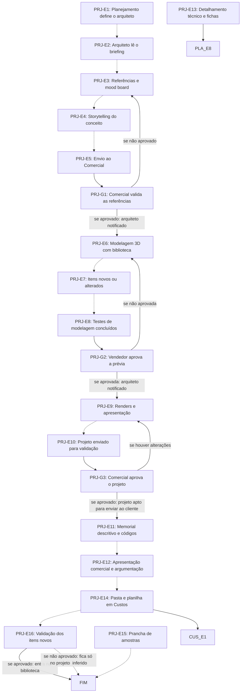

# Fluxo PRJ · Projetos

19 etapas em ordem de execução, com as decisões de Diego aplicadas. Montado por agentes a partir da Especificação e dos documentos de setor, e ainda não revisado por Diego nem pelo Pedro. Como ler: `ERP-CRM/FLUXOS/00_VISAO-GERAL.md`.

## 1. PRJ-E1 · Planejamento define o arquiteto `vigente`

- **O que acontece:** O Planejamento define quem faz o projeto e o Portal notifica o arquiteto.
- **Responsável:** Planejamento; Sistema notifica
- **Perfis:** `SISTEMA`, `PERF-PLANEJAMENTO`
- **Prazo:** não informado
- **Gatilho:** Briefing no Portal (COM-E13)
- **Próxima:** `PRJ-E2` _(pela ordem do documento)_
- **Em aberto:** O item-8 e o ponto-1 fazem o projeto entrar no Planejamento a partir do aceite, mas esta etapa acontece antes da proposta e do aceite. As decisões não tratam quem define o arquiteto nessa fase.
- **Itens:** `UNI-00269.01`, `UNI-00362`
- **Fonte:** DOC-091 §2 item 2 e §5 03 Projetos; PLANDEM_FLX-SET03_PROJETOS_V03.md §02

## 2. PRJ-E2 · Arquiteto lê o briefing `vigente`

- **O que acontece:** O arquiteto busca no Portal e lê briefing, anexos e pré-escopo.
- **Responsável:** Arquiteto
- **Perfis:** `PERF-ARQUITETO`
- **Prazo:** não informado
- **Gatilho:** Notificação do Portal ao arquiteto (PRJ-E1)
- **Próxima:** `PRJ-E3` _(pela ordem do documento)_
- **Decisões aplicadas:** `item-15`
- **Em aberto:** Formulário de briefing adiado: quantos blocos e quem preenche (item-15).
- **Itens:** `UNI-00363`
- **Fonte:** DOC-091 §5 03 Projetos; PLANDEM_FLX-SET03_PROJETOS_V03.md §02

## 3. PRJ-E3 · Referências e mood board `ajustada`

- **O que acontece:** Pesquisa e reúne referências e mood board de materiais e inspirações, por categoria, na aba Referências do projeto. O mood board fica sem sigla.
- **Responsável:** Arquiteto
- **Perfis:** `PERF-ARQUITETO`
- **Prazo:** não informado
- **Gatilho:** Briefing lido (PRJ-E2) ou referências reprovadas (G1)
- **Próxima:** `PRJ-E4` _(pela ordem do documento)_
- **Mudou em relação ao documento:** Sai a sigla REF proposta no SET03.
- **Decisões aplicadas:** `item-12`
- **Itens:** `UNI-00364`
- **Fonte:** DOC-091 §5 03 Projetos; PLANDEM_FLX-SET03_PROJETOS_V03.md §02 e §06

## 4. PRJ-E4 · Storytelling do conceito `ajustada`

- **O que acontece:** A IA gera o storytelling do conceito: justificativa, inspiração e argumento de venda. O storytelling fica sem sigla.
- **Responsável:** Agente de IA; arquiteto revisa
- **Perfis:** `AGENTE-IA`, `PERF-ARQUITETO`
- **Prazo:** não informado
- **Gatilho:** Mood board pronto (PRJ-E3)
- **Próxima:** `PRJ-E5` _(pela ordem do documento)_
- **Mudou em relação ao documento:** Sai a sigla STO proposta no SET03.
- **Decisões aplicadas:** `item-12`
- **Itens:** `UNI-00365`
- **Fonte:** DOC-091 §5 03 Projetos; PLANDEM_FLX-SET03_PROJETOS_V03.md §02, §06 e §07

## 5. PRJ-E5 · Envio ao Comercial `vigente`

- **O que acontece:** O arquiteto valida e envia ao Comercial; o vendedor do cliente é notificado.
- **Responsável:** Arquiteto
- **Perfis:** `PERF-ARQUITETO`
- **Prazo:** não informado
- **Gatilho:** Storytelling gerado (PRJ-E4)
- **Próxima:** `PRJ-G1`
- **Itens:** `UNI-00366`, `UNI-00366.01`, `UNI-01102.01`
- **Fonte:** DOC-091 §5 03 Projetos; PLANDEM_FLX-SET03_PROJETOS_V03.md §02

## 6. PRJ-G1 · Comercial valida as referências `vigente`

- **O que acontece:** O Comercial valida mood board, pesquisa, referências e argumentos. A etapa seguinte só é liberada com a aprovação. Se o Comercial atrasar, o prazo com o cliente é prorrogado pelo mesmo tempo.
- **Responsável:** Comercial (vendedor do cliente)
- **Perfis:** `PERF-VENDEDOR`, `PERF-CLIENTE`
- **Prazo:** até 1 dia
- **Gatilho:** Envio ao Comercial (PRJ-E5)
- **Próxima:** se aprovado: arquiteto notificado: `PRJ-E6`; se não aprovado: `PRJ-E3`
- **Em aberto:** Significado da sigla G1 em aberto (item-12); o PLANDEM_FLX-001 usa G1 para outra aprovação.
- **Fonte:** DOC-091 §5 03 Projetos, §6 e §7; PLANDEM_FLX-SET03_PROJETOS_V03.md §03

## 7. PRJ-E6 · Modelagem 3D com biblioteca `vigente`

- **O que acontece:** Modelagem 3D partindo da biblioteca de itens e do catálogo de locações; busca primeiro o que já existe.
- **Responsável:** Arquiteto
- **Perfis:** `PERF-ARQUITETO`
- **Prazo:** não informado
- **Gatilho:** Referências validadas (G1) ou prévia reprovada (G2)
- **Próxima:** `PRJ-E7` _(pela ordem do documento)_
- **Itens:** `UNI-00367`, `UNI-00367.01`, `UNI-00367.02`
- **Fonte:** DOC-091 §5 03 Projetos; PLANDEM_FLX-SET03_PROJETOS_V03.md §02

## 8. PRJ-E7 · Itens novos ou alterados `vigente`

- **O que acontece:** Quando o arquiteto altera ou cria um item, o Portal alerta e pede o cadastro: código, nome, tipo, medidas, imagem e arquivo 3D. O item é usado normalmente no 3D.
- **Responsável:** Arquiteto; Sistema alerta
- **Perfis:** `SISTEMA`, `PERF-ARQUITETO`
- **Prazo:** não informado
- **Gatilho:** Item alterado ou criado na modelagem (PRJ-E6)
- **Próxima:** `PRJ-E8` _(pela ordem do documento)_
- **Decisões aplicadas:** `item-9`
- **Em aberto:** Códigos BIB- e LOC- em aberto (item-9).
- **Itens:** `UNI-00368`
- **Fonte:** DOC-091 §5 03 Projetos; PLANDEM_FLX-SET03_PROJETOS_V03.md §04

## 9. PRJ-E8 · Testes de modelagem concluídos `ajustada`

- **O que acontece:** O arquiteto conclui os testes e marca a etapa; a prévia usa a sigla PRJ-002.
- **Responsável:** Arquiteto
- **Perfis:** `PERF-ARQUITETO`
- **Prazo:** não informado
- **Gatilho:** Modelagem e cadastro de itens feitos (PRJ-E7)
- **Próxima:** `PRJ-G2`
- **Mudou em relação ao documento:** Prévia passa a usar PRJ-002.
- **Decisões aplicadas:** `item-12`
- **Itens:** `UNI-00369`, `UNI-00369.01`, `UNI-00579.01`, `UNI-01102.02`
- **Fonte:** DOC-091 §5 03 Projetos; PLANDEM_FLX-SET03_PROJETOS_V03.md §02

## 10. PRJ-G2 · Vendedor aprova a prévia `ajustada`

- **O que acontece:** O vendedor que abriu a demanda aprova a modelagem testada, antes de renderizar. A etapa seguinte só é liberada com a aprovação. Se atrasar, o prazo com o cliente é prorrogado pelo mesmo tempo.
- **Responsável:** Vendedor que abriu a demanda
- **Perfis:** `PERF-VENDEDOR`
- **Prazo:** até 1 dia (a continuidade deste prazo está em aberto)
- **Gatilho:** Testes concluídos (PRJ-E8)
- **Próxima:** se aprovada: arquiteto notificado: `PRJ-E9`; se não aprovada: `PRJ-E6`
- **Mudou em relação ao documento:** O documento atribuía a validação ao Comercial e ao vendedor; agora é só de quem abriu a demanda.
- **Decisões aplicadas:** `item-2`
- **Em aberto:** O prazo de 1 dia continua? (item-2; UNI-01102). Significado da sigla G2 em aberto (item-12).
- **Fonte:** DOC-091 §5 03 Projetos e §7; PLANDEM_FLX-SET03_PROJETOS_V03.md §03

## 11. PRJ-E9 · Renders e apresentação `ajustada`

- **O que acontece:** O arquiteto faz os renders e monta a apresentação; os renders usam a sigla PRJ-002.
- **Responsável:** Arquiteto
- **Perfis:** `PERF-ARQUITETO`
- **Prazo:** não informado
- **Gatilho:** Prévia aprovada (G2) ou alterações apontadas (G3)
- **Próxima:** `PRJ-E10` _(pela ordem do documento)_
- **Mudou em relação ao documento:** Render passa a usar PRJ-002.
- **Decisões aplicadas:** `item-12`
- **Itens:** `UNI-00370`
- **Fonte:** DOC-091 §5 03 Projetos; PLANDEM_FLX-SET03_PROJETOS_V03.md §02

## 12. PRJ-E10 · Projeto enviado para validação `vigente`

- **O que acontece:** O arquiteto dá o comando no Portal, que avisa o Comercial.
- **Responsável:** Arquiteto
- **Perfis:** `PERF-ARQUITETO`
- **Prazo:** não informado
- **Gatilho:** Renders e apresentação prontos (PRJ-E9)
- **Próxima:** `PRJ-G3`
- **Itens:** `UNI-00371`, `UNI-00371.01`, `UNI-01102.03`
- **Fonte:** DOC-091 §5 03 Projetos; PLANDEM_FLX-SET03_PROJETOS_V03.md §02

## 13. PRJ-G3 · Comercial aprova o projeto `vigente`

- **O que acontece:** O Comercial valida a apresentação montada. Se houver ajuste, aponta pelo Portal e o ciclo se repete. A etapa seguinte só é liberada com a aprovação. Se atrasar, o prazo com o cliente é prorrogado pelo mesmo tempo.
- **Responsável:** Comercial
- **Perfis:** `PERF-VENDEDOR`
- **Prazo:** até 1 dia
- **Gatilho:** Projeto enviado para validação (PRJ-E10)
- **Próxima:** se aprovado: projeto apto para enviar ao cliente: `PRJ-E11`; se houver alterações: `PRJ-E9`
- **Fonte:** DOC-091 §5 03 Projetos, §6 e §7; PLANDEM_FLX-SET03_PROJETOS_V03.md §03

## 14. PRJ-E11 · Memorial descritivo e códigos `ajustada`

- **O que acontece:** O Portal gera o memorial com os mesmos itens e códigos do 3D, da biblioteca e do catálogo de locações; o arquiteto valida. O código do item é abreviatura do projeto + versão + número da sessão + número do item; nasce aqui e não muda até a montagem.
- **Responsável:** Sistema gera; arquiteto valida
- **Perfis:** `SISTEMA`, `PERF-ARQUITETO`
- **Prazo:** não informado
- **Gatilho:** Projeto aprovado (G3)
- **Próxima:** `PRJ-E12` _(pela ordem do documento)_
- **Mudou em relação ao documento:** A Especificação usava código de projeto + item + subitem; vale o formato do item-9.
- **Decisões aplicadas:** `item-9`
- **Em aberto:** Versão fixa ou não; BIB- e LOC- (item-9).
- **Itens:** `UNI-00372`, `UNI-00372.01`, `UNI-01429`
- **Fonte:** DOC-091 §4 Item do projeto, §5 03 Projetos e §6; PLANDEM_FLX-SET03_PROJETOS_V03.md §05

## 15. PRJ-E12 · Apresentação comercial e argumentação `vigente`

- **O que acontece:** O Portal gera a apresentação comercial e a argumentação de venda a partir de mood board, storytelling e renders.
- **Responsável:** Sistema
- **Perfis:** `SISTEMA`
- **Prazo:** não informado
- **Gatilho:** Memorial validado (PRJ-E11)
- **Próxima:** `PRJ-E14` _(pela ordem do documento)_
- **Itens:** `UNI-00373`
- **Fonte:** DOC-091 §5 03 Projetos; PLANDEM_FLX-SET03_PROJETOS_V03.md §02

## 16. PRJ-E14 · Pasta e planilha em Custos `vigente`

- **O que acontece:** O Portal abre a pasta em Custos com a planilha de custos, dá 3 dias e avisa Comercial, assistente comercial, Financeiro e assistente financeiro.
- **Responsável:** Sistema
- **Perfis:** `SISTEMA`
- **Prazo:** 3 dias (de PRJ-E14 a CUS-E6)
- **Gatilho:** Apresentação gerada (PRJ-E12)
- **Próxima:** `CUS-E1`; `PRJ-E16` _(pela ordem do documento)_
- **Itens:** `UNI-00276.01`, `UNI-00374`, `UNI-01103`, `UNI-01595`
- **Fonte:** DOC-091 §2 item 3, §5 03 Projetos e §7; PLANDEM_FLX-SET03_PROJETOS_V03.md §02

## 17. PRJ-E16 · Validação dos itens novos `vigente`

- **O que acontece:** O Portal envia ao Diego a lista de itens novos ou alterados, e ele valida em 1 dia. Os aprovados entram na biblioteca. Item não aprovado fica só naquele projeto (inferido).
- **Responsável:** Diretoria (Diego); Sistema envia
- **Perfis:** `SISTEMA`, `PERF-DIRETORIA-COMERCIAL`
- **Prazo:** 1 dia
- **Gatilho:** Na Especificação, vem depois de PRJ-E14; no SET03, quando o projeto termina
- **Próxima:** se aprovado: entra na biblioteca: `FIM`; se não aprovado: fica só no projeto (inferido): `FIM` _(pela ordem do documento)_
- **Em aberto:** Divergência: a Especificação lista a etapa antes do contrato e o SET03 diz após a conclusão do projeto. Item não aprovado é inferência (UNI-01104).
- **Itens:** `UNI-00375`, `UNI-01104`
- **Fonte:** DOC-091 §5 03 Projetos e §7; PLANDEM_FLX-SET03_PROJETOS_V03.md §03, §04 e §08

## 18. PRJ-E13 · Detalhamento técnico e fichas `ajustada`

- **O que acontece:** Só depois do contrato assinado, o sistema abre a demanda de detalhamento técnico (DT), gerado pela IA e conferido pelo arquiteto: pranchas, fichas técnicas (FT) por categoria, quantidades e tabela de precificação. Nada de DT ou FT antes da assinatura, mesmo com o projeto já no Planejamento desde o aceite.
- **Responsável:** Agente de IA gera; arquiteto confere
- **Perfis:** `AGENTE-IA`, `PERF-ARQUITETO`
- **Prazo:** 3 dias (PLA-E7)
- **Gatilho:** Contrato assinado registrado (ACM-E11) e pedido do Planejamento (PLA-E7)
- **Próxima:** `PLA-E8`
- **Mudou em relação ao documento:** O projeto entra no Planejamento no aceite, mas o DT espera a assinatura. A sigla DET sai e valem DT e FT. O SET03 tinha o arquiteto fazendo; a Especificação §25 passa a geração à IA.
- **Decisões aplicadas:** `ponto-1`, `item-8`, `item-12`
- **Em aberto:** O que o Planejamento faz entre o aceite e a assinatura; como fica a janela de 25 dias (ponto-1; UNI-00084).
- **Itens:** `UNI-00376`
- **Fonte:** DOC-091 §5 03 Projetos, §7 e §25 Dois momentos distintos; PLANDEM_FLX-SET03_PROJETOS_V03.md §02 e §05

## 19. PRJ-E15 · Prancha de amostras `vigente`

- **O que acontece:** Na etapa de amostras da produção, o arquiteto faz a prancha de amostras: cada material com marca e modelo, aplicado no projeto.
- **Responsável:** Arquiteto
- **Perfis:** `PERF-ARQUITETO`
- **Prazo:** não informado
- **Gatilho:** Etapa de amostras da produção
- **Próxima:** `FIM` _(pela ordem do documento)_
- **Em aberto:** Divergência: PLA-E1 recebe o projeto com a prancha de amostras e a formalização, mas a prancha só é feita na etapa de amostras, depois do contrato, e o item-8 faz a entrada no Planejamento no aceite.
- **Itens:** `UNI-00377`
- **Fonte:** DOC-091 §5 03 Projetos e §5 07 Planejamento (PLA-E1); PLANDEM_FLX-SET03_PROJETOS_V03.md §02 e §05

