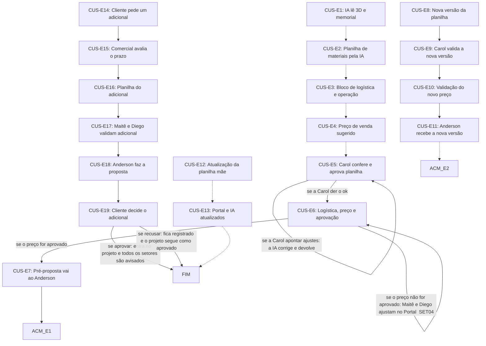

# Fluxo CUS · Custos

19 etapas em ordem de execução, com as decisões de Diego aplicadas. Montado por agentes a partir da Especificação e dos documentos de setor, e ainda não revisado por Diego nem pelo Pedro. Como ler: `ERP-CRM/FLUXOS/00_VISAO-GERAL.md`.

## 1. CUS-E1 · IA lê 3D e memorial `vigente`

- **O que acontece:** O agente de IA lê o projeto 3D, o memorial descritivo e as informações técnicas, com o projeto ainda sem detalhamento técnico.
- **Responsável:** Agente de IA
- **Perfis:** `AGENTE-IA`
- **Prazo:** 3 dias (de PRJ-E14 a CUS-E6)
- **Gatilho:** Pasta e planilha abertas por Projetos (PRJ-E14)
- **Próxima:** `CUS-E2` _(pela ordem do documento)_
- **Itens:** `UNI-00378`
- **Fonte:** DOC-091 §5 04 Custos e Novo fluxo de Custos com IA, passo 1; PLANDEM_FLX-SET04_CUSTOS_V03.md §02

## 2. CUS-E2 · Planilha de materiais pela IA `vigente`

- **O que acontece:** O agente de IA gera a planilha de materiais com os parâmetros pré-definidos e preços de mercado; a Carol não elabora mais a planilha. Usa o maior valor entre as duas unidades, item a item, porque a unidade só é definida no Planejamento. Puxa a média de projetos parecidos e, em projeto repetido, replica o padrão anterior e atualiza os valores.
- **Responsável:** Agente de IA
- **Perfis:** `AGENTE-IA`
- **Prazo:** 3 dias (de PRJ-E14 a CUS-E6)
- **Gatilho:** 3D e memorial lidos (CUS-E1)
- **Próxima:** `CUS-E3` _(pela ordem do documento)_
- **Em aberto:** Origem dos preços de mercado não informada (UNI-00909).
- **Itens:** `UNI-00379`, `UNI-00379.01`, `UNI-00379.02`
- **Fonte:** DOC-091 §5 04 Custos, Custos por unidade, Novo fluxo passo 1, Base histórica e Projetos repetidos; PLANDEM_FLX-SET04_CUSTOS_V03.md §04

## 3. CUS-E3 · Bloco de logística e operação `ajustada`

- **O que acontece:** A planilha traz o bloco de logística e operação: mão de obra, frete, combustível, hotel, alimentação, limpeza, taxas e RRT. Os valores são propostos pela IA, pelo histórico, no CUS-E6.
- **Responsável:** Agente de IA
- **Perfis:** `AGENTE-IA`
- **Prazo:** 3 dias (de PRJ-E14 a CUS-E6)
- **Gatilho:** Planilha de materiais pronta (CUS-E2)
- **Próxima:** `CUS-E4` _(pela ordem do documento)_
- **Mudou em relação ao documento:** O SET04 deixava os valores para o Financeiro lançar; agora a IA propõe e a Maitê valida.
- **Decisões aplicadas:** `item-19`
- **Itens:** `UNI-00380`
- **Fonte:** DOC-091 §5 04 Custos; PLANDEM_FLX-SET04_CUSTOS_V03.md §04

## 4. CUS-E4 · Preço de venda sugerido `ajustada`

- **O que acontece:** A planilha base calcula o preço de venda sugerido: custo de materiais + logística e operação + margem + impostos. O preço que segue para aprovação é o que a IA gera no CUS-E6, depois do ok da Maitê.
- **Responsável:** Agente de IA
- **Perfis:** `AGENTE-IA`
- **Prazo:** 3 dias (de PRJ-E14 a CUS-E6)
- **Gatilho:** Bloco de logística e operação pronto (CUS-E3)
- **Próxima:** `CUS-E5` _(pela ordem do documento)_
- **Mudou em relação ao documento:** O preço levado à aprovação passa a ser o gerado pela IA depois da validação da Maitê.
- **Decisões aplicadas:** `item-19`
- **Em aberto:** A Especificação mantém o preço sugerido aqui e gera outro no CUS-E6, e o item-19 não diz se o sugerido continua antes da conferência. Alíquotas pendentes (UNI-00892, UNI-01629).
- **Itens:** `UNI-00112.02`, `UNI-00112.07`, `UNI-00381`, `UNI-00750.01`, `UNI-00891.01`, `UNI-01152.01`, `UNI-01152.02`
- **Fonte:** DOC-091 §5 04 Custos, Novo fluxo passo 5 e Respostas do Diego 31/10; PLANDEM_FLX-SET04_CUSTOS_V03.md §02

## 5. CUS-E5 · Carol confere e aprova planilha `ajustada`

- **O que acontece:** A Carol confere os custos e aponta à IA os ajustes de cada item; a IA corrige e devolve até o ok da Carol, que aprova a planilha de custos. Item fora da média histórica é apontado pela IA à Carol e à Maitê. A planilha validada também alimenta a previsão orçamentária do projeto.
- **Responsável:** Custos (Carol)
- **Perfis:** `PERF-CUSTOS`
- **Prazo:** 3 dias no total, contando o Financeiro (de PRJ-E14 a CUS-E6)
- **Gatilho:** Planilha gerada pela IA (CUS-E4)
- **Próxima:** se a Carol der o ok: `CUS-E6`; se a Carol apontar ajustes: a IA corrige e devolve: `CUS-E5`
- **Mudou em relação ao documento:** No SET04 a Carol corrigia a planilha. Agora ela aponta os ajustes, a IA corrige, e a aprovação da planilha é dela.
- **Decisões aplicadas:** `item-1`
- **Itens:** `UNI-00073`, `UNI-00382`, `UNI-00382.01`, `UNI-00382.02`, `UNI-00556`, `UNI-00557.01`
- **Fonte:** DOC-091 §5 04 Custos, Novo fluxo passo 2, Base histórica e Previsão orçamentária; PLANDEM_FLX-SET04_CUSTOS_V03.md §02

## 6. CUS-E6 · Logística, preço e aprovação `ajustada`

- **O que acontece:** Com o ok da Carol, o sistema notifica o Financeiro e a IA propõe à Maitê mão de obra, quantidade de equipe, hospedagem, alimentação, frete e deslocamento, pelo histórico. A Maitê valida ou pede alteração. Com o ok dela, a IA gera o preço de venda (custos + logística e operação + margem inicial de 35% + impostos). Maitê e Diego aprovam o preço. Junto do pedido, a IA compara com o que o cliente pagou na última feira, em total e R$/m², e classifica: muito acima (10% ou mais acima), dentro (diferença menor que 10%) ou muito abaixo (10% ou mais abaixo).
- **Responsável:** Agente de IA propõe e gera o preço; Financeiro (Maitê) valida; Maitê e Diego aprovam o preço
- **Perfis:** `AGENTE-IA`, `PERF-DIRETORIA-FINANCEIRA`, `PERF-FINANCEIRO`, `PERF-DIRETORIA-COMERCIAL`
- **Prazo:** 3 dias no total, contando Custos (de PRJ-E14 a CUS-E6)
- **Gatilho:** Ok da Carol (CUS-E5)
- **Próxima:** se o preço for aprovado: `CUS-E7`; se a Maitê pedir alteração na proposta da IA: `CUS-E6`; se o preço não for aprovado: Maitê e Diego ajustam no Portal (SET04): `CUS-E6`
- **Mudou em relação ao documento:** No SET04, Maitê e Diego lançavam a logística e formavam o preço; agora a IA propõe e gera (item-19). Na Especificação só o Diego aprovava o preço final; só Maitê e Diego aprovam (item-1).
- **Decisões aplicadas:** `item-19`, `item-1`, `item-14`
- **Em aberto:** O item-1 não diz se a aprovação do preço é conjunta nem a ordem. O novo fluxo não traz caminho para preço não aprovado; o caminho indicado vem do SET04. Acesso do Financeiro à área de Custos em aberto (item-14). Alíquotas pendentes (UNI-00892, UNI-01629).
- **Itens:** `UNI-00073.01`, `UNI-00383` (não usar), `UNI-00383.01`, `UNI-00557`, `UNI-00557.01`, `UNI-00557.02`, `UNI-00750.01`, `UNI-01499`, `UNI-01572` (não usar)
- **Fonte:** DOC-091 §5 04 Custos, Novo fluxo passos 3 a 6; PLANDEM_FLX-SET04_CUSTOS_V03.md §02 e §07

## 7. CUS-E7 · Pré-proposta vai ao Anderson `vigente`

- **O que acontece:** Só depois da aprovação, preço e pré-proposta vão para o assistente comercial, que emite a proposta.
- **Responsável:** Sistema; assistente comercial (Anderson) recebe
- **Perfis:** `SISTEMA`, `PERF-ASSISTENTE-COMERCIAL`
- **Prazo:** não informado
- **Gatilho:** Preço aprovado (CUS-E6)
- **Próxima:** `ACM-E1`
- **Itens:** `UNI-00557.01`
- **Fonte:** DOC-091 §2 item 4, §5 04 Custos e Novo fluxo passo 6; PLANDEM_FLX-SET04_CUSTOS_V03.md §05

## 8. CUS-E8 · Nova versão da planilha `ajustada`

- **O que acontece:** Alteração de projeto ou item fora do escopo gera a nova versão da planilha (V2, V3...) e avisa a Carol com o motivo. Também entra aqui o projeto ajustado por desconto e o pedido de ajuste do cliente que volta a Custos.
- **Responsável:** Sistema
- **Perfis:** `SISTEMA`
- **Prazo:** não informado
- **Gatilho:** Projeto alterado pelo cliente, item fora do escopo inicial, cliente ajusta o projeto por desconto ou pedido de ajuste da proposta (ACM-E6)
- **Próxima:** `CUS-E9`
- **Mudou em relação ao documento:** O pedido de ajuste do cliente passa a voltar ao vendedor e a Custos.
- **Decisões aplicadas:** `item-4`
- **Em aberto:** O item-4 não diz em qual etapa de Custos o pedido entra; está aqui por ser a etapa que abre nova versão.
- **Itens:** `UNI-00112.05`, `UNI-00384`
- **Fonte:** DOC-091 §5 04 Custos, Controle de desconto e §5 06 Assistente comercial (ACM-E6); PLANDEM_FLX-SET04_CUSTOS_V03.md §02 e §05

## 9. CUS-E9 · Carol valida a nova versão `vigente`

- **O que acontece:** A Carol revisa e valida a V2: tira e inclui itens e muda quantidades. Se o projeto for aprovado 1 dia ou mais depois do orçamento, o Portal alerta reajuste a Maitê e Diego.
- **Responsável:** Custos (Carol)
- **Perfis:** `PERF-CUSTOS`
- **Prazo:** não informado
- **Gatilho:** Aviso da V2 (CUS-E8)
- **Próxima:** `CUS-E10`
- **Decisões aplicadas:** `item-1`
- **Itens:** `UNI-00385`, `UNI-00594`
- **Fonte:** DOC-091 §5 04 Custos; PLANDEM_FLX-SET04_CUSTOS_V03.md §02 e §05

## 10. CUS-E10 · Validação do novo preço `ajustada`

- **O que acontece:** Maitê e Diego validam o novo preço, também quando o Portal alerta reajuste; nesse caso a Carol só entra se o projeto mudar.
- **Responsável:** Financeiro (Maitê) e Diretoria (Diego)
- **Perfis:** `PERF-FINANCEIRO`, `PERF-DIRETORIA-COMERCIAL`
- **Prazo:** não informado
- **Gatilho:** Carol validou a V2 (CUS-E9) ou alerta de reajuste do Portal
- **Próxima:** `CUS-E11`
- **Mudou em relação ao documento:** A Especificação diz Financeiro; a decisão restringe a aprovação do preço a Maitê e Diego.
- **Decisões aplicadas:** `item-1`
- **Em aberto:** O item-19 não diz se a IA também propõe logística e operação na V2. Caminho se o novo preço não for aprovado: não informado.
- **Itens:** `UNI-00386`
- **Fonte:** DOC-091 §5 04 Custos; PLANDEM_FLX-SET04_CUSTOS_V03.md §05

## 11. CUS-E11 · Anderson recebe a nova versão `vigente`

- **O que acontece:** O assistente comercial recebe a V2 para emitir a nova proposta.
- **Responsável:** Sistema; assistente comercial (Anderson) recebe
- **Perfis:** `SISTEMA`, `PERF-ASSISTENTE-COMERCIAL`
- **Prazo:** não informado
- **Gatilho:** Novo preço validado (CUS-E10)
- **Próxima:** `ACM-E2` _(pela ordem do documento)_
- **Em aberto:** O documento diz só nova proposta comercial, sem código; ACM-E2 é leitura pela sequência.
- **Itens:** `UNI-00387`
- **Fonte:** DOC-091 §5 04 Custos; PLANDEM_FLX-SET04_CUSTOS_V03.md §02

## 12. CUS-E14 · Cliente pede um adicional `ajustada`

- **O que acontece:** Com o projeto aprovado e em produção, o cliente pede um adicional no Portal; Comercial e Carol são notificados. Depois do congelamento do projeto, o Portal bloqueia novos pedidos, com exceção só por aprovação do Diego. A sigla ADI não é mais usada.
- **Responsável:** Cliente
- **Perfis:** `PERF-CLIENTE`
- **Prazo:** não informado
- **Gatilho:** Pedido do cliente com o projeto aprovado, já em produção
- **Próxima:** `CUS-E15`
- **Mudou em relação ao documento:** Sai o código ADI-NNN.
- **Decisões aplicadas:** `ponto-5`
- **Em aberto:** Como os adicionais serão identificados nos documentos e nos nomes de arquivo (ponto-5).
- **Itens:** `UNI-00389`, `UNI-01430`
- **Fonte:** DOC-091 §5 04 Custos, §4 Adicional e §12 Congelamento do projeto; PLANDEM_FLX-SET04_CUSTOS_V03.md §02 e §05

## 13. CUS-E15 · Comercial avalia o prazo `vigente`

- **O que acontece:** O Comercial avalia o prazo pelo cronograma e dá retorno ao cliente.
- **Responsável:** Comercial
- **Perfis:** `PERF-VENDEDOR`
- **Prazo:** até 2 dias
- **Gatilho:** Pedido de adicional (CUS-E14)
- **Próxima:** `CUS-E16`
- **Em aberto:** Caminho se o cronograma não comportar o adicional: não informado. O aviso do SET04 pede prazo e planilha a Comercial e Carol ao mesmo tempo, em até 2 dias cada, e o fluxograma mostra em sequência.
- **Itens:** `UNI-00075`, `UNI-00075.01`, `UNI-01430`, `UNI-01500`
- **Fonte:** DOC-091 §5 04 Custos e §7; PLANDEM_FLX-SET04_CUSTOS_V03.md §02 e §05

## 14. CUS-E16 · Planilha do adicional `ajustada`

- **O que acontece:** Custos gera a planilha própria do adicional, com escopo pré-definido pelo Portal; a planilha do projeto aprovado segue finalizada. A sigla ADI não é mais usada.
- **Responsável:** Custos (Carol)
- **Perfis:** `PERF-CUSTOS`
- **Prazo:** até 2 dias
- **Gatilho:** Prazo avaliado (CUS-E15)
- **Próxima:** `CUS-E17`
- **Mudou em relação ao documento:** Sai o código ADI-NNN.
- **Decisões aplicadas:** `ponto-5`
- **Em aberto:** Como os adicionais serão identificados (ponto-5). O novo fluxo com IA não diz se a IA também gera esta planilha.
- **Itens:** `UNI-00075.01`, `UNI-00076`, `UNI-01430`, `UNI-01501`
- **Fonte:** DOC-091 §5 04 Custos, §4 Adicional e §7; PLANDEM_FLX-SET04_CUSTOS_V03.md §02 e §05

## 15. CUS-E17 · Maitê e Diego validam adicional `vigente`

- **O que acontece:** Maitê e Diego validam o preço do adicional.
- **Responsável:** Financeiro (Maitê) e Diretoria (Diego)
- **Perfis:** `PERF-FINANCEIRO`, `PERF-DIRETORIA-COMERCIAL`
- **Prazo:** até 2 dias
- **Gatilho:** Planilha do adicional gerada (CUS-E16)
- **Próxima:** `CUS-E18`
- **Decisões aplicadas:** `item-1`
- **Em aberto:** Caminho se o preço do adicional não for validado: não informado.
- **Itens:** `UNI-00075.01`, `UNI-00390`, `UNI-01430`
- **Fonte:** DOC-091 §5 04 Custos e §7; PLANDEM_FLX-SET04_CUSTOS_V03.md §05

## 16. CUS-E18 · Anderson faz a proposta `ajustada`

- **O que acontece:** O assistente comercial elabora a proposta própria do adicional e devolve ao Comercial. A sigla ADI não é mais usada.
- **Responsável:** Assistente comercial (Anderson)
- **Perfis:** `PERF-ASSISTENTE-COMERCIAL`
- **Prazo:** até 2 dias
- **Gatilho:** Preço do adicional liberado (CUS-E17)
- **Próxima:** `CUS-E19`
- **Mudou em relação ao documento:** Sai o código ADI-NNN.
- **Decisões aplicadas:** `ponto-5`
- **Em aberto:** Como os adicionais serão identificados (ponto-5). O item-7 não cita a proposta do adicional.
- **Itens:** `UNI-00075.01`, `UNI-01430`
- **Fonte:** DOC-091 §5 04 Custos, §4 Adicional e §7; PLANDEM_FLX-SET04_CUSTOS_V03.md §02 e §05

## 17. CUS-E19 · Cliente decide o adicional `vigente`

- **O que acontece:** Se o cliente aprova, o adicional entra no projeto e na produção e o Portal avisa todos os setores. Se recusa, fica registrado como recusado e o projeto segue como foi aprovado.
- **Responsável:** Cliente; Sistema registra e avisa
- **Perfis:** `SISTEMA`, `PERF-CLIENTE`
- **Prazo:** não informado
- **Gatilho:** Proposta do adicional pronta para aprovar com o cliente (CUS-E18)
- **Próxima:** se aprovar: entra no projeto e todos os setores são avisados: `FIM`; se recusar: fica registrado e o projeto segue como aprovado: `FIM`
- **Itens:** `UNI-00558`, `UNI-00595`, `UNI-01430`
- **Fonte:** DOC-091 §5 04 Custos; PLANDEM_FLX-SET04_CUSTOS_V03.md §02

## 18. CUS-E12 · Atualização da planilha mãe `vigente`

- **O que acontece:** A Carol atualiza a planilha mãe todo mês: materiais novos, especificações, preços de mercado e itens fora do escopo, separando as duas unidades. Para São Paulo, pede pelo sistema os preços à compradora de SP (Samanta), valida e lança.
- **Responsável:** Custos (Carol)
- **Perfis:** `PERF-CUSTOS`
- **Prazo:** todo mês; a compradora de SP devolve em 2 dias
- **Gatilho:** Contínua: todo mês
- **Próxima:** `CUS-E13` _(pela ordem do documento)_
- **Em aberto:** Origem dos preços de mercado não informada (UNI-00909).
- **Itens:** `UNI-00074`, `UNI-00074.01`, `UNI-00074.02`, `UNI-00909`
- **Fonte:** DOC-091 §5 04 Custos e Planilha mãe (CUS-E12); PLANDEM_FLX-SET04_CUSTOS_V03.md §02 e §07

## 19. CUS-E13 · Portal e IA atualizados `vigente`

- **O que acontece:** O Portal e a IA recebem a atualização; a próxima planilha já sai com os valores novos.
- **Responsável:** Sistema
- **Perfis:** `SISTEMA`
- **Prazo:** não informado
- **Gatilho:** Contínua: a cada atualização da planilha mãe (CUS-E12)
- **Próxima:** `FIM` _(pela ordem do documento)_
- **Itens:** `UNI-00388`
- **Fonte:** DOC-091 §5 04 Custos; PLANDEM_FLX-SET04_CUSTOS_V03.md §02

