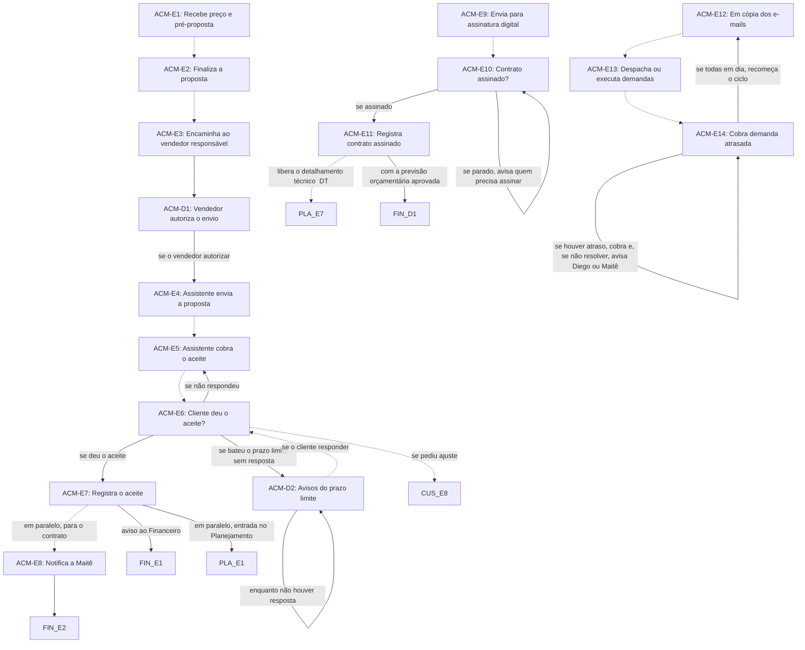

# Fluxo ACM · Assistente comercial

16 etapas em ordem de execução, com as decisões de Diego aplicadas. Montado por agentes a partir da Especificação e dos documentos de setor, e ainda não revisado por Diego nem pelo Pedro. Como ler: `ERP-CRM/FLUXOS/00_VISAO-GERAL.md`.

## 1. ACM-E1 · Recebe preço e pré-proposta `vigente`

- **O que acontece:** O Portal notifica o assistente comercial de que o preço de venda e a pré-proposta estão prontos, depois da aprovação do preço. Pelo mesmo caminho chegam a V2 de preço (CUS-E11) e o preço validado de um adicional (CUS-E18).
- **Responsável:** Assistente comercial (Anderson); notificação pelo Sistema
- **Perfis:** `SISTEMA`, `PERF-ASSISTENTE-COMERCIAL`
- **Prazo:** não informado
- **Gatilho:** CUS-E7: preço e pré-proposta vão para o assistente comercial
- **Próxima:** `ACM-E2` _(pela ordem do documento)_
- **Itens:** `UNI-00599`
- **Fonte:** DOC-091 §2 e §5 Assistente comercial; PLANDEM_FLX-SET06_ASSISTENTE-COMERCIAL_V01 §02 e §03

## 2. ACM-E2 · Finaliza a proposta `vigente`

- **O que acontece:** O assistente finaliza a proposta no modelo da Imagine, com escopo, valores e condições.
- **Responsável:** Assistente comercial (Anderson)
- **Perfis:** `PERF-ASSISTENTE-COMERCIAL`
- **Prazo:** até 2 dias após receber o preço
- **Gatilho:** Preço e pré-proposta recebidos (ACM-E1)
- **Próxima:** `ACM-E3` _(pela ordem do documento)_
- **Itens:** `UNI-00914.01`
- **Fonte:** DOC-091 §5 Assistente comercial; DOC-091 Respostas do Diego, Prazo da proposta

## 3. ACM-E3 · Encaminha ao vendedor responsável `vigente`

- **O que acontece:** O Portal encaminha a proposta finalizada ao vendedor responsável pelo cliente.
- **Responsável:** Sistema
- **Perfis:** `SISTEMA`
- **Prazo:** não informado
- **Gatilho:** Proposta finalizada (ACM-E2)
- **Próxima:** `ACM-D1`
- **Itens:** `UNI-00397`
- **Fonte:** DOC-091 §5 Assistente comercial; PLANDEM_FLX-SET06_ASSISTENTE-COMERCIAL_V01 §02

## 4. ACM-D1 · Vendedor autoriza o envio `nova-por-decisao`

- **O que acontece:** O vendedor que fez a proposta autoriza o assistente a enviá-la ao cliente. Sem essa autorização, o assistente não envia.
- **Responsável:** Vendedor que fez a proposta
- **Perfis:** `PERF-VENDEDOR`
- **Prazo:** não informado
- **Gatilho:** Proposta encaminhada ao vendedor (ACM-E3)
- **Próxima:** se o vendedor autorizar: `ACM-E4`
- **Mudou em relação ao documento:** Etapa criada porque o envio pelo assistente depende da autorização do vendedor.
- **Decisões aplicadas:** `item-7`
- **Em aberto:** O caminho quando o vendedor não autoriza não foi informado.
- **Fonte:** 01_DECISOES-DE-DIEGO item-7

## 5. ACM-E4 · Assistente envia a proposta `ajustada`

- **O que acontece:** O assistente envia a proposta ao cliente, só com a autorização do vendedor que a fez. A proposta tem validade de 7 dias.
- **Responsável:** Assistente comercial (Anderson)
- **Perfis:** `PERF-ASSISTENTE-COMERCIAL`
- **Prazo:** validade da proposta de 7 dias
- **Gatilho:** Autorização do vendedor (ACM-D1)
- **Próxima:** `ACM-E5` _(pela ordem do documento)_
- **Mudou em relação ao documento:** No documento, o vendedor enviava com o assistente em cópia. Agora o assistente envia, com autorização do vendedor, e a validade fica em 7 dias.
- **Decisões aplicadas:** `item-7`
- **Em aberto:** A expiração no 3º aviso continua?
- **Itens:** `UNI-01526` (não usar)
- **Fonte:** DOC-091 §5 Assistente comercial; 01_DECISOES-DE-DIEGO item-7

## 6. ACM-E5 · Assistente cobra o aceite `vigente`

- **O que acontece:** O assistente cobra o aceite do cliente até a resposta. O sistema agenda e lembra cada cobrança.
- **Responsável:** Assistente comercial (Anderson); agenda pelo Sistema
- **Perfis:** `SISTEMA`, `PERF-ASSISTENTE-COMERCIAL`
- **Prazo:** em aberto: a Especificação diz a cada 3 dias, mas o item-4 deixou a frequência aberta
- **Gatilho:** Proposta enviada ao cliente (ACM-E4) ou nova cobrança (ACM-E6)
- **Próxima:** `ACM-E6` _(pela ordem do documento)_
- **Decisões aplicadas:** `item-4`
- **Em aberto:** Quantas cobranças e com que frequência.
- **Itens:** `UNI-00915.01`, `UNI-01527`, `UNI-01528`
- **Fonte:** DOC-091 §5 Assistente comercial; DOC-091 Respostas do Diego, Cobrança do aceite; PLANDEM_FLX-SET06_ASSISTENTE-COMERCIAL_V01 §02

## 7. ACM-E6 · Cliente deu o aceite? `vigente`

- **O que acontece:** Ponto de decisão sobre a resposta do cliente. Sem resposta, há nova cobrança. Pedido de ajuste volta ao vendedor e a Custos. Com aceite, segue para o registro.
- **Responsável:** Assistente comercial (Anderson)
- **Perfis:** `PERF-ASSISTENTE-COMERCIAL`
- **Prazo:** não informado
- **Gatilho:** Resposta do cliente ou falta dela depois da cobrança (ACM-E5)
- **Próxima:** se deu o aceite: `ACM-E7`; se não respondeu: `ACM-E5`; se pediu ajuste: `CUS-E8` _(pela ordem do documento)_; se bateu o prazo limite sem resposta: `ACM-D2`
- **Decisões aplicadas:** `item-4`, `item-24`
- **Em aberto:** O caminho de recusa não consta nesta seção nem no SET06; a Especificação só exige o motivo ao marcar proposta como perdida (COM-E16). O retorno a Custos foi ligado ao CUS-E8 por leitura do texto. No pedido de ajuste, o vendedor também é avisado (item-4).
- **Itens:** `UNI-00585.01`
- **Fonte:** DOC-091 §5 Assistente comercial; PLANDEM_FLX-SET06_ASSISTENTE-COMERCIAL_V01 §02

## 8. ACM-D2 · Avisos do prazo limite `nova-por-decisao`

- **O que acontece:** Ao bater o prazo limite, o sistema avisa o vendedor e o Diego. Depois do prazo, dispara um aviso por dia, todos os dias seguintes, para o vendedor, o Diego e o assistente comercial.
- **Responsável:** Sistema
- **Perfis:** `SISTEMA`
- **Prazo:** no prazo limite e, depois dele, um aviso por dia
- **Gatilho:** Prazo limite atingido sem resposta do cliente
- **Próxima:** enquanto não houver resposta: `ACM-D2`; se o cliente responder: `ACM-E6` _(pela ordem do documento)_
- **Mudou em relação ao documento:** A Especificação previa um aviso ao Diego e ao vendedor depois de 10 dias sem resposta. A decisão traz o aviso no prazo limite e os avisos diários, incluindo o assistente.
- **Decisões aplicadas:** `item-24`
- **Em aberto:** Até quando os avisos diários continuam. A decisão não diz qual é o prazo limite: a Especificação fala em 10 dias, o item-7 em validade de 7 dias e o DOC-031 E24 no micro cronograma.
- **Fonte:** 01_DECISOES-DE-DIEGO item-24; DOC-091 Respostas do Diego, Cobrança do aceite

## 9. ACM-E7 · Registra o aceite `ajustada`

- **O que acontece:** O assistente registra a proposta formalizada e o aceite, e o Portal avisa vendedor, Diego e Financeiro. A partir do aceite, o projeto entra no Planejamento; o detalhamento técnico (DT) ainda espera o contrato assinado.
- **Responsável:** Assistente comercial (Anderson); avisos pelo Sistema
- **Perfis:** `SISTEMA`, `PERF-ASSISTENTE-COMERCIAL`
- **Prazo:** não informado
- **Gatilho:** Cliente deu o aceite (ACM-E6)
- **Próxima:** aviso ao Financeiro: `FIN-E1`; em paralelo, para o contrato: `ACM-E8` _(pela ordem do documento)_; em paralelo, entrada no Planejamento: `PLA-E1`
- **Mudou em relação ao documento:** No documento, o Planejamento só recebia o projeto com o contrato assinado (ACM-E11). Agora ele entra a partir do aceite.
- **Decisões aplicadas:** `item-8`, `ponto-1`
- **Em aberto:** O que o Planejamento faz entre o aceite e a assinatura. Como fica a janela de 25 dias (UNI-00084).
- **Itens:** `UNI-00600`
- **Fonte:** DOC-091 §2 passo 5 e §5 Assistente comercial; 01_DECISOES-DE-DIEGO item-8 e ponto-1

## 10. ACM-E8 · Notifica a Maitê `vigente`

- **O que acontece:** O assistente notifica a diretoria jurídica e financeira para fazer e liberar o contrato.
- **Responsável:** Assistente comercial (Anderson)
- **Perfis:** `PERF-ASSISTENTE-COMERCIAL`
- **Prazo:** não informado
- **Gatilho:** Aceite registrado (ACM-E7)
- **Próxima:** `FIN-E2`
- **Itens:** `UNI-00398`
- **Fonte:** DOC-091 §5 Assistente comercial; PLANDEM_FLX-SET06_ASSISTENTE-COMERCIAL_V01 §02

## 11. ACM-E9 · Envia para assinatura digital `vigente`

- **O que acontece:** O contrato liberado é enviado para assinatura digital, com o assistente em cópia do envio.
- **Responsável:** não informado
- **Prazo:** não informado
- **Gatilho:** Contrato liberado pela Maitê (FIN-E2)
- **Próxima:** `ACM-E10` _(pela ordem do documento)_
- **Em aberto:** Quem envia o contrato (Maitê ou assistente) e qual é a plataforma de assinatura (UNI-00918).
- **Itens:** `UNI-00399`
- **Fonte:** DOC-091 §5 Assistente comercial; PLANDEM_FLX-SET06_ASSISTENTE-COMERCIAL_V01 §02 e §06

## 12. ACM-E10 · Contrato assinado? `vigente`

- **O que acontece:** Ponto de decisão sobre a assinatura. Com o contrato parado, o assistente avisa quem precisa assinar.
- **Responsável:** Assistente comercial (Anderson)
- **Perfis:** `PERF-ASSISTENTE-COMERCIAL`
- **Prazo:** não informado
- **Gatilho:** Contrato enviado para assinatura (ACM-E9)
- **Próxima:** se assinado: `ACM-E11`; se parado, avisa quem precisa assinar: `ACM-E10`
- **Itens:** `UNI-00560`, `UNI-00602.01`
- **Fonte:** DOC-091 §5 Assistente comercial; PLANDEM_FLX-SET06_ASSISTENTE-COMERCIAL_V01 §02

## 13. ACM-E11 · Registra contrato assinado `ajustada`

- **O que acontece:** O contrato assinado é registrado no Portal. Esse registro libera o detalhamento técnico (DT) e, com a previsão orçamentária aprovada, a pré-comanda automática.
- **Responsável:** Assistente comercial (Anderson)
- **Perfis:** `PERF-ASSISTENTE-COMERCIAL`
- **Prazo:** não informado
- **Gatilho:** Contrato assinado (ACM-E10)
- **Próxima:** libera o detalhamento técnico (DT): `PLA-E7` _(pela ordem do documento)_; com a previsão orçamentária aprovada: `FIN-D1`
- **Mudou em relação ao documento:** No documento, esta etapa liberava a entrada no Planejamento (PLA-E1). Essa entrada passou para o aceite, e o contrato assinado agora libera o início do DT.
- **Decisões aplicadas:** `item-8`, `ponto-1`, `item-21`
- **Em aberto:** O que o Planejamento faz entre o aceite e a assinatura. Como fica a janela de 25 dias (UNI-00084). O início do DT foi ligado ao PLA-E7 por leitura do texto.
- **Itens:** `UNI-00601`, `UNI-01529`
- **Fonte:** DOC-091 §2 passo 5, §5 Assistente comercial e §25 Dois momentos distintos; 01_DECISOES-DE-DIEGO item-8 e ponto-1

## 14. ACM-E12 · Em cópia dos e-mails `vigente`

- **O que acontece:** O assistente fica em cópia de todos os e-mails do fluxo comercial, com entradas e saídas de todos os clientes.
- **Responsável:** Assistente comercial (Anderson)
- **Perfis:** `PERF-ASSISTENTE-COMERCIAL`
- **Prazo:** ciclo diário
- **Gatilho:** Contínua, ciclo diário
- **Próxima:** `ACM-E13` _(pela ordem do documento)_
- **Em aberto:** Se a cópia é regra de cada vendedor ou se o Portal integra os e-mails numa caixa só (UNI-00916).
- **Itens:** `UNI-00400`, `UNI-00916.01`, `UNI-01612`
- **Fonte:** DOC-091 §5 Assistente comercial e §9; PLANDEM_FLX-SET06_ASSISTENTE-COMERCIAL_V01 §02 e §06

## 15. ACM-E13 · Despacha ou executa demandas `vigente`

- **O que acontece:** O assistente encaminha cada demanda ao setor certo ou a resolve.
- **Responsável:** Assistente comercial (Anderson)
- **Perfis:** `PERF-ASSISTENTE-COMERCIAL`
- **Prazo:** ciclo diário
- **Gatilho:** Contínua, a cada demanda identificada
- **Próxima:** `ACM-E14` _(pela ordem do documento)_
- **Itens:** `UNI-00401`
- **Fonte:** DOC-091 §5 Assistente comercial; PLANDEM_FLX-SET06_ASSISTENTE-COMERCIAL_V01 §02

## 16. ACM-E14 · Cobra demanda atrasada `vigente`

- **O que acontece:** O assistente verifica se as demandas estão em dia. Com atraso, cobra o responsável e, se não resolver, avisa o Diego ou a Maitê, conforme a área.
- **Responsável:** Assistente comercial (Anderson)
- **Perfis:** `PERF-ASSISTENTE-COMERCIAL`
- **Prazo:** ciclo diário; prazo máximo de retorno ao cliente não informado
- **Gatilho:** Contínua, ciclo diário
- **Próxima:** se todas em dia, recomeça o ciclo: `ACM-E12`; se houver atraso, cobra e, se não resolver, avisa Diego ou Maitê: `ACM-E14`
- **Em aberto:** Prazo máximo de retorno ao cliente nas questões burocráticas (UNI-00917).
- **Itens:** `UNI-00561`, `UNI-00561.01`
- **Fonte:** DOC-091 §5 Assistente comercial; PLANDEM_FLX-SET06_ASSISTENTE-COMERCIAL_V01 §02 e §04

