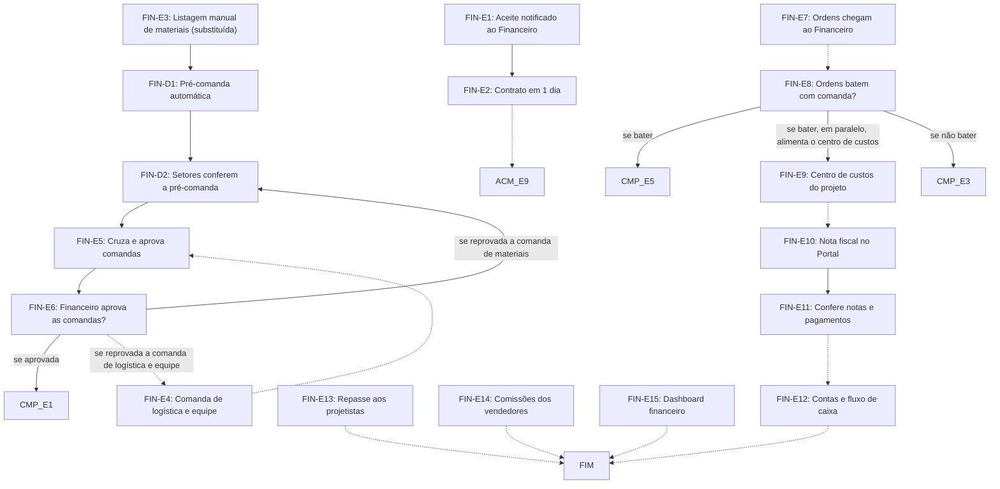

# Fluxo FIN · Financeiro

17 etapas em ordem de execução, com as decisões de Diego aplicadas. Montado por agentes a partir da Especificação e dos documentos de setor, e ainda não revisado por Diego nem pelo Pedro. Como ler: `ERP-CRM/FLUXOS/00_VISAO-GERAL.md`.

## 1. FIN-E1 · Aceite notificado ao Financeiro `vigente`

- **O que acontece:** O aceite do cliente registrado pelo assistente é notificado ao Financeiro.
- **Responsável:** Sistema
- **Perfis:** `SISTEMA`
- **Prazo:** não informado
- **Gatilho:** Aceite registrado (ACM-E7)
- **Próxima:** `FIN-E2`
- **Fonte:** DOC-091 §2 passo 5 e §5 Financeiro

## 2. FIN-E2 · Contrato em 1 dia `vigente`

- **O que acontece:** A IA gera a minuta no modelo padrão com os dados da proposta aceita e aponta os pontos duvidosos. A Maitê valida cada ponto e libera.
- **Responsável:** Agente de IA (minuta); Diretoria jurídica e financeira (Maitê) valida e libera
- **Perfis:** `AGENTE-IA`, `PERF-DIRETORIA-FINANCEIRA`
- **Prazo:** 1 dia
- **Gatilho:** Aceite notificado (FIN-E1) e notificação do assistente (ACM-E8)
- **Próxima:** `ACM-E9` _(pela ordem do documento)_
- **Itens:** `UNI-00077`, `UNI-00077.01`, `UNI-00077.02`, `UNI-00077.03`, `UNI-00751.01`, `UNI-00751.07`, `UNI-00910`, `UNI-00910.01`
- **Fonte:** DOC-091 §5 Financeiro, §7 e Respostas do Diego, Modelo de contrato

## 3. FIN-E3 · Listagem manual de materiais `substituida`

- **O que acontece:** Etapa eliminada: cada setor listava os materiais e o Planejamento reunia a comanda.
- **Responsável:** Sistema (pré-comanda); Setores produtivos (conferência)
- **Perfis:** `SISTEMA`, `PERF-LIDER-SETOR`
- **Prazo:** não informado
- **Gatilho:** Contrato assinado (ACM-E11) e previsão orçamentária aprovada pela Maitê
- **Próxima:** `FIN-D1`
- **Mudou em relação ao documento:** No lugar da listagem manual, o sistema gera a pré-comanda (FIN-D1) e os setores só conferem e ajustam (FIN-D2).
- **Decisões aplicadas:** `item-21`
- **Itens:** `UNI-00088`, `UNI-00391` (não usar), `UNI-00661.01`
- **Fonte:** DOC-091 §5 Financeiro e §25 passos 5 e 6; 01_DECISOES-DE-DIEGO item-21

## 4. FIN-D1 · Pré-comanda automática `nova-por-decisao`

- **O que acontece:** O sistema converte a planilha de custos, item a item e pelo mesmo código, numa pré-comanda separada pela unidade de produção, com materiais, quantidades e valores previstos. Item a comprar pronto entra nessa base de compras.
- **Responsável:** Sistema
- **Perfis:** `SISTEMA`
- **Prazo:** não informado
- **Gatilho:** Contrato assinado (ACM-E11) e previsão orçamentária aprovada pela Maitê
- **Próxima:** `FIN-D2`
- **Mudou em relação ao documento:** Passa a existir no lugar da listagem manual do FIN-E3.
- **Decisões aplicadas:** `item-21`
- **Em aberto:** A previsão orçamentária não tem código de etapa na Especificação. Como fica a janela de 25 dias (ponto-1).
- **Fonte:** DOC-091 §25 passo 5 e Previsão orçamentária do projeto; 01_DECISOES-DE-DIEGO item-21

## 5. FIN-D2 · Setores conferem a pré-comanda `nova-por-decisao`

- **O que acontece:** Os setores produtivos só conferem e ajustam a pré-comanda. A comanda segue ao Financeiro, com ou sem diferença em relação ao orçado.
- **Responsável:** Setores produtivos
- **Perfis:** `PERF-LIDER-SETOR`
- **Prazo:** bloco 2 da janela, D-20 a D-16, em aberto pelo ponto-1
- **Gatilho:** Pré-comanda gerada (FIN-D1) ou comanda devolvida pelo Financeiro (FIN-E6)
- **Próxima:** `FIN-E5`
- **Mudou em relação ao documento:** Substitui a listagem manual. O §25 falava em diferença passando pelo Financeiro; pelo ponto-3, toda comanda passa.
- **Decisões aplicadas:** `item-21`, `ponto-3`
- **Em aberto:** Se os setores veem os valores previstos da pré-comanda não foi informado. Se o Planejamento ainda reúne a comanda não foi informado.
- **Fonte:** DOC-091 §25 passo 6 e §5 Janela de 25 dias; 01_DECISOES-DE-DIEGO item-21 e ponto-3

## 6. FIN-E4 · Comanda de logística e equipe `vigente`

- **O que acontece:** Comanda com mão de obra, dias de produção, viagem e montagem, alimentação, combustível, hotéis, fretes e transportes, cruzada com o bloco de logística e montagem da planilha.
- **Responsável:** Planejamento
- **Perfis:** `PERF-PLANEJAMENTO`
- **Prazo:** bloco 2 da janela, D-20 a D-16, em aberto pelo ponto-1
- **Gatilho:** não informado
- **Próxima:** `FIN-E5` _(pela ordem do documento)_
- **Em aberto:** O item-21 trata da comanda de materiais. Não foi dito se a de logística e equipe também nasce automática.
- **Itens:** `UNI-00392`, `UNI-00661.01`
- **Fonte:** DOC-091 §5 Financeiro e Janela de 25 dias; PLANDEM_FLX-SET05_FINANCEIRO_V02 §02, §03 e §04

## 7. FIN-E5 · Cruza e aprova comandas `vigente`

- **O que acontece:** O Portal cruza previsto × pedido, item a item. Toda comanda é aprovada em 1 dia, sem tolerância. O alerta de preço não substitui essa aprovação: ele vale só para o preço de compra.
- **Responsável:** Sistema (cruzamento); Financeiro (Maitê) aprova
- **Perfis:** `SISTEMA`, `PERF-FINANCEIRO`
- **Prazo:** 1 dia
- **Gatilho:** Comandas prontas (FIN-D2 e FIN-E4)
- **Próxima:** `FIN-E6`
- **Decisões aplicadas:** `ponto-3`
- **Em aberto:** Acesso do Financeiro à área de Custos (item-14); o §6 da Especificação inclui o Financeiro.
- **Itens:** `UNI-00103`, `UNI-00103.01`, `UNI-00661.01`, `UNI-00763.01`, `UNI-00763.04`, `UNI-00763.05`
- **Fonte:** DOC-091 §5 Financeiro, §6 e §7; 01_DECISOES-DE-DIEGO ponto-3

## 8. FIN-E6 · Financeiro aprova as comandas? `vigente`

- **O que acontece:** Aprovada, as listas são liberadas para Compras. Reprovada, a comanda volta ao setor, que ajusta, e o Portal cruza de novo.
- **Responsável:** Financeiro (Maitê)
- **Perfis:** `PERF-FINANCEIRO`
- **Prazo:** 1 dia
- **Gatilho:** Cruzamento concluído (FIN-E5)
- **Próxima:** se aprovada: `CMP-E1`; se reprovada a comanda de materiais: `FIN-D2`; se reprovada a comanda de logística e equipe: `FIN-E4` _(pela ordem do documento)_
- **Decisões aplicadas:** `item-21`
- **Itens:** `UNI-00597`, `UNI-00661.01`
- **Fonte:** DOC-091 §5 Financeiro e Compras; PLANDEM_FLX-SET05_FINANCEIRO_V02 §02

## 9. FIN-E7 · Ordens chegam ao Financeiro `ajustada`

- **O que acontece:** Compras da unidade gera as ordens, sem ver o valor orçado, e o Financeiro as recebe para conferir em 1 dia. Também chegam ordens dos formulários de frete, de equipes terceirizadas, de deslocamento e da lavagem de veículos.
- **Responsável:** Compras da unidade (RS: Osmar; SP: Samanta) gera; Financeiro (Maitê) confere
- **Perfis:** `PERF-FINANCEIRO`, `PERF-COMPRAS`
- **Prazo:** 1 dia
- **Gatilho:** Ordem gerada em CMP-E3 ou por formulário de outro setor (frete, equipes, deslocamento, FRT-E5)
- **Próxima:** `FIN-E8` _(pela ordem do documento)_
- **Mudou em relação ao documento:** O comprador deixa de ver o valor orçado.
- **Decisões aplicadas:** `ponto-2`
- **Em aberto:** O texto do FIN-E7 cita só o Osmar; a seção de Compras da Especificação inclui a Samanta em SP.
- **Itens:** `UNI-00393`, `UNI-00393.01`, `UNI-00559`, `UNI-00690.01`, `UNI-00752.01`, `UNI-00752.07`, `UNI-00763.02`, `UNI-00763.03`, `UNI-01394.01`, `UNI-01394.02`, `UNI-01451`, `UNI-01535`, `UNI-01538`
- **Fonte:** DOC-091 §5 Financeiro e Compras, Respostas do Diego (Logística, Escala, Deslocamento) e FRT-E5; 01_DECISOES-DE-DIEGO ponto-2

## 10. FIN-E8 · Ordens batem com comanda? `ajustada`

- **O que acontece:** O Financeiro confere a ordem com a comanda e o custo. Se não bater, a ordem volta para Compras da unidade, sem mostrar o valor orçado ao comprador. Esta etapa é a mesma do CMP-E4.
- **Responsável:** Financeiro (Maitê)
- **Perfis:** `PERF-FINANCEIRO`
- **Prazo:** 1 dia
- **Gatilho:** Ordem recebida (FIN-E7)
- **Próxima:** se bater: `CMP-E5`; se bater, em paralelo, alimenta o centro de custos: `FIN-E9`; se não bater: `CMP-E3`
- **Mudou em relação ao documento:** O retorno a Compras não pode revelar o valor orçado ao comprador.
- **Decisões aplicadas:** `ponto-2`
- **Em aberto:** Quem aprova depois do alerta de preço (item-5, ponto-2).
- **Itens:** `UNI-00104.01`, `UNI-00690.01`, `UNI-00763.03`
- **Fonte:** DOC-091 §5 Financeiro e Compras; PLANDEM_FLX-SET05_FINANCEIRO_V02 §02 e §05; 01_DECISOES-DE-DIEGO ponto-2

## 11. FIN-E9 · Centro de custos do projeto `vigente`

- **O que acontece:** Cada ordem alimenta o centro de custos do projeto, com itens, valor, fornecedor, prazo e forma de pagamento e IBS/CBS. A diferença entre o custo orçado e o custo real da unidade aparece como margem extra do projeto. O Financeiro acompanha previsto × comprado × realizado por projeto e por código.
- **Responsável:** Financeiro (Maitê)
- **Perfis:** `PERF-FINANCEIRO`
- **Prazo:** não informado
- **Gatilho:** Ordem conferida (FIN-E8)
- **Próxima:** `FIN-E10` _(pela ordem do documento)_
- **Itens:** `UNI-00690.01`
- **Fonte:** DOC-091 §5 Financeiro, Recálculo pela unidade e §25 passo 8; PLANDEM_FLX-SET05_FINANCEIRO_V02 §05

## 12. FIN-E10 · Nota fiscal no Portal `vigente`

- **O que acontece:** Com o item entregue, Compras sobe a nota fiscal no Portal e o Financeiro é notificado. Esta etapa é a mesma do CMP-E6.
- **Responsável:** Compras da unidade (RS: Osmar; SP: Samanta)
- **Perfis:** `PERF-COMPRAS`
- **Prazo:** até 2 dias após a entrega
- **Gatilho:** Item entregue
- **Próxima:** `FIN-E11`
- **Itens:** `UNI-00078`, `UNI-00078.01`, `UNI-00690.01`, `UNI-01502`
- **Fonte:** DOC-091 §5 Financeiro e Compras, §7; PLANDEM_FLX-SET05_FINANCEIRO_V02 §02 e §03

## 13. FIN-E11 · Confere notas e pagamentos `vigente`

- **O que acontece:** O Financeiro confere notas, compras, pagamentos e vencimentos: nota não emitida, compra não concluída, pagamento pendente e prazo vencendo.
- **Responsável:** Financeiro (Maitê)
- **Perfis:** `PERF-FINANCEIRO`
- **Prazo:** não informado
- **Gatilho:** Nota fiscal enviada (FIN-E10 ou CMP-E6)
- **Próxima:** `FIN-E12` _(pela ordem do documento)_
- **Itens:** `UNI-00394`, `UNI-00690.01`
- **Fonte:** DOC-091 §5 Financeiro; PLANDEM_FLX-SET05_FINANCEIRO_V02 §02 e §03

## 14. FIN-E12 · Contas e fluxo de caixa `vigente`

- **O que acontece:** Contas a pagar, recebimentos e fluxo de caixa ficam no sistema financeiro integrado ao Portal.
- **Responsável:** Financeiro (Maitê)
- **Perfis:** `PERF-FINANCEIRO`
- **Prazo:** não informado
- **Gatilho:** Contínua
- **Próxima:** `FIM` _(pela ordem do documento)_
- **Em aberto:** Nome do sistema financeiro (UNI-00891, UNI-01445).
- **Itens:** `UNI-00060`, `UNI-01503`
- **Fonte:** DOC-091 §5 Financeiro, §9 e §11; PLANDEM_FLX-SET05_FINANCEIRO_V02 §02

## 15. FIN-E13 · Repasse aos projetistas `vigente`

- **O que acontece:** Todos os projetistas são pagos por hora, inclusive freelancers. A Érika estima as horas do projeto e, ao concluir, atualiza as realizadas. O sistema calcula o valor de cada projetista, e a Maitê valida e paga.
- **Responsável:** Planejamento (Érika) estima e atualiza as horas; Sistema calcula; Financeiro (Maitê) valida e paga
- **Perfis:** `SISTEMA`, `PERF-FINANCEIRO`, `PERF-PLANEJAMENTO`
- **Prazo:** não informado
- **Gatilho:** Contínua, por projeto: estimativa de horas e, depois, conclusão do projeto
- **Próxima:** `FIM` _(pela ordem do documento)_
- **Decisões aplicadas:** `item-20`, `ponto-4`
- **Em aberto:** A decisão sobre o valor do projetista da filial SP, e quando ela será tomada (ponto-4).
- **Itens:** `UNI-00395` (não usar), `UNI-00395.01`, `UNI-00751.02`, `UNI-00751.03`, `UNI-00751.04`, `UNI-00751.05`, `UNI-00751.06`, `UNI-00911`, `UNI-01504`
- **Fonte:** DOC-091 §5 Financeiro e Respostas do Diego, Fluxo de pagamento; o modelo por arquiteto do SET05 não vale (item-20)

## 16. FIN-E14 · Comissões dos vendedores `vigente`

- **O que acontece:** Comissão de 1,5% em clientes direcionados pela empresa e 3% em clientes abertos pelo vendedor, paga sobre o recebido, com fechamento mensal e um único pagamento. Adicionais não geram comissão.
- **Responsável:** Financeiro (Maitê)
- **Perfis:** `PERF-FINANCEIRO`
- **Prazo:** fechamento no fim de cada mês
- **Gatilho:** Contínua, fechamento mensal
- **Próxima:** `FIM` _(pela ordem do documento)_
- **Decisões aplicadas:** `item-10`
- **Em aberto:** O §11 da Especificação ainda lista o momento de pagar como pendência, embora o FIN-E14 e as Respostas do Diego o definam.
- **Itens:** `UNI-00111.01`, `UNI-00912`, `UNI-00913`, `UNI-00913.01`, `UNI-00913.02`, `UNI-01427`
- **Fonte:** DOC-091 §5 Financeiro e Respostas do Diego, Comissões; os 2% do SET05 não valem (item-10)

## 17. FIN-E15 · Dashboard financeiro `vigente`

- **O que acontece:** Dashboard com comissões, volume de vendas e curva da meta do mês, integrado ao COM-E15.
- **Responsável:** Financeiro (Maitê)
- **Perfis:** `PERF-FINANCEIRO`
- **Prazo:** não informado
- **Gatilho:** Contínua
- **Próxima:** `FIM` _(pela ordem do documento)_
- **Itens:** `UNI-00396`, `UNI-01456`
- **Fonte:** DOC-091 §5 Financeiro e §10; PLANDEM_FLX-SET05_FINANCEIRO_V02 §02 e §07

