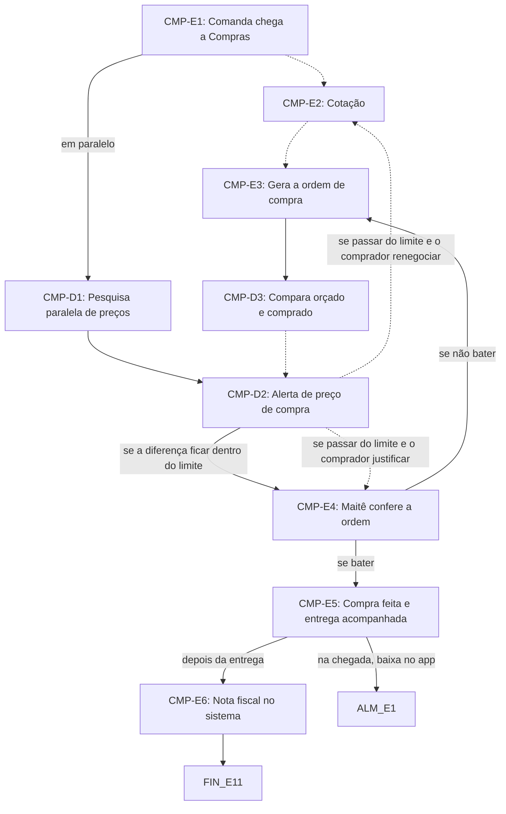

# Fluxo CMP · Compras

9 etapas em ordem de execução, com as decisões de Diego aplicadas. Montado por agentes a partir da Especificação e dos documentos de setor, e ainda não revisado por Diego nem pelo Pedro. Como ler: `ERP-CRM/FLUXOS/00_VISAO-GERAL.md`.

## 1. CMP-E1 · Comanda chega a Compras `ajustada`

- **O que acontece:** A comanda aprovada pelo Financeiro vai para Compras da unidade de produção do projeto. O comprador a recebe sem ver o valor orçado.
- **Responsável:** Sistema
- **Perfis:** `SISTEMA`
- **Prazo:** não informado
- **Gatilho:** Comanda aprovada (FIN-E6), com a previsão orçamentária já aprovada pela Maitê
- **Próxima:** `CMP-E2` _(pela ordem do documento)_; em paralelo: `CMP-D1`
- **Mudou em relação ao documento:** A pré-comanda traz valores previstos, mas o comprador não vê o valor orçado.
- **Decisões aplicadas:** `ponto-2`, `ponto-3`, `item-21`
- **Itens:** `UNI-00597.01`
- **Fonte:** DOC-091 §5 Compras e §25 passos 5 a 7; 01_DECISOES-DE-DIEGO ponto-2, ponto-3 e item-21

## 2. CMP-D1 · Pesquisa paralela de preços `nova-por-decisao`

- **O que acontece:** Em paralelo à cotação do comprador, o sistema pesquisa preços em três fontes: histórico da Imagine, cotação automática a três ou mais fornecedores cadastrados da unidade e busca na internet por agente de IA. O preço do comprador aparece ao lado das três fontes num quadro comparativo.
- **Responsável:** Sistema; Agente de IA (internet)
- **Perfis:** `AGENTE-IA`, `SISTEMA`
- **Prazo:** não informado
- **Gatilho:** Nascimento da comanda
- **Próxima:** `CMP-D2`
- **Mudou em relação ao documento:** Sem código na Especificação (§16). O item-5 adotou o alerta de preço do ERP-001, que depende desta pesquisa.
- **Decisões aplicadas:** `item-5`
- **Em aberto:** O §16 diz ao nascer a comanda; não foi dito se é antes ou depois da aprovação do Financeiro.
- **Fonte:** DOC-091 §16; PLANDEM_ERP-001_DECISOES_V08; 01_DECISOES-DE-DIEGO item-5

## 3. CMP-E2 · Cotação `vigente`

- **O que acontece:** Cotação com os fornecedores do cadastro da unidade. O comprador escolhe a opção mais barata e registra as cotações.
- **Responsável:** Compras da unidade (RS: Osmar; SP: Samanta)
- **Perfis:** `PERF-COMPRAS`
- **Prazo:** não informado
- **Gatilho:** Comanda aprovada chega a Compras (CMP-E1), renegociação (CMP-D2) ou solicitação de reposição (ALM-E6)
- **Próxima:** `CMP-E3` _(pela ordem do documento)_
- **Em aberto:** Número mínimo de cotações (UNI-00975).
- **Itens:** `UNI-00752.01`, `UNI-00752.07`, `UNI-00752.08`, `UNI-00881.01`
- **Fonte:** DOC-091 §5 Compras e Respostas do Diego, Compras cotação

## 4. CMP-E3 · Gera a ordem de compra `vigente`

- **O que acontece:** Gera a ordem de compra da unidade a partir da pré-comanda aprovada. Data e horário de entrega são obrigatórios; sem eles, a ordem não é enviada. Também é obrigatório indicar entrega pelo fornecedor ou coleta com veículo da Imagine.
- **Responsável:** Compras da unidade (RS: Osmar; SP: Samanta)
- **Perfis:** `PERF-COMPRAS`
- **Prazo:** não informado
- **Gatilho:** Cotação concluída (CMP-E2) ou ordem devolvida pelo Financeiro (CMP-E4)
- **Próxima:** `CMP-D3`
- **Decisões aplicadas:** `item-21`
- **Itens:** `UNI-00393.02`, `UNI-01598`
- **Fonte:** DOC-091 §5 Compras, Coleta com veículo próprio e §25 passo 7

## 5. CMP-D3 · Compara orçado e comprado `nova-por-decisao`

- **O que acontece:** O sistema compara comprado × orçado item a item, sem mostrar o orçado ao comprador. Compras só sabe o valor do item que foi comprado.
- **Responsável:** Sistema
- **Perfis:** `SISTEMA`
- **Prazo:** não informado
- **Gatilho:** Ordem de compra gerada (CMP-E3)
- **Próxima:** `CMP-D2` _(pela ordem do documento)_
- **Mudou em relação ao documento:** O §25 fazia a comparação na ordem, sem restringir quem a vê. Agora ela é oculta ao comprador.
- **Decisões aplicadas:** `ponto-2`, `item-14`
- **Em aberto:** Quem vê o resultado da comparação. O §25 passo 8 diz que o Financeiro acompanha previsto × comprado × realizado, mas a decisão deixou o ponto aberto.
- **Fonte:** DOC-091 §25 passos 7 e 8; 01_DECISOES-DE-DIEGO ponto-2 e item-14

## 6. CMP-D2 · Alerta de preço de compra `nova-por-decisao`

- **O que acontece:** Se a diferença entre o preço do comprador e as três fontes passar do limite de 10% (configurável), a ordem não segue direto: comprador e Maitê recebem alerta, e o comprador justifica a escolha ou renegocia. O alerta vale só para o preço de compra.
- **Responsável:** Sistema (alerta); Compras da unidade (RS: Osmar; SP: Samanta) justifica ou renegocia
- **Perfis:** `SISTEMA`, `PERF-COMPRAS`
- **Prazo:** não informado
- **Gatilho:** Ordem gerada e quadro comparativo disponível (CMP-D1 e CMP-D3)
- **Próxima:** se a diferença ficar dentro do limite: `CMP-E4`; se passar do limite e o comprador renegociar: `CMP-E2` _(pela ordem do documento)_; se passar do limite e o comprador justificar: `CMP-E4` _(pela ordem do documento)_
- **Mudou em relação ao documento:** O item-5 adotou o alerta de preço do ERP-001, descrito no §16 sem código de etapa.
- **Decisões aplicadas:** `item-5`, `ponto-2`, `ponto-3`
- **Em aberto:** Quem aprova depois do alerta. A ligação da justificativa ao CMP-E4 é só a sequência: toda ordem é conferida pela Maitê.
- **Fonte:** DOC-091 §16; PLANDEM_ERP-001_DECISOES_V08; 01_DECISOES-DE-DIEGO item-5, ponto-2 e ponto-3

## 7. CMP-E4 · Maitê confere a ordem `ajustada`

- **O que acontece:** A Maitê confere a ordem em 1 dia. Se não bater com a comanda e o custo, ela volta para Compras da unidade, sem mostrar o valor orçado ao comprador. A Maitê recebe notificação diária, em caminhos separados para SP e RS. Esta etapa é a mesma do FIN-E8.
- **Responsável:** Financeiro (Maitê)
- **Perfis:** `PERF-FINANCEIRO`
- **Prazo:** 1 dia
- **Gatilho:** Ordem de compra liberada para conferência (CMP-D2 e FIN-E7)
- **Próxima:** se bater: `CMP-E5`; se não bater: `CMP-E3`
- **Mudou em relação ao documento:** O retorno a Compras não pode revelar o valor orçado ao comprador.
- **Decisões aplicadas:** `ponto-2`
- **Em aberto:** Quem aprova depois do alerta de preço (item-5, ponto-2).
- **Itens:** `UNI-00104.01`, `UNI-00763.03`
- **Fonte:** DOC-091 §5 Compras; 01_DECISOES-DE-DIEGO ponto-2

## 8. CMP-E5 · Compra feita e entrega acompanhada `vigente`

- **O que acontece:** A compra é feita e a entrega, acompanhada. A ordem aprovada entra na agenda de chegadas da unidade. O sistema avisa conflitos com carregamentos (EXP-E8) ou entre descargas, envia o resumo na véspera e no dia, e avisa comprador e Planejamento em caso de atraso. Coletas com veículo próprio aparecem destacadas. Toda manhã, um agente de IA gera por unidade a planilha que concilia chegadas e saídas do dia.
- **Responsável:** Compras da unidade (RS: Osmar; SP: Samanta); agenda e avisos pelo Sistema; conciliação por Agente de IA
- **Perfis:** `AGENTE-IA`, `SISTEMA`, `PERF-COMPRAS`
- **Prazo:** resumo na véspera e no dia; conciliação toda manhã; demais não informado
- **Gatilho:** Ordem aprovada pela Maitê (CMP-E4)
- **Próxima:** na chegada, baixa no app: `ALM-E1`; depois da entrega: `CMP-E6`
- **Em aberto:** Quem confere o recebimento na fábrica e quando a entrega é direto no pavilhão (UNI-00976).
- **Itens:** `UNI-01505`
- **Fonte:** DOC-091 §5 Compras, Agenda de chegada, Conciliação diária e Coleta com veículo próprio

## 9. CMP-E6 · Nota fiscal no sistema `vigente`

- **O que acontece:** A nota fiscal entra no sistema até 2 dias após a entrega. Esta etapa é a mesma do FIN-E10.
- **Responsável:** Compras da unidade (RS: Osmar; SP: Samanta)
- **Perfis:** `PERF-COMPRAS`
- **Prazo:** até 2 dias após a entrega
- **Gatilho:** Entrega concluída (CMP-E5)
- **Próxima:** `FIN-E11`
- **Itens:** `UNI-01506`
- **Fonte:** DOC-091 §5 Compras e §7; PLANDEM_FLX-SET05_FINANCEIRO_V02 §03

