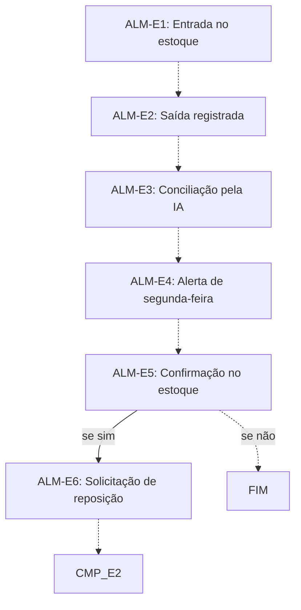

# Fluxo ALM · Almoxarifado

6 etapas em ordem de execução, com as decisões de Diego aplicadas. Montado por agentes a partir da Especificação e dos documentos de setor, e ainda não revisado por Diego nem pelo Pedro. Como ler: `ERP-CRM/FLUXOS/00_VISAO-GERAL.md`.

## 1. ALM-E1 · Entrada no estoque `vigente`

- **O que acontece:** O material comprado entra no estoque quando a chegada é baixada no app, na agenda de chegadas.
- **Responsável:** Almoxarifado da unidade (RS: seu Marcos; SP: assistente do Rômulo, a contratar)
- **Perfis:** `PERF-ALMOXARIFADO`
- **Prazo:** não informado
- **Gatilho:** Chegada baixada no app (CMP-E5)
- **Próxima:** `ALM-E2` _(pela ordem do documento)_
- **Em aberto:** Papel do Almoxarifado a confirmar (UNI-00929).
- **Itens:** `UNI-01511`
- **Fonte:** DOC-091 §5 Almoxarifado

## 2. ALM-E2 · Saída registrada `vigente`

- **O que acontece:** Cada retirada é registrada no app, com material, quantidade, projeto e setor que retirou. Item de estoque reservado tem baixa na saída.
- **Responsável:** Almoxarifado da unidade (RS: seu Marcos; SP: assistente do Rômulo, a contratar)
- **Perfis:** `PERF-ALMOXARIFADO`
- **Prazo:** não informado
- **Gatilho:** Cada retirada de material
- **Próxima:** `ALM-E3` _(pela ordem do documento)_
- **Em aberto:** Se o Almoxarifado recebe fichas de produção ou só apoia (UNI-00932).
- **Itens:** `UNI-01512`
- **Fonte:** DOC-091 §5 Almoxarifado e §25 Item de estoque

## 3. ALM-E3 · Conciliação pela IA `vigente`

- **O que acontece:** Um agente de IA compara a lista de compras com a lista de consumo (saídas) e calcula o saldo de cada item.
- **Responsável:** Agente de IA
- **Perfis:** `AGENTE-IA`
- **Prazo:** não informado
- **Gatilho:** não informado
- **Próxima:** `ALM-E4` _(pela ordem do documento)_
- **Itens:** `UNI-01513`
- **Fonte:** DOC-091 §5 Almoxarifado

## 4. ALM-E4 · Alerta de segunda-feira `vigente`

- **O que acontece:** Toda segunda-feira, a IA envia ao responsável da unidade a lista de itens que, a princípio, estão faltando ou abaixo do mínimo.
- **Responsável:** Agente de IA
- **Perfis:** `AGENTE-IA`
- **Prazo:** toda segunda-feira
- **Gatilho:** Toda segunda-feira
- **Próxima:** `ALM-E5` _(pela ordem do documento)_
- **Em aberto:** Valores de estoque mínimo por item ainda não definidos (UNI-01600).
- **Itens:** `UNI-01514`
- **Fonte:** DOC-091 §5 Almoxarifado e Estoque mínimo

## 5. ALM-E5 · Confirmação no estoque `vigente`

- **O que acontece:** O responsável confere no estoque e marca sim ou não em cada item.
- **Responsável:** Almoxarifado da unidade (RS: seu Marcos; SP: assistente do Rômulo, a contratar)
- **Perfis:** `PERF-ALMOXARIFADO`
- **Prazo:** não informado
- **Gatilho:** Lista recebida (ALM-E4)
- **Próxima:** se sim: `ALM-E6`; se não: `FIM` _(pela ordem do documento)_
- **Itens:** `UNI-01573`
- **Fonte:** DOC-091 §5 Almoxarifado

## 6. ALM-E6 · Solicitação de reposição `vigente`

- **O que acontece:** Os itens marcados com sim viram uma solicitação de compra de reposição para Compras da unidade, que segue o fluxo normal com aprovação da Maitê.
- **Responsável:** Sistema
- **Perfis:** `SISTEMA`
- **Prazo:** não informado
- **Gatilho:** Item confirmado com sim (ALM-E5)
- **Próxima:** `CMP-E2` _(pela ordem do documento)_
- **Em aberto:** A reposição não nasce de comanda. A entrada no fluxo de Compras foi ligada ao CMP-E2 por leitura do texto.
- **Itens:** `UNI-01515`
- **Fonte:** DOC-091 §5 Almoxarifado

