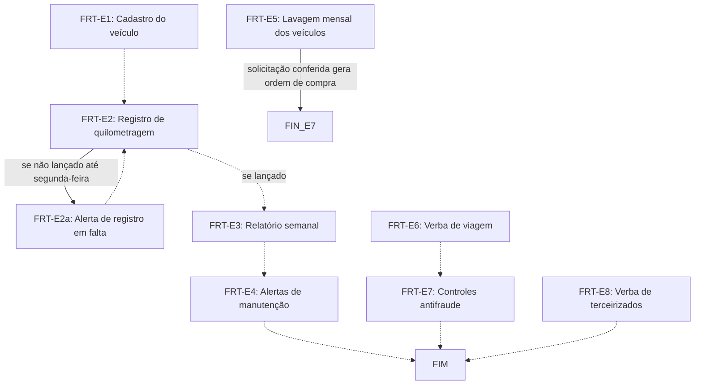

# Fluxo FRT · Frota

9 etapas em ordem de execução, com as decisões de Diego aplicadas. Montado por agentes a partir da Especificação e dos documentos de setor, e ainda não revisado por Diego nem pelo Pedro. Como ler: `ERP-CRM/FLUXOS/00_VISAO-GERAL.md`.

## 1. FRT-E1 · Cadastro do veículo `vigente`

- **O que acontece:** Cada veículo é cadastrado com placa, modelo, unidade, quilometragem atual e plano de manutenção (troca de óleo e preventivas por quilometragem ou por data).
- **Responsável:** não informado
- **Prazo:** não informado
- **Gatilho:** não informado
- **Próxima:** `FRT-E2` _(pela ordem do documento)_
- **Itens:** `UNI-01439`
- **Fonte:** DOC-091 §5 Frota

## 2. FRT-E2 · Registro de quilometragem `vigente`

- **O que acontece:** A quilometragem de cada veículo é lançada no app uma vez por semana.
- **Responsável:** Almoxarifado da unidade (RS: seu Marcos; SP: assistente do Rômulo)
- **Perfis:** `PERF-ALMOXARIFADO`
- **Prazo:** uma vez por semana; o lançamento da semana anterior vence na segunda-feira
- **Gatilho:** Toda semana
- **Próxima:** se lançado: `FRT-E3` _(pela ordem do documento)_; se não lançado até segunda-feira: `FRT-E2a`
- **Itens:** `UNI-00009.01`, `UNI-01601`
- **Fonte:** DOC-091 §5 Frota

## 3. FRT-E2a · Alerta de registro em falta `vigente`

- **O que acontece:** Se o lançamento da semana anterior não for feito até segunda-feira, na terça-feira o sistema alerta quem lança (seu Marcos e assistente do Rômulo), além de Eduardo, Leandro e Rômulo.
- **Responsável:** Sistema
- **Perfis:** `SISTEMA`
- **Prazo:** terça-feira
- **Gatilho:** Lançamento da semana anterior não feito até segunda-feira
- **Próxima:** `FRT-E2` _(pela ordem do documento)_
- **Itens:** `UNI-01516`
- **Fonte:** DOC-091 §5 Frota

## 4. FRT-E3 · Relatório semanal `vigente`

- **O que acontece:** O sistema gera toda semana o relatório de quilometragem de cada veículo. Recebem: RS, seu Marcos, Eduardo e Leandro; SP, Rômulo.
- **Responsável:** Sistema
- **Perfis:** `SISTEMA`
- **Prazo:** toda semana
- **Gatilho:** Toda semana
- **Próxima:** `FRT-E4` _(pela ordem do documento)_
- **Itens:** `UNI-00009.02`
- **Fonte:** DOC-091 §5 Frota (FRT-E3 está depois do bloco de Custos, linha 318)

## 5. FRT-E4 · Alertas de manutenção `vigente`

- **O que acontece:** O sistema alerta os veículos no prazo de troca de óleo, de manutenção preventiva ou com necessidade básica de manutenção. Recebem: RS, seu Marcos, Eduardo e Leandro; SP, Rômulo.
- **Responsável:** Sistema
- **Perfis:** `SISTEMA`
- **Prazo:** não informado
- **Gatilho:** Veículo no prazo de troca de óleo ou de preventiva, ou com necessidade básica de manutenção
- **Próxima:** `FIM` _(pela ordem do documento)_
- **Em aberto:** O que acontece depois do alerta não foi informado.
- **Itens:** `UNI-00009.03`, `UNI-01440`
- **Fonte:** DOC-091 §5 Frota (FRT-E4 está depois do bloco de Custos, linhas 319 e 320)

## 6. FRT-E5 · Lavagem mensal dos veículos `vigente`

- **O que acontece:** Todo dia 20, o sistema alerta e pede a solicitação de pagamento da lavagem. No RS, o Leandro solicita, e o seu Marcos e o Eduardo conferem. Em SP, o assistente do Rômulo solicita e o Rômulo confere. A solicitação conferida gera uma ordem de compra para o Financeiro planejar e validar.
- **Responsável:** Sistema (alerta); apoio operacional (RS: Leandro) ou assistente de produção (SP: assistente do Rômulo) solicita; conferência (RS: seu Marcos e Eduardo; SP: Rômulo)
- **Perfis:** `SISTEMA`
- **Prazo:** todo dia 20
- **Gatilho:** Todo dia 20
- **Próxima:** solicitação conferida gera ordem de compra: `FIN-E7`
- **Itens:** `UNI-00009.04`, `UNI-01602`, `UNI-01603`
- **Fonte:** DOC-091 §5 Frota

## 7. FRT-E6 · Verba de viagem `vigente`

- **O que acontece:** O solicitante pede a verba no app: combustível pela tabela padrão (km a rodar ÷ km por litro × preço do litro), pedágio e estacionamento pelo valor previsto da rota. O Financeiro valida e libera. O solicitante anexa as notas e um agente de IA compara liberado e realizado. Se gastar menos, a IA notifica o Financeiro e o solicitante devolve a diferença. Se gastar mais, com comprovação, a empresa reembolsa.
- **Responsável:** Solicitante (RS: Eduardo e Leandro; SP: Rômulo e assistente do Rômulo); Financeiro valida; Agente de IA confere
- **Perfis:** `AGENTE-IA`, `PERF-FINANCEIRO`
- **Prazo:** comprovantes em até 5 dias após a viagem (FRT-E7); demais não informado
- **Gatilho:** Solicitação de verba para viagem
- **Próxima:** `FRT-E7` _(pela ordem do documento)_
- **Itens:** `UNI-00009.05`, `UNI-00009.06`, `UNI-01604`, `UNI-01605`, `UNI-01606`
- **Fonte:** DOC-091 §5 Frota

## 8. FRT-E7 · Controles antifraude `vigente`

- **O que acontece:** Rota calculada pelo sistema; foto do hodômetro na saída e na volta, com comparação pela IA; preço do litro limitado pela média da região (ANP), com justificativa acima dela; preferência por cartão de combustível e tag de pedágio da empresa; comprovantes em 5 dias, sem os quais nova verba fica bloqueada; IA confere data, posto, placa e horário das notas e aponta repetições e desvios; descontos em folha só com autorização por escrito e conforme a lei.
- **Responsável:** Sistema; Agente de IA
- **Perfis:** `AGENTE-IA`, `SISTEMA`
- **Prazo:** comprovantes em até 5 dias após a viagem
- **Gatilho:** Contínua, durante a FRT-E6 e a FRT-E8
- **Próxima:** `FIM` _(pela ordem do documento)_
- **Em aberto:** Descontos em folha ainda a validar com a Maitê.
- **Itens:** `UNI-00009.07`, `UNI-00009.08`, `UNI-00009.09`, `UNI-00009.10`, `UNI-00009.11`, `UNI-00009.12`, `UNI-00009.13`
- **Fonte:** DOC-091 §5 Frota

## 9. FRT-E8 · Verba de terceirizados `vigente`

- **O que acontece:** Montadores terceirizados pedem a verba no app, com usuário que só acessa a própria verba. Processo e controles são os da FRT-E6 e FRT-E7, mas sem adiantamento nem cartão da empresa: o terceirizado paga, anexa as notas e a empresa reembolsa, limitado ao valor calculado pela rota e pela tabela padrão.
- **Responsável:** Montador terceirizado solicita; Financeiro valida; Agente de IA confere
- **Perfis:** `AGENTE-IA`, `PERF-FINANCEIRO`, `PERF-TERCEIRIZADO`
- **Prazo:** comprovantes em até 5 dias após a viagem (FRT-E7)
- **Gatilho:** Solicitação de verba por montador terceirizado
- **Próxima:** `FIM` _(pela ordem do documento)_
- **Itens:** `UNI-01517`, `UNI-01607`
- **Fonte:** DOC-091 §5 Frota

