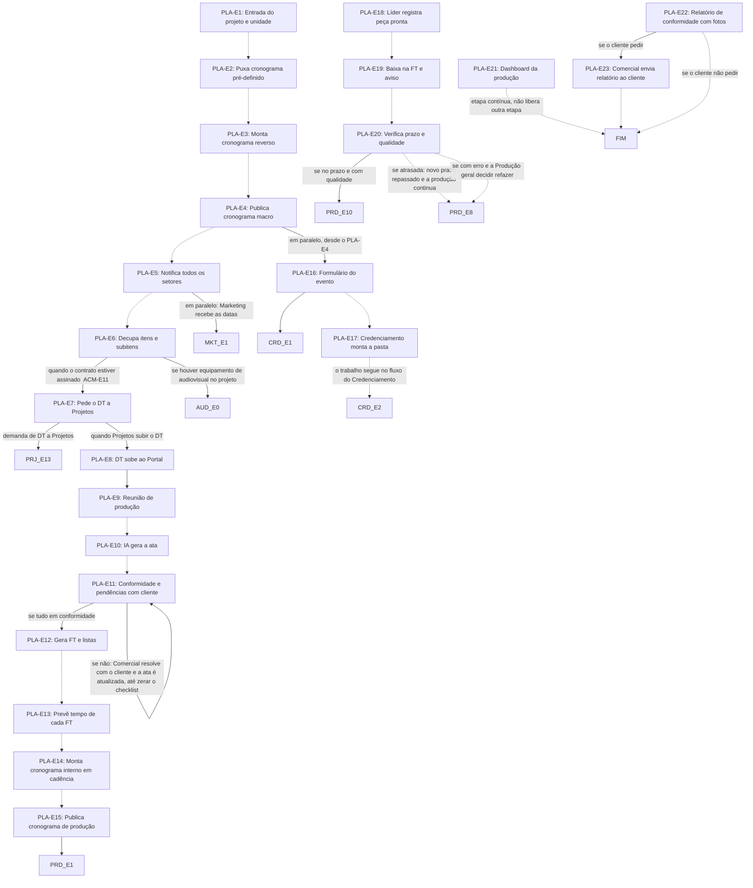

# Fluxo PLA · Planejamento

23 etapas em ordem de execução, com as decisões de Diego aplicadas. Montado por agentes a partir da Especificação e dos documentos de setor, e ainda não revisado por Diego nem pelo Pedro. Como ler: `ERP-CRM/FLUXOS/00_VISAO-GERAL.md`.

## 1. PLA-E1 · Entrada do projeto e unidade `ajustada`

- **O que acontece:** A partir do aceite do cliente, o Planejamento recebe o projeto fechado (memorial, prancha de amostras e formalização) e define a unidade de produção: Rio Grande do Sul ou São Paulo. Com a unidade definida, o sistema recalcula o custo com os preços dela e direciona notificações, fichas, alertas e acessos à equipe da unidade.
- **Responsável:** Planejamento (Érika)
- **Perfis:** `PERF-PLANEJAMENTO`
- **Prazo:** não informado
- **Gatilho:** Aceite do cliente registrado (ACM-E7 = FIN-E1)
- **Próxima:** `PLA-E2` _(pela ordem do documento)_
- **Mudou em relação ao documento:** A Especificação (§2, passagem 5) ligava a entrada ao contrato assinado (ACM-E11). A decisão fixa a entrada no aceite do cliente.
- **Decisões aplicadas:** `item-8`, `ponto-1`
- **Em aberto:** ponto-1: o que o Planejamento faz entre o aceite e a assinatura do contrato.
- **Itens:** `UNI-00280`, `UNI-01518`, `UNI-01530`
- **Fonte:** DOC-091 §5 07 Planejamento; DOC-091 §Respostas Unidade de produção; PLANDEM_FLX-SET07_PLANEJAMENTO_V07 §02 Fase 1

## 2. PLA-E2 · Puxa cronograma pré-definido `ajustada`

- **O que acontece:** Puxa do Portal o cronograma de produção pré-definido, modelo padrão para editar. O modelo tem de respeitar os limites fixos do item-11: proposta até 30 dias e produção até 20 dias antes do evento.
- **Responsável:** Planejamento da unidade (RS: Érika; SP: Samanta)
- **Perfis:** `PERF-PLANEJAMENTO`
- **Prazo:** não informado
- **Gatilho:** Projeto recebido e unidade definida (PLA-E1)
- **Próxima:** `PLA-E3` _(pela ordem do documento)_
- **Mudou em relação ao documento:** O modelo do SET07 §03 traz janela de 25 dias com produção de D-10 a D0. A decisão fixa os limites de 30 e 20 dias antes do evento, e o restante depende do projeto.
- **Decisões aplicadas:** `item-11`
- **Em aberto:** ponto-1: como fica a janela de 25 dias e o que o Planejamento faz entre o aceite e a assinatura.
- **Itens:** `UNI-00280`, `UNI-00402`
- **Fonte:** DOC-091 §5 07 Planejamento; PLANDEM_FLX-SET07_PLANEJAMENTO_V07 §02 Fase 1 e §03

## 3. PLA-E3 · Monta cronograma reverso `ajustada`

- **O que acontece:** Monta o cronograma reverso, da data da feira para trás, com as datas de corte de cada etapa e de cada setor. Os prazos dependem do projeto, mas são fixos proposta até 30 dias e produção até 20 dias antes do evento (no fluxo geral V03, de onde veio a opção escolhida, a produção começa no máximo 20 dias antes). O prazo limite do formulário de deslocamento, definido pelo Credenciamento a partir do manual da feira, entra neste cronograma.
- **Responsável:** Planejamento da unidade (RS: Érika; SP: Samanta)
- **Perfis:** `PERF-PLANEJAMENTO`
- **Prazo:** não informado
- **Gatilho:** Cronograma pré-definido puxado (PLA-E2)
- **Próxima:** `PLA-E4` _(pela ordem do documento)_
- **Mudou em relação ao documento:** Saem os blocos da janela de 25 dias como regra (bloco 4 de produção de D-10 a D0). Valem os limites fixos do item-11.
- **Decisões aplicadas:** `item-11`
- **Em aberto:** ponto-1: como fica a janela de 25 dias. O prazo do formulário de deslocamento vem da leitura do manual (CRD-E5, CRD-E7), que na sequência ocorre depois do PLA-E3; os documentos não dizem como o cronograma é atualizado. Os prazos encadeados de PLA-E4 a PLA-E13 somam cerca de 20 dias, e o V03 prevê cerca de 10 dias entre a proposta e a produção.
- **Itens:** `UNI-00280`, `UNI-00403`
- **Fonte:** DOC-091 §5 07 Planejamento; DOC-091 §Respostas Prazo do formulário de deslocamento; PLANDEM_FLX-SET07_PLANEJAMENTO_V07 §02 Fase 1 e §03; PLANDEM_FLX-001_FLUXO-IMAGINE_V03 §Prazos

## 4. PLA-E4 · Publica cronograma macro `vigente`

- **O que acontece:** Confirma o projeto e publica o cronograma macro no Portal.
- **Responsável:** Planejamento da unidade (RS: Érika; SP: Samanta)
- **Perfis:** `PERF-PLANEJAMENTO`
- **Prazo:** até 3 dias após o aceite
- **Gatilho:** Cronograma reverso montado (PLA-E3)
- **Próxima:** `PLA-E5` _(pela ordem do documento)_; em paralelo, desde o PLA-E4: `PLA-E16`
- **Em aberto:** ponto-1: o que o Planejamento faz entre o aceite e a assinatura.
- **Itens:** `UNI-00079`, `UNI-00280`, `UNI-00280.01`, `UNI-00404`
- **Fonte:** DOC-091 §5 07 Planejamento e §7; PLANDEM_FLX-SET07_PLANEJAMENTO_V07 §02 Fases 1 e 5

## 5. PLA-E5 · Notifica todos os setores `vigente`

- **O que acontece:** O Portal notifica todos os setores, e cada um já prevê a demanda que vem desse projeto. O Marketing recebe as datas em paralelo.
- **Responsável:** Sistema
- **Perfis:** `SISTEMA`
- **Prazo:** não informado
- **Gatilho:** Cronograma macro publicado (PLA-E4)
- **Próxima:** `PLA-E6` _(pela ordem do documento)_; em paralelo: Marketing recebe as datas: `MKT-E1`
- **Em aberto:** ponto-1: o que o Planejamento faz entre o aceite e a assinatura.
- **Itens:** `UNI-00280`, `UNI-00280.01`, `UNI-00603`
- **Fonte:** DOC-091 §2 passagens 6 e 7; DOC-091 §5 07 Planejamento; PLANDEM_FLX-SET07_PLANEJAMENTO_V07 §02 Fase 1

## 6. PLA-E6 · Decupa itens e subitens `vigente`

- **O que acontece:** Decupa os itens e subitens do cronograma a partir do memorial e da prancha de amostras, apontando os setores que vão receber cada item. Se identificar equipamento de audiovisual, o sistema abre a demanda do setor.
- **Responsável:** Planejamento da unidade (RS: Érika; SP: Samanta)
- **Perfis:** `PERF-PLANEJAMENTO`
- **Prazo:** não informado
- **Gatilho:** Setores notificados (PLA-E5)
- **Próxima:** quando o contrato estiver assinado (ACM-E11): `PLA-E7`; se houver equipamento de audiovisual no projeto: `AUD-E0`
- **Em aberto:** ponto-1: o que o Planejamento faz entre o aceite e a assinatura; não está decidido se a decupagem ocorre antes da assinatura.
- **Itens:** `UNI-00281`, `UNI-00405`
- **Fonte:** DOC-091 §5 07 Planejamento; DOC-091 §Respostas Audiovisual; PLANDEM_FLX-SET07_PLANEJAMENTO_V07 §02 Fase 2

## 7. PLA-E7 · Pede o DT a Projetos `ajustada`

- **O que acontece:** Só depois do contrato assinado, pede a Projetos o detalhamento técnico (DT), com prazo de 3 dias. Pela §25 da Especificação, o sistema abre essa demanda, e nenhum DT ou ficha técnica (FT) é gerado antes da formalização do contrato.
- **Responsável:** Planejamento da unidade (RS: Érika; SP: Samanta)
- **Perfis:** `PERF-PLANEJAMENTO`
- **Prazo:** 3 dias para Projetos
- **Gatilho:** Contrato assinado registrado (ACM-E11), com a decupagem pronta (PLA-E6)
- **Próxima:** demanda de DT a Projetos: `PRJ-E13`; quando Projetos subir o DT: `PLA-E8`
- **Mudou em relação ao documento:** O documento pedia o DT logo após a decupagem, sem depender do contrato. A decisão condiciona o início do DT ao contrato assinado.
- **Decisões aplicadas:** `ponto-1`
- **Em aberto:** ponto-1: como fica a janela de 25 dias. A etapa diz que o Planejamento pede o DT; a §25 diz que o sistema abre a demanda.
- **Itens:** `UNI-00080`, `UNI-00281`, `UNI-00406`
- **Fonte:** DOC-091 §5 07 Planejamento e §25; PLANDEM_FLX-SET07_PLANEJAMENTO_V07 §02 Fase 2

## 8. PLA-E8 · DT sobe ao Portal `vigente`

- **O que acontece:** Projetos sobe o DT, gerado pela IA e conferido pelo arquiteto, e o Portal notifica Planejamento e Produção.
- **Responsável:** Projetos
- **Perfis:** `PERF-ARQUITETO`
- **Prazo:** 3 dias depois do pedido
- **Gatilho:** DT concluído por Projetos (PRJ-E13)
- **Próxima:** `PLA-E9`
- **Itens:** `UNI-00281`, `UNI-00604`
- **Fonte:** DOC-091 §5 07 Planejamento e §25; PLANDEM_FLX-SET07_PLANEJAMENTO_V07 §02 Fase 2 e §03

## 9. PLA-E9 · Reunião de produção `vigente`

- **O que acontece:** Reunião de produção com Planejamento, produção, arquiteto e Comercial.
- **Responsável:** Planejamento da unidade (RS: Érika; SP: Samanta)
- **Perfis:** `PERF-PLANEJAMENTO`
- **Prazo:** 2 dias depois do detalhamento
- **Gatilho:** DT no Portal (PLA-E8)
- **Próxima:** `PLA-E10` _(pela ordem do documento)_
- **Itens:** `UNI-00081`, `UNI-00282`, `UNI-00407`
- **Fonte:** DOC-091 §5 07 Planejamento e §7; PLANDEM_FLX-SET07_PLANEJAMENTO_V07 §02 Fase 3

## 10. PLA-E10 · IA gera a ata `vigente`

- **O que acontece:** A IA gera a ata a partir da gravação: o que está conforme, dúvidas e observações a validar com o cliente.
- **Responsável:** Agente de IA
- **Perfis:** `AGENTE-IA`
- **Prazo:** não informado
- **Gatilho:** Reunião de produção realizada (PLA-E9)
- **Próxima:** `PLA-E11` _(pela ordem do documento)_
- **Itens:** `UNI-00282`, `UNI-00408`
- **Fonte:** DOC-091 §5 07 Planejamento; PLANDEM_FLX-SET07_PLANEJAMENTO_V07 §02 Fase 3

## 11. PLA-E11 · Conformidade e pendências com cliente `vigente`

- **O que acontece:** Verifica se tudo está em conformidade. Se não, abre o checklist de itens a resolver; o Comercial resolve com o cliente e a ata é atualizada, até o projeto ficar validado para produção.
- **Responsável:** Comercial
- **Perfis:** `PERF-VENDEDOR`
- **Prazo:** até 5 dias
- **Gatilho:** Ata registrada (PLA-E10)
- **Próxima:** se tudo em conformidade: `PLA-E12`; se não: Comercial resolve com o cliente e a ata é atualizada, até zerar o checklist: `PLA-E11`
- **Itens:** `UNI-00082`, `UNI-00282`, `UNI-00562`, `UNI-01531`
- **Fonte:** DOC-091 §5 07 Planejamento e §7; PLANDEM_FLX-SET07_PLANEJAMENTO_V07 §02 Fase 3 e §08

## 12. PLA-E12 · Gera FT e listas `vigente`

- **O que acontece:** A Produção gera as FT e as listas de materiais por IA no Portal, a partir do DT. As FT de comunicação visual são geradas junto com as demais.
- **Responsável:** Produção (Marília)
- **Perfis:** `PERF-PRODUCAO-GERAL`
- **Prazo:** cerca de 5 dias
- **Gatilho:** Projeto validado para produção (PLA-E11)
- **Próxima:** `PLA-E13` _(pela ordem do documento)_
- **Em aberto:** A §25 diz que o sistema gera automaticamente a FT do item a produzir; a etapa diz que a Marília gera por IA. Em SP a Especificação cita Produção = Rômulo e Samanta, sem dizer quem gera. O SET07 §05 diz que a lista de materiais ajusta a comanda; não está dito como ajusta a pré-comanda automática (item-21).
- **Itens:** `UNI-00083`, `UNI-00283`, `UNI-00409`, `UNI-00409.01`, `UNI-00409.02`, `UNI-00409.03`
- **Fonte:** DOC-091 §5 07 Planejamento, §25 e §27; PLANDEM_FLX-SET07_PLANEJAMENTO_V07 §02 Fase 4 e §05

## 13. PLA-E13 · Prevê tempo de cada FT `vigente`

- **O que acontece:** Prevê a complexidade e o tempo de cada FT, por grupo de itens e por setor.
- **Responsável:** Produção (Eduardo)
- **Perfis:** `PERF-PRODUCAO-GERAL`
- **Prazo:** 2 dias
- **Gatilho:** FT recebidas (PLA-E12)
- **Próxima:** `PLA-E14` _(pela ordem do documento)_
- **Em aberto:** Em SP a Especificação cita Produção = Rômulo e Samanta, sem dizer quem prevê o tempo.
- **Itens:** `UNI-00283`, `UNI-00410`, `UNI-00410.01`
- **Fonte:** DOC-091 §5 07 Planejamento e §7; PLANDEM_FLX-SET07_PLANEJAMENTO_V07 §02 Fase 4 e §03

## 14. PLA-E14 · Monta cronograma interno em cadência `ajustada`

- **O que acontece:** Monta o cronograma interno com o vencimento de cada FT em cada setor, em cadência (ex.: serralheria antes da pintura), respeitando o limite fixo da produção até 20 dias antes do evento.
- **Responsável:** Planejamento da unidade (RS: Érika; SP: Samanta)
- **Perfis:** `PERF-PLANEJAMENTO`
- **Prazo:** não informado
- **Gatilho:** Tempo de cada FT previsto (PLA-E13)
- **Próxima:** `PLA-E15` _(pela ordem do documento)_
- **Mudou em relação ao documento:** O SET07 §03 colocava a produção no bloco 4 (D-10 a D0). A decisão fixa a produção até 20 dias antes do evento.
- **Decisões aplicadas:** `item-11`
- **Em aberto:** ponto-1: como fica a janela de 25 dias.
- **Itens:** `UNI-00283`, `UNI-00411`
- **Fonte:** DOC-091 §5 07 Planejamento; PLANDEM_FLX-SET07_PLANEJAMENTO_V07 §02 Fase 4 e §03

## 15. PLA-E15 · Publica cronograma de produção `vigente`

- **O que acontece:** Publica o cronograma de produção, e todos os setores veem as suas datas. A FT publicada entra no app do setor.
- **Responsável:** Planejamento da unidade (RS: Érika; SP: Samanta)
- **Perfis:** `PERF-PLANEJAMENTO`
- **Prazo:** não informado
- **Gatilho:** Cronograma interno montado (PLA-E14)
- **Próxima:** `PRD-E1`
- **Itens:** `UNI-00283`, `UNI-00292.01`, `UNI-00412`
- **Fonte:** DOC-091 §2 passagem 8; DOC-091 §5 07 Planejamento; PLANDEM_FLX-SET07_PLANEJAMENTO_V07 §02 Fase 4

## 16. PLA-E18 · Líder registra peça pronta `vigente`

- **O que acontece:** Com a peça pronta, o líder do setor registra no app: lê o QR code, tira a foto e marca a qualidade, ok ou com erro. Sem leitura não há baixa, e a foto é obrigatória. Em SP, onde os setores são terceirizados sem app, o assistente do Rômulo faz a leitura, a foto e a baixa.
- **Responsável:** Líder do setor (SP: assistente do Rômulo)
- **Perfis:** `PERF-LIDER-SETOR`
- **Prazo:** não informado
- **Gatilho:** Peça pronta no setor (mesmo momento do PRD-E8)
- **Próxima:** `PLA-E19` _(pela ordem do documento)_
- **Em aberto:** A etapa diz que o líder lê o QR code e fotografa; a §25 diz que o operador fotografa o item com a ficha impressa, o sistema lê o QR code na foto e o operador dá o ok.
- **Itens:** `UNI-00285`
- **Fonte:** DOC-091 §5 07 Planejamento, §25 e §Respostas Equipe de São Paulo; PLANDEM_FLX-SET07_PLANEJAMENTO_V07 §02 Fase 6 e §06

## 17. PLA-E19 · Baixa na FT e aviso `vigente`

- **O que acontece:** O Portal dá baixa na FT e avisa a produção, o Planejamento e o próximo setor da cadência, com status em tempo real.
- **Responsável:** Sistema
- **Perfis:** `SISTEMA`
- **Prazo:** na hora (SET07 §06)
- **Gatilho:** Peça registrada no app (PLA-E18)
- **Próxima:** `PLA-E20` _(pela ordem do documento)_
- **Itens:** `UNI-00285`, `UNI-00605`, `UNI-00605.01`
- **Fonte:** DOC-091 §5 07 Planejamento; PLANDEM_FLX-SET07_PLANEJAMENTO_V07 §02 Fase 6 e §06

## 18. PLA-E20 · Verifica prazo e qualidade `vigente`

- **O que acontece:** Verifica se a peça está no prazo e com qualidade. Se não, alerta vermelho e relatório de erros. Atraso: o novo prazo informado pela produção é repassado ao próximo setor e ao Planejamento e à Produção. Erro: a Produção geral decide refazer.
- **Responsável:** Sistema (alerta); Produção geral decide refazer (RS: Eduardo e Marília; SP: Rômulo e Samanta)
- **Perfis:** `SISTEMA`, `PERF-PRODUCAO-GERAL`
- **Prazo:** não informado
- **Gatilho:** Baixa na FT (PLA-E19)
- **Próxima:** se no prazo e com qualidade: `PRD-E10`; se atrasada: novo prazo repassado e a produção continua: `PRD-E8` _(pela ordem do documento)_; se com erro e a Produção geral decidir refazer: `PRD-E8` _(pela ordem do documento)_
- **Em aberto:** O documento não diz o caminho se a Produção geral decidir não refazer, nem para onde o fluxo volta depois do atraso ou do erro.
- **Itens:** `UNI-00285`, `UNI-00563`
- **Fonte:** DOC-091 §2 passagem 9; DOC-091 §5 07 Planejamento; PLANDEM_FLX-SET07_PLANEJAMENTO_V07 §02 Fase 6 e §07

## 19. PLA-E16 · Formulário do evento `vigente`

- **O que acontece:** O Portal gera o formulário do evento (cliente, evento, prazos da feira e informações úteis) e notifica o Credenciamento.
- **Responsável:** Sistema
- **Perfis:** `SISTEMA`
- **Prazo:** não informado
- **Gatilho:** Paralela: desde a publicação do cronograma macro (PLA-E4)
- **Próxima:** `CRD-E1`; `PLA-E17` _(pela ordem do documento)_
- **Em aberto:** ponto-1: não está decidido se o Credenciamento corre entre o aceite e a assinatura.
- **Itens:** `UNI-00284`, `UNI-00284.01`
- **Fonte:** DOC-091 §2 passagem 7; DOC-091 §5 07 Planejamento; PLANDEM_FLX-SET07_PLANEJAMENTO_V07 §02 Fase 5

## 20. PLA-E17 · Credenciamento monta a pasta `vigente`

- **O que acontece:** O Credenciamento monta a pasta: pede o manual ao Comercial ou ao cliente e levanta documentos e aprovações da feira.
- **Responsável:** Credenciamento (Alexandra)
- **Perfis:** `PERF-CREDENCIAMENTO`
- **Prazo:** prazo do manual da feira
- **Gatilho:** Paralela: Credenciamento notificado (PLA-E16, CRD-E1)
- **Próxima:** o trabalho segue no fluxo do Credenciamento: `CRD-E2` _(pela ordem do documento)_
- **Itens:** `UNI-00086`, `UNI-00413`, `UNI-00413.01`
- **Fonte:** DOC-091 §5 07 Planejamento; PLANDEM_FLX-SET07_PLANEJAMENTO_V07 §02 Fase 5 e §03

## 21. PLA-E21 · Dashboard da produção `vigente`

- **O que acontece:** Dashboard com itens prontos × itens que faltam, no prazo, antecipado e atrasado, por projeto e por setor.
- **Responsável:** Sistema
- **Perfis:** `SISTEMA`
- **Prazo:** não informado
- **Gatilho:** Contínua durante a produção, alimentada pelas baixas (PLA-E19)
- **Próxima:** etapa contínua, não libera outra etapa: `FIM` _(pela ordem do documento)_
- **Itens:** `UNI-00285`, `UNI-00414`, `UNI-00414.01`, `UNI-00664.01`
- **Fonte:** DOC-091 §5 07 Planejamento e §10; PLANDEM_FLX-SET07_PLANEJAMENTO_V07 §02 Fase 6 e §06

## 22. PLA-E22 · Relatório de conformidade com fotos `vigente`

- **O que acontece:** Relatório visual de conformidade e controle de qualidade, com fotos de cada item, alimentado pela Qualidade e pela Produção.
- **Responsável:** Controle de qualidade (Suellen) e Produção
- **Perfis:** `PERF-PRODUCAO-GERAL`, `PERF-QUALIDADE`
- **Prazo:** durante a produção, até o carregamento
- **Gatilho:** Contínua durante a produção
- **Próxima:** se o cliente pedir: `PLA-E23`; se o cliente não pedir: `FIM` _(pela ordem do documento)_
- **Itens:** `UNI-00087`, `UNI-00286`, `UNI-00415`, `UNI-00415.01`
- **Fonte:** DOC-091 §5 07 Planejamento; PLANDEM_FLX-SET07_PLANEJAMENTO_V07 §02 Fase 7 e §03

## 23. PLA-E23 · Comercial envia relatório ao cliente `vigente`

- **O que acontece:** O Comercial edita ou pede edição do relatório e o envia ao cliente, somente quando ele pedir (pré-feira).
- **Responsável:** Comercial
- **Perfis:** `PERF-VENDEDOR`
- **Prazo:** não informado
- **Gatilho:** Pedido do cliente (pré-feira)
- **Próxima:** `FIM` _(pela ordem do documento)_
- **Em aberto:** O SET07 fecha esta fase com segue para expedição e logística; pela Especificação (§2, passagem 9) a passagem à Expedição é PLA-E19/PRD-E10, e este relatório não libera etapa.
- **Itens:** `UNI-00416`
- **Fonte:** DOC-091 §5 07 Planejamento; PLANDEM_FLX-SET07_PLANEJAMENTO_V07 §02 Fase 7

