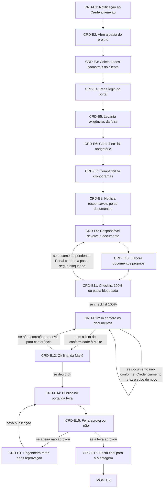

# Fluxo CRD · Credenciamento

17 etapas em ordem de execução, com as decisões de Diego aplicadas. Montado por agentes a partir da Especificação e dos documentos de setor, e ainda não revisado por Diego nem pelo Pedro. Como ler: `ERP-CRM/FLUXOS/00_VISAO-GERAL.md`.

## 1. CRD-E1 · Notificação ao Credenciamento `vigente`

- **O que acontece:** O Portal notifica o Credenciamento com cliente, evento e prazos da feira, já com o passo a passo do setor.
- **Responsável:** Sistema
- **Perfis:** `SISTEMA`
- **Prazo:** não informado
- **Gatilho:** Formulário do evento gerado (PLA-E16)
- **Próxima:** `CRD-E2` _(pela ordem do documento)_
- **Itens:** `UNI-00287`, `UNI-00417`
- **Fonte:** DOC-091 §5 08 Credenciamento; PLANDEM_FLX-SET08_CREDENCIAMENTO_V01 §02 Fase 1

## 2. CRD-E2 · Abre a pasta do projeto `vigente`

- **O que acontece:** Abre no Portal a pasta do projeto, com projetos e informações do projeto da Imagine.
- **Responsável:** Credenciamento (Alexandra)
- **Perfis:** `PERF-CREDENCIAMENTO`
- **Prazo:** não informado
- **Gatilho:** Notificação recebida (CRD-E1)
- **Próxima:** `CRD-E3` _(pela ordem do documento)_
- **Itens:** `UNI-00287`, `UNI-00418`
- **Fonte:** DOC-091 §5 08 Credenciamento; PLANDEM_FLX-SET08_CREDENCIAMENTO_V01 §02 Fase 1

## 3. CRD-E3 · Coleta dados cadastrais do cliente `vigente`

- **O que acontece:** Coleta os dados cadastrais do cliente: razão social, CNPJ, endereço e contatos.
- **Responsável:** Credenciamento (Alexandra)
- **Perfis:** `PERF-CREDENCIAMENTO`
- **Prazo:** não informado
- **Gatilho:** Pasta aberta (CRD-E2)
- **Próxima:** `CRD-E4` _(pela ordem do documento)_
- **Itens:** `UNI-00287`, `UNI-00419`
- **Fonte:** DOC-091 §5 08 Credenciamento; PLANDEM_FLX-SET08_CREDENCIAMENTO_V01 §02 Fase 1

## 4. CRD-E4 · Pede login do portal `vigente`

- **O que acontece:** Pede ao cliente o login do portal do expositor; o acesso fica guardado com acesso restrito.
- **Responsável:** não informado
- **Prazo:** não informado
- **Gatilho:** Dados do cliente coletados (CRD-E3)
- **Próxima:** `CRD-E5` _(pela ordem do documento)_
- **Em aberto:** UNI-00925: quem pede o login ao cliente (Credenciamento, vendedor ou assistente comercial).
- **Itens:** `UNI-00117.01`, `UNI-00288`, `UNI-00420`, `UNI-00925`
- **Fonte:** DOC-091 §5 08 Credenciamento; PLANDEM_FLX-SET08_CREDENCIAMENTO_V01 §02 Fase 2, §04 e §06 item 6

## 5. CRD-E5 · Levanta exigências da feira `vigente`

- **O que acontece:** Acessa o portal do expositor e levanta documentos, regras e prazos da feira. A partir do manual, define o prazo limite do formulário de deslocamento.
- **Responsável:** Credenciamento (Alexandra)
- **Perfis:** `PERF-CREDENCIAMENTO`
- **Prazo:** não informado
- **Gatilho:** Acesso ao portal do expositor recebido (CRD-E4)
- **Próxima:** `CRD-E6` _(pela ordem do documento)_
- **Em aberto:** UNI-00926: se o Credenciamento levanta as taxas da feira e pede o pagamento ao Financeiro.
- **Itens:** `UNI-00288`, `UNI-00421`, `UNI-01426`
- **Fonte:** DOC-091 §5 08 Credenciamento; DOC-091 §Respostas Prazo do formulário de deslocamento; PLANDEM_FLX-SET08_CREDENCIAMENTO_V01 §02 Fase 2 e §06 item 7

## 6. CRD-E6 · Gera checklist obrigatório `vigente`

- **O que acontece:** O Portal gera o checklist obrigatório: exigências da feira mais os documentos básicos que a Imagine sempre emite.
- **Responsável:** Sistema
- **Perfis:** `SISTEMA`
- **Prazo:** não informado
- **Gatilho:** Exigências da feira levantadas (CRD-E5)
- **Próxima:** `CRD-E7` _(pela ordem do documento)_
- **Em aberto:** UNI-00923: se o laudo do engenheiro é exigido sempre ou só com estrutura suspensa.
- **Itens:** `UNI-00288`, `UNI-00422`, `UNI-00665.01`
- **Fonte:** DOC-091 §5 08 Credenciamento; PLANDEM_FLX-SET08_CREDENCIAMENTO_V01 §02 Fase 2, §03 e §06 item 3

## 7. CRD-E7 · Compatibiliza cronogramas `vigente`

- **O que acontece:** Compatibiliza na aba do Credenciamento o cronograma da feira com o cronograma macro da Imagine, gerando a data limite de cada documento e os alertas antes de cada prazo.
- **Responsável:** Credenciamento (Alexandra)
- **Perfis:** `PERF-CREDENCIAMENTO`
- **Prazo:** não informado
- **Gatilho:** Checklist gerado (CRD-E6)
- **Próxima:** `CRD-E8`
- **Em aberto:** UNI-00927: quantos dias antes de cada prazo da feira o Portal alerta.
- **Itens:** `UNI-00288`, `UNI-00423`, `UNI-00927`
- **Fonte:** DOC-091 §5 08 Credenciamento; PLANDEM_FLX-SET08_CREDENCIAMENTO_V01 §02 Fase 2, §04 e §06 item 8

## 8. CRD-E8 · Notifica responsáveis pelos documentos `vigente`

- **O que acontece:** O Portal notifica o responsável por cada documento: arquiteto do projeto, engenheiro, Planejamento e Expedição. O Credenciamento também recebe a lista da equipe pelo formulário de deslocamento, coleta os dados de cada colaborador e gera os documentos para credenciar.
- **Responsável:** Sistema
- **Perfis:** `SISTEMA`
- **Prazo:** não informado
- **Gatilho:** Cronograma compatibilizado (CRD-E7); formulário de deslocamento recebido (Logística da unidade ou Audiovisual)
- **Próxima:** `CRD-E9` _(pela ordem do documento)_
- **Em aberto:** UNI-01108: a coluna de quem fornece cada documento é inferida, em especial se o engenheiro é da casa ou terceirizado e quem reúne os documentos dos funcionários.
- **Itens:** `UNI-00289`, `UNI-00606`, `UNI-01536`
- **Fonte:** DOC-091 §5 08 Credenciamento; DOC-091 §Respostas Formulário de deslocamento; PLANDEM_FLX-SET08_CREDENCIAMENTO_V01 §02 Fase 3 e §03

## 9. CRD-E9 · Responsável devolve o documento `vigente`

- **O que acontece:** O responsável devolve o documento pelo Portal, e ele entra no item do checklist.
- **Responsável:** Responsável de cada documento
- **Prazo:** até 3 dias após a notificação
- **Gatilho:** Notificação do documento (CRD-E8) ou cobrança do Portal (CRD-E11)
- **Próxima:** `CRD-E10` _(pela ordem do documento)_
- **Em aberto:** O checklist exige detalhamento parcial, que pelo ponto-1 só começa depois do contrato assinado; se o Credenciamento correr antes da assinatura, esse item não cabe nos 3 dias. Não há decisão.
- **Itens:** `UNI-00289`, `UNI-00424`, `UNI-00924`, `UNI-00924.01`
- **Fonte:** DOC-091 §5 08 Credenciamento; DOC-091 §Respostas Documentos do Credenciamento; PLANDEM_FLX-SET08_CREDENCIAMENTO_V01 §02 Fase 3 e §03

## 10. CRD-E10 · Elabora documentos próprios `vigente`

- **O que acontece:** Elabora o termo de responsabilidade e os formulários da feira.
- **Responsável:** Credenciamento (Alexandra)
- **Perfis:** `PERF-CREDENCIAMENTO`
- **Prazo:** não informado
- **Gatilho:** Documentos recebidos dos responsáveis (CRD-E9)
- **Próxima:** `CRD-E11` _(pela ordem do documento)_
- **Itens:** `UNI-00289`, `UNI-00425`
- **Fonte:** DOC-091 §5 08 Credenciamento; PLANDEM_FLX-SET08_CREDENCIAMENTO_V01 §02 Fase 3

## 11. CRD-E11 · Checklist 100% ou pasta bloqueada `vigente`

- **O que acontece:** Verifica se o checklist está 100% completo. Se não, o Portal cobra o responsável e a pasta continua bloqueada.
- **Responsável:** Sistema
- **Perfis:** `SISTEMA`
- **Prazo:** não informado
- **Gatilho:** Documentos próprios elaborados (CRD-E10)
- **Próxima:** se checklist 100%: `CRD-E12`; se documento pendente: Portal cobra e a pasta segue bloqueada: `CRD-E9`
- **Itens:** `UNI-00289`, `UNI-00564`
- **Fonte:** DOC-091 §5 08 Credenciamento e §6; PLANDEM_FLX-SET08_CREDENCIAMENTO_V01 §02 Fase 3

## 12. CRD-E12 · IA confere os documentos `vigente`

- **O que acontece:** Um agente de IA confere cada documento contra os padrões definidos pela Maitê e a notifica com a lista do que está e do que não está em conformidade. Documento não conforme: o agente notifica o Credenciamento para refazer e subir de novo, e a conferência roda outra vez.
- **Responsável:** Agente de IA
- **Perfis:** `AGENTE-IA`
- **Prazo:** não informado
- **Gatilho:** Checklist 100% (CRD-E11)
- **Próxima:** com a lista de conformidade à Maitê: `CRD-E13`; se documento não conforme: Credenciamento refaz e sobe de novo: `CRD-E12`
- **Em aberto:** Os padrões da Maitê ainda estão a criar.
- **Itens:** `UNI-00290`, `UNI-00426`, `UNI-00426.01`, `UNI-00565.01`, `UNI-00928.01`
- **Fonte:** DOC-091 §5 08 Credenciamento; DOC-091 §Respostas Conferência do Credenciamento

## 13. CRD-E13 · Ok final da Maitê `vigente`

- **O que acontece:** O jurídico-financeiro dá o ok final. Se não der, o Credenciamento ou o responsável corrige e reenvia para conferência.
- **Responsável:** Jurídico-financeiro (Maitê)
- **Perfis:** `PERF-DIRETORIA-FINANCEIRA`
- **Prazo:** até 5 dias
- **Gatilho:** Lista de conformidade recebida (CRD-E12)
- **Próxima:** se deu o ok: `CRD-E14`; se não: correção e reenvio para conferência: `CRD-E12`
- **Itens:** `UNI-00565`, `UNI-00928`, `UNI-00928.01`
- **Fonte:** DOC-091 §5 08 Credenciamento; DOC-091 §Respostas Conferência do Credenciamento; PLANDEM_FLX-SET08_CREDENCIAMENTO_V01 §02 Fase 4

## 14. CRD-E14 · Publica no portal da feira `vigente`

- **O que acontece:** Publica o projeto e os documentos no portal da feira.
- **Responsável:** Credenciamento (Alexandra)
- **Perfis:** `PERF-CREDENCIAMENTO`
- **Prazo:** dentro dos prazos do cronograma compatibilizado
- **Gatilho:** Ok final (CRD-E13) ou refeitura do engenheiro (CRD-D1)
- **Próxima:** `CRD-E15` _(pela ordem do documento)_
- **Itens:** `UNI-00291`, `UNI-00427`
- **Fonte:** DOC-091 §5 08 Credenciamento; PLANDEM_FLX-SET08_CREDENCIAMENTO_V01 §02 Fase 5

## 15. CRD-E15 · Feira aprova ou não `ajustada`

- **O que acontece:** A feira analisa o que foi publicado. Se aprovar, segue para a pasta final. Se não aprovar, o engenheiro refaz detalhamento, cargas e pontos aéreos, e há nova publicação.
- **Responsável:** Credenciamento (Alexandra), com a resposta da feira
- **Perfis:** `PERF-CREDENCIAMENTO`
- **Prazo:** não informado
- **Gatilho:** Publicação no portal da feira (CRD-E14)
- **Próxima:** se a feira aprovou: `CRD-E16`; se a feira não aprovou: `CRD-D1`
- **Mudou em relação ao documento:** A Especificação dizia ajuste e nova publicação, e o SET08 dizia que a exigência é ajustada, passa pela Maitê e é publicada de novo (inferido). A decisão manda o engenheiro refazer.
- **Decisões aplicadas:** `item-3`
- **Itens:** `UNI-00291`, `UNI-00580.01`, `UNI-01109`
- **Fonte:** DOC-091 §5 08 Credenciamento; PLANDEM_FLX-SET08_CREDENCIAMENTO_V01 §02 Fase 5

## 16. CRD-D1 · Engenheiro refaz após reprovação `nova-por-decisao`

- **O que acontece:** O engenheiro refaz detalhamento, cargas e pontos aéreos, e o material volta a ser publicado no portal da feira.
- **Responsável:** Engenheiro
- **Perfis:** `PERF-ENGENHEIRO`
- **Prazo:** não informado
- **Gatilho:** A feira não aprovou o projeto (CRD-E15)
- **Próxima:** nova publicação: `CRD-E14`
- **Mudou em relação ao documento:** Etapa criada pela decisão, no lugar do ajuste da exigência com nova passagem pela Maitê.
- **Decisões aplicadas:** `item-3`
- **Em aberto:** UNI-01109: se o retorno passa de novo pela Maitê antes de publicar; a decisão não cita a Maitê. A decisão só trata de detalhamento, cargas e pontos aéreos, e não diz o que acontece com exigências de outro tipo. UNI-01108: se o engenheiro é da casa ou terceirizado.
- **Fonte:** 01_DECISOES-DE-DIEGO item-3; PLANDEM_FLX-001_FLUXO-IMAGINE_V03 fluxograma do Credenciamento

## 17. CRD-E16 · Pasta final para a Montagem `vigente`

- **O que acontece:** Salva no Portal a pasta final, com credenciais, documentos e projeto aprovado, que a Montagem apresenta no CAEX. A pasta só é liberada com o checklist 100% e o ok da Maitê.
- **Responsável:** Credenciamento (Alexandra)
- **Perfis:** `PERF-CREDENCIAMENTO`
- **Prazo:** não informado
- **Gatilho:** Aprovação da feira (CRD-E15)
- **Próxima:** `MON-E2`
- **Itens:** `UNI-00291`, `UNI-00428`
- **Fonte:** DOC-091 §5 08 Credenciamento e §6; PLANDEM_FLX-SET08_CREDENCIAMENTO_V01 §02 Fase 5

