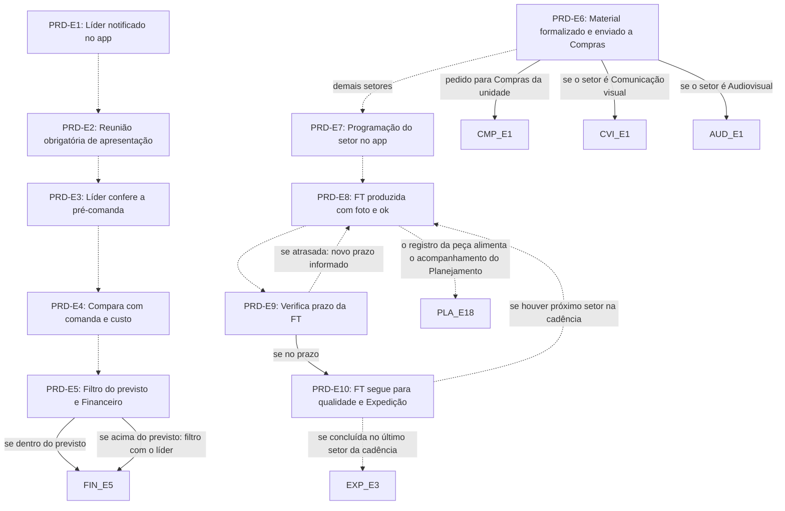

# Fluxo PRD · Setores produtivos

10 etapas em ordem de execução, com as decisões de Diego aplicadas. Montado por agentes a partir da Especificação e dos documentos de setor, e ainda não revisado por Diego nem pelo Pedro. Como ler: `ERP-CRM/FLUXOS/00_VISAO-GERAL.md`.

## 1. PRD-E1 · Líder notificado no app `vigente`

- **O que acontece:** O Portal notifica o setor da demanda que entrou: o líder recebe no app, com o código do projeto e de cada item.
- **Responsável:** Sistema
- **Perfis:** `SISTEMA`
- **Prazo:** não informado
- **Gatilho:** FT publicada pelo Planejamento (PLA-E15)
- **Próxima:** `PRD-E2` _(pela ordem do documento)_
- **Em aberto:** Em SP os setores terceirizados não usam o app; não está dito quem recebe a notificação. UNI-00932: se Almoxarifado e logística interna recebem FT ou só apoiam.
- **Itens:** `UNI-00292`, `UNI-00429`
- **Fonte:** DOC-091 §2 passagem 8; DOC-091 §5 09 Setores produtivos; PLANDEM_FLX-SET09_SETORES-PRODUTIVOS_V02 §02 Fase 1 e §07 item 5

## 2. PRD-E2 · Reunião obrigatória de apresentação `vigente`

- **O que acontece:** Reunião obrigatória em que as FT e o projeto são apresentados ao setor, registrada no Portal.
- **Responsável:** não informado
- **Prazo:** não informado
- **Gatilho:** Líder notificado (PRD-E1)
- **Próxima:** `PRD-E3` _(pela ordem do documento)_
- **Em aberto:** UNI-00930: quem apresenta as fichas e em quanto tempo a reunião acontece depois da notificação.
- **Itens:** `UNI-00292`, `UNI-00430`, `UNI-00930`, `UNI-01614`
- **Fonte:** DOC-091 §5 09 Setores produtivos; PLANDEM_FLX-SET09_SETORES-PRODUTIVOS_V02 §02 Fase 1 e §07 item 2

## 3. PRD-E3 · Líder confere a pré-comanda `ajustada`

- **O que acontece:** O líder avalia, confere e ajusta, por FT e por código de item, a pré-comanda automática. O setor não lista mais os materiais manualmente.
- **Responsável:** Líder do setor
- **Perfis:** `PERF-LIDER-SETOR`
- **Prazo:** não informado
- **Gatilho:** Reunião realizada (PRD-E2) e pré-comanda automática disponível (FIN-E3; §25: contrato assinado e previsão orçamentária aprovada)
- **Próxima:** `PRD-E4` _(pela ordem do documento)_
- **Mudou em relação ao documento:** O documento dizia que o líder solicita os materiais. Pela decisão, ele só confere e ajusta a pré-comanda, que substitui a listagem manual.
- **Decisões aplicadas:** `item-21`
- **Em aberto:** A §25 gera a pré-comanda com contrato assinado e previsão aprovada, o SET07 coloca as comandas antes das FT, e o PRD-E1 só ocorre depois do PLA-E15. Não está dito em que momento o setor confere a pré-comanda.
- **Itens:** `UNI-00292`, `UNI-00431` (não usar)
- **Fonte:** DOC-091 §5 09 Setores produtivos e §25; PLANDEM_FLX-SET09_SETORES-PRODUTIVOS_V02 §02 Fase 1; PLANDEM_FLX-SET07_PLANEJAMENTO_V07 §03

## 4. PRD-E4 · Compara com comanda e custo `ajustada`

- **O que acontece:** O Portal compara a pré-comanda conferida e ajustada pelo setor com a comanda e o custo, previsto × pedido, item a item (FIN-E5).
- **Responsável:** Sistema
- **Perfis:** `SISTEMA`
- **Prazo:** não informado
- **Gatilho:** Pré-comanda conferida e ajustada (PRD-E3)
- **Próxima:** `PRD-E5` _(pela ordem do documento)_
- **Mudou em relação ao documento:** O documento comparava a solicitação do líder; agora compara a pré-comanda ajustada.
- **Decisões aplicadas:** `item-21`
- **Itens:** `UNI-00293`, `UNI-00432`
- **Fonte:** DOC-091 §5 09 Setores produtivos e §25; PLANDEM_FLX-SET09_SETORES-PRODUTIVOS_V02 §02 Fase 2

## 5. PRD-E5 · Filtro do previsto e Financeiro `ajustada`

- **O que acontece:** Verifica se o pedido está dentro do previsto. Acima do previsto, a quantidade é ajustada com o líder (filtro) e vai para aprovação. Dentro ou acima do previsto, a comanda passa pelo Financeiro, sem tolerância.
- **Responsável:** Líder do setor (filtro); Financeiro (aprovação)
- **Perfis:** `PERF-FINANCEIRO`, `PERF-LIDER-SETOR`
- **Prazo:** não informado; a aprovação da comanda no FIN-E5 tem 1 dia
- **Gatilho:** Comparação concluída (PRD-E4)
- **Próxima:** se dentro do previsto: `FIN-E5`; se acima do previsto: filtro com o líder: `FIN-E5`
- **Mudou em relação ao documento:** No documento, o pedido dentro do previsto seguia direto. Pela decisão, toda comanda passa pelo Financeiro.
- **Decisões aplicadas:** `ponto-3`
- **Em aberto:** UNI-01111: quem aprova o que passa do previsto; Maitê e Diego é inferido.
- **Itens:** `UNI-00293`, `UNI-00566`, `UNI-00566.01`, `UNI-01111`
- **Fonte:** DOC-091 §5 05 Financeiro, §5 09 Setores produtivos, §6 e §25; PLANDEM_FLX-SET09_SETORES-PRODUTIVOS_V02 §02 Fase 2 e §07 item 3

## 6. PRD-E6 · Material formalizado e enviado a Compras `ajustada`

- **O que acontece:** Com a comanda aprovada pelo Financeiro, o material fica formalizado com a quantidade correta e o pedido vai para Compras da unidade. Nenhuma FT começa sem material formalizado.
- **Responsável:** Sistema
- **Perfis:** `SISTEMA`
- **Prazo:** não informado
- **Gatilho:** Comanda aprovada pelo Financeiro (FIN-E6)
- **Próxima:** pedido para Compras da unidade: `CMP-E1`; se o setor é Comunicação visual: `CVI-E1`; se o setor é Audiovisual: `AUD-E1`; demais setores: `PRD-E7` _(pela ordem do documento)_
- **Mudou em relação ao documento:** No documento, o material formalizado ia direto a Compras. Pela decisão, ele só segue depois da aprovação do Financeiro.
- **Decisões aplicadas:** `ponto-3`
- **Em aberto:** A Especificação lista AUD-E1 a E10 entre PRD-E6 e PRD-E7, mas abre a demanda do Audiovisual já no PLA-E6 (AUD-E0). Não está dito se AUD-E1 espera o PRD-E6.
- **Itens:** `UNI-00293`
- **Fonte:** DOC-091 §5 05 Financeiro, Compras CMP-E1, §5 09 Setores produtivos e §6; PLANDEM_FLX-SET09_SETORES-PRODUTIVOS_V02 §02 Fase 2

## 7. PRD-E7 · Programação do setor no app `vigente`

- **O que acontece:** O app mostra a programação do setor: data de chegada de cada material e data de cada FT, já definidas pelo Planejamento.
- **Responsável:** Sistema (datas definidas pelo Planejamento)
- **Perfis:** `SISTEMA`, `PERF-PLANEJAMENTO`
- **Prazo:** não informado
- **Gatilho:** Material formalizado (PRD-E6); nos setores com etapas próprias, prova validada (CVI-E7) ou Audiovisual concluído (AUD-E12)
- **Próxima:** `PRD-E8` _(pela ordem do documento)_
- **Itens:** `UNI-00295`, `UNI-00443`
- **Fonte:** DOC-091 §5 09 Setores produtivos; PLANDEM_FLX-SET09_SETORES-PRODUTIVOS_V02 §02 Fase 4

## 8. PRD-E8 · FT produzida com foto e ok `vigente`

- **O que acontece:** O setor produz a FT e registra foto e ok no app. A cada FT concluída, o dashboard de produção é atualizado. Em SP, o assistente do Rômulo faz a foto e a baixa.
- **Responsável:** Líder do setor (SP: assistente do Rômulo)
- **Perfis:** `PERF-LIDER-SETOR`
- **Prazo:** data da FT no cronograma interno
- **Gatilho:** Programação disponível e material formalizado (PRD-E7)
- **Próxima:** `PRD-E9` _(pela ordem do documento)_; o registro da peça alimenta o acompanhamento do Planejamento: `PLA-E18` _(pela ordem do documento)_
- **Em aberto:** Os documentos descrevem PRD-E8 e PLA-E18 em paralelo, sem dizer que são o mesmo registro. A etapa diz líder; a §25 diz operador do setor.
- **Itens:** `UNI-00295`, `UNI-00444`, `UNI-00444.02`
- **Fonte:** DOC-091 §5 09 Setores produtivos e §25; PLANDEM_FLX-SET09_SETORES-PRODUTIVOS_V02 §02 Fase 4 e §03

## 9. PRD-E9 · Verifica prazo da FT `vigente`

- **O que acontece:** Verifica se a FT está no prazo. Em caso de atraso, o setor informa o novo prazo no Portal, e Planejamento e Produção são notificados.
- **Responsável:** Líder do setor (novo prazo); Sistema (aviso a Eduardo, Marília e Érika)
- **Perfis:** `SISTEMA`, `PERF-LIDER-SETOR`
- **Prazo:** não informado
- **Gatilho:** FT em produção ou concluída (PRD-E8)
- **Próxima:** se no prazo: `PRD-E10`; se atrasada: novo prazo informado: `PRD-E8` _(pela ordem do documento)_
- **Em aberto:** O documento não diz para onde o fluxo volta depois do novo prazo.
- **Itens:** `UNI-00295`, `UNI-00571`
- **Fonte:** DOC-091 §5 09 Setores produtivos; PLANDEM_FLX-SET09_SETORES-PRODUTIVOS_V02 §02 Fase 4

## 10. PRD-E10 · FT segue para qualidade e Expedição `ajustada`

- **O que acontece:** A FT concluída, com foto e ok, segue para o próximo setor da cadência. Concluída no último setor, vai primeiro para o Controle de qualidade e depois para a Expedição.
- **Responsável:** Sistema
- **Perfis:** `SISTEMA`
- **Prazo:** não informado
- **Gatilho:** FT concluída no prazo ou com novo prazo informado (PRD-E9, PLA-E20)
- **Próxima:** se concluída no último setor da cadência: `EXP-E3` _(pela ordem do documento)_; se houver próximo setor na cadência: `PRD-E8` _(pela ordem do documento)_
- **Mudou em relação ao documento:** A §2 da Especificação fala só em Produção → Expedição. A decisão fixa o Controle de qualidade antes da Expedição.
- **Decisões aplicadas:** `item-22`
- **Em aberto:** Não há etapa com código próprio de Controle de qualidade: a verificação está em EXP-E1 a E3, e o SET12 será dividido. item-22: qual número fica com cada setor.
- **Itens:** `UNI-00295`, `UNI-00445`
- **Fonte:** DOC-091 §2 passagem 9; DOC-091 §5 09 Setores produtivos, §25 e §Respostas Setores; PLANDEM_FLX-SET09_SETORES-PRODUTIVOS_V02 §02 Fase 4

