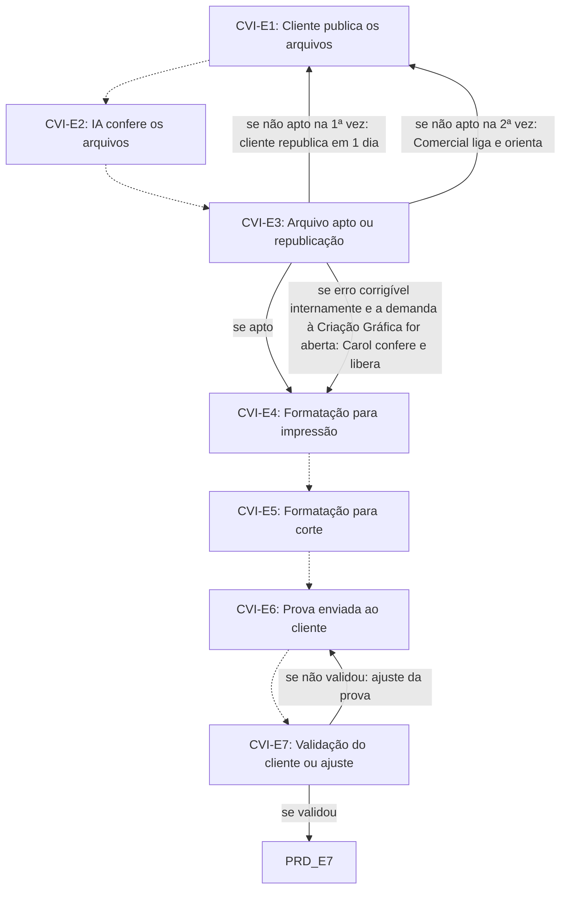

# Fluxo CVI · Comunicação visual

7 etapas em ordem de execução, com as decisões de Diego aplicadas. Montado por agentes a partir da Especificação e dos documentos de setor, e ainda não revisado por Diego nem pelo Pedro. Como ler: `ERP-CRM/FLUXOS/00_VISAO-GERAL.md`.

## 1. CVI-E1 · Cliente publica os arquivos `vigente`

- **O que acontece:** O cliente publica logos, artes e imagens na área de arquivos da aba do cliente, com o nome da letra do item indicada no manual de comunicação visual. O sistema avisa o cliente antes do prazo e se faltar alguma arte. Cada peça só avança com o ok do responsável, registrado com data, hora e usuário.
- **Responsável:** Cliente (ok da etapa: Comunicação visual da unidade; RS: Adair; SP: a definir)
- **Perfis:** `PERF-CVI`, `PERF-CLIENTE`
- **Prazo:** até 20 dias antes do início da feira
- **Gatilho:** Material do setor formalizado (PRD-E6) e aviso do sistema ao cliente
- **Próxima:** `CVI-E2` _(pela ordem do documento)_
- **Em aberto:** O limite do cliente (20 dias antes do início da feira) coincide com o limite da produção no item-11 (até 20 dias antes do evento), e as etapas CVI-E2 a E7 vêm depois. Responsável de SP a definir (UNI-00894).
- **Itens:** `UNI-00433`, `UNI-00933`, `UNI-00933.01`
- **Fonte:** DOC-091 §5 09 Setores produtivos, §Respostas Arquivos do cliente, §26 e §27; PLANDEM_FLX-SET09_SETORES-PRODUTIVOS_V02 §02 Fase 3A

## 2. CVI-E2 · IA confere os arquivos `vigente`

- **O que acontece:** A IA confere formato, resolução, cor, medidas, sangria, fontes e corte.
- **Responsável:** Agente de IA (ok da etapa: Comunicação visual da unidade; RS: Adair; SP: a definir)
- **Perfis:** `AGENTE-IA`, `PERF-CVI`
- **Prazo:** no mesmo dia da publicação (SET09 §04)
- **Gatilho:** Arquivo publicado pelo cliente (CVI-E1)
- **Próxima:** `CVI-E3` _(pela ordem do documento)_
- **Em aberto:** UNI-00934: a Comunicação visual precisa definir os critérios técnicos que a IA confere.
- **Itens:** `UNI-00434`, `UNI-00434.01`, `UNI-00934`, `UNI-01569`
- **Fonte:** DOC-091 §5 09 Setores produtivos e §26; PLANDEM_FLX-SET09_SETORES-PRODUTIVOS_V02 §02 Fase 3A e §04

## 3. CVI-E3 · Arquivo apto ou republicação `vigente`

- **O que acontece:** Arquivo não apto: o Portal avisa Comunicação visual, Comercial e Planejamento, e o cliente tem 1 dia para republicar. Na 2ª vez, o Comercial liga e orienta. Cada dia de atraso recalcula o impacto no cronograma de produção. Se o erro for corrigível internamente, o sistema sugere abrir a demanda à Criação Gráfica em vez de devolver ao cliente.
- **Responsável:** Sistema (aviso); Cliente (republica); Comercial (liga na 2ª vez)
- **Perfis:** `SISTEMA`, `PERF-VENDEDOR`, `PERF-CLIENTE`
- **Prazo:** 1 dia para republicar
- **Gatilho:** Conferência da IA concluída (CVI-E2)
- **Próxima:** se apto: `CVI-E4`; se não apto na 1ª vez: cliente republica em 1 dia: `CVI-E1`; se não apto na 2ª vez: Comercial liga e orienta: `CVI-E1`; se erro corrigível internamente e a demanda à Criação Gráfica for aberta: Carol confere e libera: `CVI-E4`
- **Em aberto:** O documento não diz o que acontece se o arquivo seguir não apto depois da ligação do Comercial.
- **Itens:** `UNI-00089`, `UNI-00567`, `UNI-00567.01`
- **Fonte:** DOC-091 §5 09 Setores produtivos, §7 e §38; PLANDEM_FLX-SET09_SETORES-PRODUTIVOS_V02 §02 Fase 3A e §04

## 4. CVI-E4 · Formatação para impressão `vigente`

- **O que acontece:** Formata os arquivos para impressão.
- **Responsável:** Comunicação visual da unidade (RS: Adair; SP: a definir)
- **Perfis:** `PERF-CVI`
- **Prazo:** não informado
- **Gatilho:** Arquivo apto (CVI-E3)
- **Próxima:** `CVI-E5` _(pela ordem do documento)_
- **Itens:** `UNI-00435`
- **Fonte:** DOC-091 §5 09 Setores produtivos e §26; PLANDEM_FLX-SET09_SETORES-PRODUTIVOS_V02 §02 Fase 3A

## 5. CVI-E5 · Formatação para corte `vigente`

- **O que acontece:** Formata os arquivos para corte.
- **Responsável:** Comunicação visual da unidade (RS: Adair; SP: a definir)
- **Perfis:** `PERF-CVI`
- **Prazo:** não informado
- **Gatilho:** Ok da formatação para impressão (CVI-E4)
- **Próxima:** `CVI-E6` _(pela ordem do documento)_
- **Itens:** `UNI-00435`
- **Fonte:** DOC-091 §5 09 Setores produtivos e §26; PLANDEM_FLX-SET09_SETORES-PRODUTIVOS_V02 §02 Fase 3A

## 6. CVI-E6 · Prova enviada ao cliente `vigente`

- **O que acontece:** Envia a prova ao cliente para validação, pela aba do cliente.
- **Responsável:** Comunicação visual da unidade (RS: Adair; SP: a definir)
- **Perfis:** `PERF-CVI`
- **Prazo:** não informado
- **Gatilho:** Ok da formatação para corte (CVI-E5) ou prova corrigida (CVI-E7)
- **Próxima:** `CVI-E7` _(pela ordem do documento)_
- **Itens:** `UNI-00436`
- **Fonte:** DOC-091 §5 09 Setores produtivos e §26; PLANDEM_FLX-SET09_SETORES-PRODUTIVOS_V02 §02 Fase 3A

## 7. CVI-E7 · Validação do cliente ou ajuste `vigente`

- **O que acontece:** O cliente valida a prova. Se não validar, a Comunicação visual corrige e reenvia.
- **Responsável:** Cliente (ok da etapa: Comunicação visual da unidade; RS: Adair; SP: a definir)
- **Perfis:** `PERF-CVI`, `PERF-CLIENTE`
- **Prazo:** não informado
- **Gatilho:** Prova recebida pelo cliente (CVI-E6)
- **Próxima:** se validou: `PRD-E7`; se não validou: ajuste da prova: `CVI-E6`
- **Itens:** `UNI-00568`
- **Fonte:** DOC-091 §5 09 Setores produtivos e §26; PLANDEM_FLX-SET09_SETORES-PRODUTIVOS_V02 §02 Fase 3A

