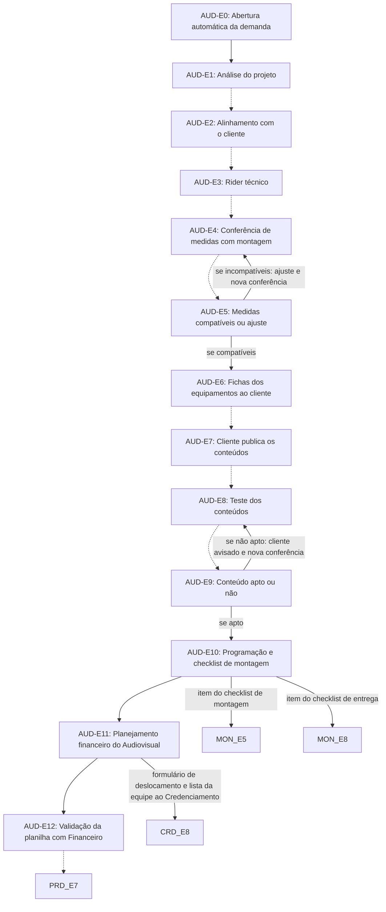

# Fluxo AUD · Audiovisual

13 etapas em ordem de execução, com as decisões de Diego aplicadas. Montado por agentes a partir da Especificação e dos documentos de setor, e ainda não revisado por Diego nem pelo Pedro. Como ler: `ERP-CRM/FLUXOS/00_VISAO-GERAL.md`.

## 1. AUD-E0 · Abertura automática da demanda `vigente`

- **O que acontece:** Quando o Planejamento identifica equipamento de audiovisual no projeto, o sistema notifica o responsável do Audiovisual e abre a demanda do setor automaticamente.
- **Responsável:** Sistema
- **Perfis:** `SISTEMA`
- **Prazo:** não informado
- **Gatilho:** Planejamento identifica equipamento de audiovisual (PLA-E6)
- **Próxima:** `AUD-E1`
- **Em aberto:** A Especificação lista AUD-E1 a E10 entre PRD-E6 e PRD-E7, e o SET09 os coloca depois da Fase 2; não está dito se a análise começa logo após a abertura ou espera o PRD-E6.
- **Itens:** `UNI-01532`
- **Fonte:** DOC-091 §5 09 Setores produtivos, linha Audiovisual etapas novas; DOC-091 §Respostas Audiovisual

## 2. AUD-E1 · Análise do projeto `vigente`

- **O que acontece:** Analisa telas, som, luz e imagem previstos no estande, depois da abertura automática da demanda.
- **Responsável:** Audiovisual (Christian)
- **Perfis:** `PERF-AUDIOVISUAL`
- **Prazo:** não informado
- **Gatilho:** Demanda aberta (AUD-E0)
- **Próxima:** `AUD-E2` _(pela ordem do documento)_
- **Itens:** `UNI-00437`, `UNI-00437.01`
- **Fonte:** DOC-091 §5 09 Setores produtivos; PLANDEM_FLX-SET09_SETORES-PRODUTIVOS_V02 §02 Fase 3B

## 3. AUD-E2 · Alinhamento com o cliente `vigente`

- **O que acontece:** Alinha com o cliente as expectativas: objetivo de uso dos equipamentos e modo de operar.
- **Responsável:** Audiovisual (Christian)
- **Perfis:** `PERF-AUDIOVISUAL`
- **Prazo:** não informado
- **Gatilho:** Projeto analisado (AUD-E1)
- **Próxima:** `AUD-E3` _(pela ordem do documento)_
- **Itens:** `UNI-00437`
- **Fonte:** DOC-091 §5 09 Setores produtivos; PLANDEM_FLX-SET09_SETORES-PRODUTIVOS_V02 §02 Fase 3B

## 4. AUD-E3 · Rider técnico `vigente`

- **O que acontece:** Pré-ajusta o rider técnico, a lista de equipamentos combinada com o cliente: equipamento, quantidade e especificação, uso, conteúdo e posição na montagem.
- **Responsável:** Audiovisual (Christian)
- **Perfis:** `PERF-AUDIOVISUAL`
- **Prazo:** não informado
- **Gatilho:** Expectativas alinhadas (AUD-E2)
- **Próxima:** `AUD-E4` _(pela ordem do documento)_
- **Em aberto:** O SET09 trata o rider como o pedido de material do setor (PRD-E3). O item-21 troca a listagem manual pela pré-comanda; não está dito se o rider continua como pedido ou se o Audiovisual também só confere.
- **Itens:** `UNI-00438`, `UNI-00669.01`
- **Fonte:** DOC-091 §5 09 Setores produtivos; PLANDEM_FLX-SET09_SETORES-PRODUTIVOS_V02 §02 Fase 3B e §05

## 5. AUD-E4 · Conferência de medidas com montagem `vigente`

- **O que acontece:** Confere as medidas com a equipe de montagem, em checklist com foto de cada item: telas, suportes, elétrica e cabos, som e luz, acesso e ventilação.
- **Responsável:** Audiovisual (Christian), com a equipe de montagem
- **Perfis:** `PERF-AUDIOVISUAL`
- **Prazo:** não informado
- **Gatilho:** Rider pré-ajustado (AUD-E3) ou ajuste de medidas (AUD-E5)
- **Próxima:** `AUD-E5` _(pela ordem do documento)_
- **Em aberto:** UNI-00937: quem da montagem confere as medidas e em que momento.
- **Itens:** `UNI-00439`, `UNI-00937`
- **Fonte:** DOC-091 §5 09 Setores produtivos; PLANDEM_FLX-SET09_SETORES-PRODUTIVOS_V02 §02 Fase 3B, §05 e §07 item 10

## 6. AUD-E5 · Medidas compatíveis ou ajuste `vigente`

- **O que acontece:** Verifica se as medidas são compatíveis. Se não, Audiovisual, setor envolvido e Planejamento corrigem a FT ou o rider, e há nova conferência.
- **Responsável:** Audiovisual, setor envolvido e Planejamento
- **Perfis:** `PERF-PLANEJAMENTO`, `PERF-AUDIOVISUAL`
- **Prazo:** não informado
- **Gatilho:** Medidas conferidas (AUD-E4)
- **Próxima:** se compatíveis: `AUD-E6`; se incompatíveis: ajuste e nova conferência: `AUD-E4`
- **Itens:** `UNI-00569`
- **Fonte:** DOC-091 §5 09 Setores produtivos; PLANDEM_FLX-SET09_SETORES-PRODUTIVOS_V02 §02 Fase 3B

## 7. AUD-E6 · Fichas dos equipamentos ao cliente `vigente`

- **O que acontece:** Envia ao cliente as fichas dos equipamentos, com resolução, proporção e formato dos conteúdos.
- **Responsável:** Audiovisual (Christian)
- **Perfis:** `PERF-AUDIOVISUAL`
- **Prazo:** não informado
- **Gatilho:** Medidas compatíveis (AUD-E5)
- **Próxima:** `AUD-E7` _(pela ordem do documento)_
- **Itens:** `UNI-00440`
- **Fonte:** DOC-091 §5 09 Setores produtivos; PLANDEM_FLX-SET09_SETORES-PRODUTIVOS_V02 §02 Fase 3B

## 8. AUD-E7 · Cliente publica os conteúdos `vigente`

- **O que acontece:** O cliente produz e publica vídeos e arquivos na aba do cliente. O sistema avisa o cliente antes do prazo.
- **Responsável:** Cliente
- **Perfis:** `PERF-CLIENTE`
- **Prazo:** até 20 dias antes do início da feira
- **Gatilho:** Fichas dos equipamentos recebidas (AUD-E6)
- **Próxima:** `AUD-E8` _(pela ordem do documento)_
- **Em aberto:** O limite do cliente (20 dias antes do início da feira) coincide com o limite da produção no item-11 (até 20 dias antes do evento), e AUD-E8 a E12 vêm depois.
- **Itens:** `UNI-00440`, `UNI-00933.01`, `UNI-00936`
- **Fonte:** DOC-091 §5 09 Setores produtivos e §Respostas Arquivos do cliente; PLANDEM_FLX-SET09_SETORES-PRODUTIVOS_V02 §02 Fase 3B

## 9. AUD-E8 · Teste dos conteúdos `vigente`

- **O que acontece:** Testa a qualidade e a resolução dos conteúdos nos equipamentos.
- **Responsável:** Audiovisual (Christian)
- **Perfis:** `PERF-AUDIOVISUAL`
- **Prazo:** não informado
- **Gatilho:** Conteúdo publicado (AUD-E7)
- **Próxima:** `AUD-E9` _(pela ordem do documento)_
- **Itens:** `UNI-00441`
- **Fonte:** DOC-091 §5 09 Setores produtivos; PLANDEM_FLX-SET09_SETORES-PRODUTIVOS_V02 §02 Fase 3B

## 10. AUD-E9 · Conteúdo apto ou não `vigente`

- **O que acontece:** Verifica se o conteúdo está apto. Se não, o Portal avisa o cliente com os problemas apontados e abre nova conferência.
- **Responsável:** Sistema (aviso ao cliente)
- **Perfis:** `SISTEMA`, `PERF-CLIENTE`
- **Prazo:** não informado
- **Gatilho:** Conteúdo testado (AUD-E8)
- **Próxima:** se apto: `AUD-E10`; se não apto: cliente avisado e nova conferência: `AUD-E8`
- **Itens:** `UNI-00570`
- **Fonte:** DOC-091 §5 09 Setores produtivos; PLANDEM_FLX-SET09_SETORES-PRODUTIVOS_V02 §02 Fase 3B

## 11. AUD-E10 · Programação e checklist de montagem `vigente`

- **O que acontece:** Organiza e programa os arquivos para os equipamentos, e eles entram como itens do checklist de montagem e entrega.
- **Responsável:** Audiovisual (Christian)
- **Perfis:** `PERF-AUDIOVISUAL`
- **Prazo:** não informado
- **Gatilho:** Conteúdo apto (AUD-E9)
- **Próxima:** `AUD-E11`; item do checklist de montagem: `MON-E5`; item do checklist de entrega: `MON-E8`
- **Em aberto:** UNI-00935: no ditado constou que a comunicação visual dá o ok nos vídeos; entendeu-se que é o Audiovisual, a confirmar.
- **Itens:** `UNI-00442`, `UNI-00935`
- **Fonte:** DOC-091 §5 09 Setores produtivos; DOC-091 §Respostas Audiovisual; PLANDEM_FLX-SET09_SETORES-PRODUTIVOS_V02 §02 Fase 3B e §07 item 8

## 12. AUD-E11 · Planejamento financeiro do Audiovisual `vigente`

- **O que acontece:** Define se usa equipamento do estoque ou se subloca, planeja a logística e o frete com a Logística da unidade e monta a planilha de custos própria do Audiovisual. Preenche o formulário de deslocamento, que notifica o Credenciamento e o Financeiro.
- **Responsável:** Audiovisual (Christian), com Logística da unidade (RS: Eduardo; SP: Samanta)
- **Perfis:** `PERF-AUDIOVISUAL`, `PERF-LOGISTICA`
- **Prazo:** não informado
- **Gatilho:** Etapas AUD-E1 a E10 concluídas
- **Próxima:** `AUD-E12`; formulário de deslocamento e lista da equipe ao Credenciamento: `CRD-E8`
- **Em aberto:** A Especificação coloca esta etapa depois de AUD-E10, mas a previsão orçamentária, que depende desta planilha, precisa da aprovação da Maitê antes de FIN-E3 e CMP-E1. O momento do formulário de deslocamento não está informado.
- **Itens:** `UNI-00005.01`, `UNI-01444`, `UNI-01533`
- **Fonte:** DOC-091 §5 09 Setores produtivos, linha Audiovisual etapas novas; DOC-091 §Respostas Audiovisual; DOC-091 §5 Custos Previsão orçamentária do projeto

## 13. AUD-E12 · Validação da planilha com Financeiro `vigente`

- **O que acontece:** Valida a planilha de custos do Audiovisual com o Financeiro.
- **Responsável:** Audiovisual (Christian), com o Financeiro
- **Perfis:** `PERF-FINANCEIRO`, `PERF-AUDIOVISUAL`
- **Prazo:** não informado
- **Gatilho:** Planilha de custos do Audiovisual montada (AUD-E11)
- **Próxima:** `PRD-E7` _(pela ordem do documento)_
- **Em aberto:** O caminho se a planilha não for validada não está informado. O SET09 liga AUD-E10 ao PRD-E7 e é anterior às etapas AUD-E11 e E12; a ligação com o PRD-E7 é só a sequência.
- **Itens:** `UNI-01534`
- **Fonte:** DOC-091 §5 09 Setores produtivos, linha Audiovisual etapas novas; DOC-091 §Respostas Audiovisual; PLANDEM_FLX-SET09_SETORES-PRODUTIVOS_V02 §02 Fase 3B

