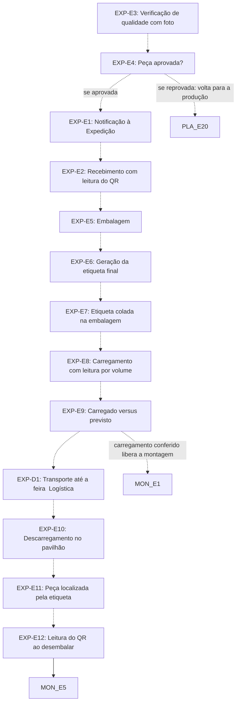

# Fluxo EXP · Expedição e qualidade

13 etapas em ordem de execução, com as decisões de Diego aplicadas. Montado por agentes a partir da Especificação e dos documentos de setor, e ainda não revisado por Diego nem pelo Pedro. Como ler: `ERP-CRM/FLUXOS/00_VISAO-GERAL.md`.

## 1. EXP-E3 · Verificação de qualidade com foto `ajustada`

- **O que acontece:** O Controle de qualidade faz a nova verificação da peça concluída: foto da peça e check de ok no sistema. A foto é a que depois vai para a etiqueta (EXP-E6).
- **Responsável:** Controle de qualidade (Suellen; em SP, assistente do Rômulo)
- **Perfis:** `PERF-QUALIDADE`
- **Prazo:** não informado
- **Gatilho:** Ficha concluída no último setor da cadência (PLA-E19/PRD-E10) vai para a qualidade e a Expedição
- **Próxima:** `EXP-E4` _(pela ordem do documento)_
- **Mudou em relação ao documento:** No SET12 esta verificação vinha depois do recebimento na Expedição (EXP-E1 e E2). Com a ordem decidida, o Controle de qualidade vem antes da Expedição.
- **Decisões aplicadas:** `item-22`
- **Em aberto:** Diego decidiu a ordem dos setores, não a divisão das etapas: confirmar se EXP-E3 e E4 ficam no Controle de qualidade ou se são uma segunda conferência dentro da Expedição. O documento não diz como o Controle de qualidade é avisado. O SET12 será dividido e o número de cada setor segue em aberto (item-22). SET12 marca como inferido que esta verificação alimenta o relatório de conformidade (PLA-E22).
- **Itens:** `UNI-00297`, `UNI-00447`
- **Fonte:** DOC-091 §5 Expedição; DOC-091 Respostas 31/10 Equipe de São Paulo; PLANDEM_FLX-SET12_EXPEDICAO_V01.md §02 Fase 2

## 2. EXP-E4 · Peça aprovada? `ajustada`

- **O que acontece:** Decisão sobre a peça. Aprovada: segue. Reprovada: volta para a produção, com alerta e registro no relatório de erros, e a produção tem 3 dias para corrigir.
- **Responsável:** Controle de qualidade (Suellen; em SP, assistente do Rômulo)
- **Perfis:** `PERF-QUALIDADE`
- **Prazo:** 3 dias para a produção corrigir a peça reprovada
- **Gatilho:** Verificação com foto e ok concluída (EXP-E3)
- **Próxima:** se aprovada: `EXP-E1` _(pela ordem do documento)_; se reprovada: volta para a produção: `PLA-E20` _(pela ordem do documento)_
- **Mudou em relação ao documento:** A peça aprovada segue para a Expedição (EXP-E1), e não direto para a embalagem como no SET12.
- **Decisões aplicadas:** `item-22`
- **Em aberto:** O documento diz que a peça volta para a produção sem citar a etapa; PLA-E20 é onde Eduardo e Marília decidem refazer. Não diz onde a peça corrigida reentra. SET12 cita o alerta a Eduardo, Marília e Érika e marca alerta e relatório de erros como inferidos. O prazo de 3 dias está nas Respostas 31/10, mas o §11 e a UNI-00938 ainda o trazem como pendente.
- **Itens:** `UNI-00572`, `UNI-00938`, `UNI-00938.01`, `UNI-01112`
- **Fonte:** DOC-091 §5 Expedição; DOC-091 Respostas 31/10 Peça reprovada; PLANDEM_FLX-SET12_EXPEDICAO_V01.md §02 Fase 2 e §05

## 3. EXP-E1 · Notificação à Expedição `ajustada`

- **O que acontece:** O sistema notifica a Expedição da peça concluída no último setor da cadência e já aprovada na qualidade.
- **Responsável:** Sistema
- **Perfis:** `SISTEMA`
- **Prazo:** não informado
- **Gatilho:** Peça aprovada no Controle de qualidade (EXP-E4)
- **Próxima:** `EXP-E2` _(pela ordem do documento)_
- **Mudou em relação ao documento:** No SET12 e na Especificação §2 a notificação vinha logo após a conclusão no último setor (PLA-E19/PRD-E10), antes da qualidade.
- **Decisões aplicadas:** `item-22`
- **Em aberto:** A Especificação §2 liga PLA-E19/PRD-E10 direto a EXP-E1; PRD-E10 diz que a ficha vai para a qualidade e a Expedição. Confirmar este gatilho junto com a divisão do SET12.
- **Itens:** `UNI-00296`, `UNI-00296.01`, `UNI-00608`
- **Fonte:** DOC-091 §2 item 9; DOC-091 §5 Expedição; PLANDEM_FLX-SET12_EXPEDICAO_V01.md §02 Fase 1

## 4. EXP-E2 · Recebimento com leitura do QR `ajustada`

- **O que acontece:** A Expedição recebe a peça e lê o QR code, conferindo código, nome e projeto. A leitura registra que a peça chegou à Expedição.
- **Responsável:** Expedição (Suellen; em SP, assistente do Rômulo)
- **Perfis:** `PERF-EXPEDICAO`
- **Prazo:** não informado
- **Gatilho:** Notificação de peça concluída e aprovada (EXP-E1)
- **Próxima:** `EXP-E5` _(pela ordem do documento)_
- **Mudou em relação ao documento:** No SET12 a etapa seguinte era a verificação de qualidade; com a qualidade antes, o recebimento segue para a embalagem.
- **Decisões aplicadas:** `item-22`
- **Itens:** `UNI-00446`
- **Fonte:** DOC-091 §5 Expedição; DOC-091 Respostas 31/10 Responsáveis; PLANDEM_FLX-SET12_EXPEDICAO_V01.md §02 Fase 1 e §04

## 5. EXP-E5 · Embalagem `vigente`

- **O que acontece:** A peça é embalada, para proteger o material até a montagem.
- **Responsável:** Expedição (Suellen; em SP, assistente do Rômulo)
- **Perfis:** `PERF-EXPEDICAO`
- **Prazo:** não informado
- **Gatilho:** Peça recebida e liberada para embalar
- **Próxima:** `EXP-E6` _(pela ordem do documento)_
- **Itens:** `UNI-00298`, `UNI-00448`
- **Fonte:** DOC-091 §5 Expedição; PLANDEM_FLX-SET12_EXPEDICAO_V01.md §02 Fase 3

## 6. EXP-E6 · Geração da etiqueta final `ajustada`

- **O que acontece:** O sistema gera a etiqueta final de expedição: código do item (abreviatura do projeto + versão + número da sessão + número do item), nome do produto, foto legível tirada na verificação de qualidade, QR code, projeto e feira, e volume 1 de N. Tamanho proposto: 10 × 15 cm. É a segunda etiqueta: a simples, com QR code, foi colada no primeiro setor da cadência.
- **Responsável:** Sistema
- **Perfis:** `SISTEMA`
- **Prazo:** não informado
- **Gatilho:** Peça embalada (EXP-E5)
- **Próxima:** `EXP-E7` _(pela ordem do documento)_
- **Mudou em relação ao documento:** O SET12 traz o código como projeto + item + subitem; vale o formato decidido no item-9.
- **Decisões aplicadas:** `item-9`
- **Em aberto:** Versão fixa ou não no código (item-9). SET12 deixa como proposta o tamanho, o tipo de impressora e o volume 1 de N.
- **Itens:** `UNI-00298`, `UNI-00449`, `UNI-00449.01`, `UNI-00671.01`
- **Fonte:** DOC-091 §5 Expedição; DOC-091 §4 Etiqueta; DOC-091 Respostas 31/10 Etiquetas; PLANDEM_FLX-SET12_EXPEDICAO_V01.md §03

## 7. EXP-E7 · Etiqueta colada na embalagem `vigente`

- **O que acontece:** A Expedição cola a etiqueta final na embalagem, para identificar a peça sem desembalar. A leitura do QR code registra a peça embalada e identificada.
- **Responsável:** Expedição (Suellen; em SP, assistente do Rômulo)
- **Perfis:** `PERF-EXPEDICAO`
- **Prazo:** não informado
- **Gatilho:** Etiqueta gerada (EXP-E6)
- **Próxima:** `EXP-E8` _(pela ordem do documento)_
- **Itens:** `UNI-00298`, `UNI-00449.02`, `UNI-00450`
- **Fonte:** DOC-091 §5 Expedição; DOC-091 Respostas 31/10 Etiquetas; PLANDEM_FLX-SET12_EXPEDICAO_V01.md §02 Fase 3 e §04

## 8. EXP-E8 · Carregamento com leitura por volume `vigente`

- **O que acontece:** Cada volume é carregado com leitura do QR code, para controlar o que sobe no caminhão. Os carregamentos previstos também alimentam o alerta de conflito com as descargas de material e a planilha de conciliação diária.
- **Responsável:** Expedição (Suellen; em SP, assistente do Rômulo)
- **Perfis:** `PERF-EXPEDICAO`
- **Prazo:** D0 (data de carregamento do cronograma)
- **Gatilho:** Volumes etiquetados e data de carregamento
- **Próxima:** `EXP-E9` _(pela ordem do documento)_
- **Itens:** `UNI-00299`, `UNI-00451`
- **Fonte:** DOC-091 §5 Expedição; DOC-091 §5 alerta de conflito e conciliação diária; PLANDEM_FLX-SET12_EXPEDICAO_V01.md §02 Fase 4; PLANDEM_FLX-SET07_PLANEJAMENTO_V07.md Carregamento D0

## 9. EXP-E9 · Carregado versus previsto `ajustada`

- **O que acontece:** O sistema confere carregado × previsto pela lista de itens do projeto. Se faltar item, alerta a produção da unidade do projeto sobre quais itens não foram conferidos (RS: Eduardo e Marília; SP: Rômulo e Samanta). Não bloqueia a saída do caminhão.
- **Responsável:** Sistema
- **Perfis:** `SISTEMA`
- **Prazo:** não informado
- **Gatilho:** Volumes carregados com leitura (EXP-E8)
- **Próxima:** `EXP-D1` _(pela ordem do documento)_; carregamento conferido libera a montagem: `MON-E1` _(pela ordem do documento)_
- **Mudou em relação ao documento:** A Logística passa a vir entre a Expedição e a Montagem (EXP-D1); no SET12 e na Especificação §2 a Expedição passa direto à Montagem.
- **Decisões aplicadas:** `item-22`
- **Em aberto:** As Respostas 31/10 e o §5 dizem que não bloqueia, mas o §11 e a UNI-01539 ainda trazem o bloqueio como pendência, e o checklist do SET12 pede todos os itens carregados, sem faltas. Não diz se os itens entregues pelo fornecedor na feira (Especificação §31) saem do previsto. A Especificação libera a Montagem no carregamento, mas o item-22 põe a Logística antes dela (DUV-028).
- **Itens:** `UNI-00299.01`, `UNI-00452`, `UNI-00452.01`, `UNI-00838`
- **Fonte:** DOC-091 §5 Expedição; DOC-091 Respostas 31/10 Carregamento; DOC-091 §2 item 10; PLANDEM_FLX-SET12_EXPEDICAO_V01.md §02 Fase 4

## 10. EXP-D1 · Transporte até a feira (Logística) `nova-por-decisao`

- **O que acontece:** Depois da Expedição vem a Logística, com o frete e o transporte até a feira. A Especificação só traz o formulário padrão de solicitação de frete no app, que gera ordem de compra para o Financeiro (FIN-E7); o fluxo do setor não foi mapeado.
- **Responsável:** Logística (RS: Eduardo; SP: Samanta)
- **Perfis:** `PERF-LOGISTICA`
- **Prazo:** não informado
- **Gatilho:** Carregamento conferido (EXP-E9)
- **Próxima:** `EXP-E10` _(pela ordem do documento)_
- **Mudou em relação ao documento:** Etapa criada só para marcar a posição da Logística decidida no item-22; não tem código na Especificação nem no SET12.
- **Decisões aplicadas:** `item-22`
- **Em aberto:** Fluxo do setor 11 a mapear (§11). Não diz em que momento o formulário de frete é preenchido. Se Logística é setor próprio (UNI-00939): as Respostas 31/10 dizem 11 = Logística, e o número de cada setor segue em aberto (item-22).
- **Fonte:** Decisão item-22; DOC-091 Respostas 31/10 Logística no Rio Grande do Sul (Setor 11); DOC-091 Respostas 31/10 Equipe de São Paulo

## 11. EXP-E10 · Descarregamento no pavilhão `vigente`

- **O que acontece:** Os volumes são descarregados no pavilhão e ficam organizados e ainda embalados.
- **Responsável:** Montagem
- **Prazo:** não informado
- **Gatilho:** Transporte chega ao pavilhão (EXP-D1)
- **Próxima:** `EXP-E11` _(pela ordem do documento)_
- **Em aberto:** A leitura do QR code no descarregamento é proposta do SET12. O SET13 diz que a equipe só entra no pavilhão depois das credenciais (MON-E2), mas nenhum documento ordena EXP-E10 em relação a MON-E2 e MON-E3.
- **Itens:** `UNI-00300`, `UNI-00453`
- **Fonte:** DOC-091 §5 Expedição; PLANDEM_FLX-SET12_EXPEDICAO_V01.md §02 Fase 5, §04 e §06

## 12. EXP-E11 · Peça localizada pela etiqueta `vigente`

- **O que acontece:** O montador localiza a peça pela foto da etiqueta e desembala só quando vai usar.
- **Responsável:** Montador
- **Prazo:** não informado
- **Gatilho:** Peça necessária para a montagem; mesmo momento de MON-E4
- **Próxima:** `EXP-E12` _(pela ordem do documento)_
- **Itens:** `UNI-00300`, `UNI-00454`
- **Fonte:** DOC-091 §5 Expedição; PLANDEM_FLX-SET12_EXPEDICAO_V01.md §02 Fase 5; PLANDEM_FLX-SET13_MONTAGEM_V03.md MON-E4

## 13. EXP-E12 · Leitura do QR ao desembalar `vigente`

- **O que acontece:** O montador lê o QR code ao desembalar, registrando data e hora. A instalação não é lida aqui: é registrada no checklist (MON-E5).
- **Responsável:** Montador
- **Prazo:** não informado
- **Gatilho:** Peça localizada e aberta (EXP-E11); mesmo momento de MON-E4
- **Próxima:** `MON-E5`
- **Em aberto:** O SET12 V01 registrava também a peça instalada nesta leitura; o §11 da Especificação manda valer a Montagem V03, embora a UNI-00941 ainda liste o ajuste. Em SP os montadores são terceirizados, sem acesso ao app, e o documento não diz quem faz esta leitura no pavilhão.
- **Itens:** `UNI-00300`, `UNI-00454`
- **Fonte:** DOC-091 §5 Expedição; DOC-091 §11; PLANDEM_FLX-SET13_MONTAGEM_V03.md §08; DOC-091 Respostas 31/10 Equipe de São Paulo

