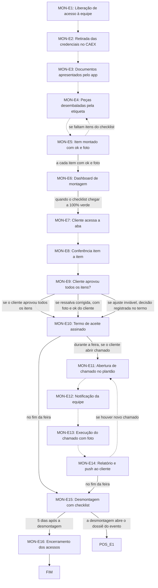

# Fluxo MON · Montagem

16 etapas em ordem de execução, com as decisões de Diego aplicadas. Montado por agentes a partir da Especificação e dos documentos de setor, e ainda não revisado por Diego nem pelo Pedro. Como ler: `ERP-CRM/FLUXOS/00_VISAO-GERAL.md`.

## 1. MON-E1 · Liberação de acesso à equipe `vigente`

- **O que acontece:** O Planejamento libera o acesso da equipe de montagem no app, por categoria, só para a equipe nomeada e escalada para esta feira.
- **Responsável:** Planejamento (Érika)
- **Perfis:** `PERF-PLANEJAMENTO`
- **Prazo:** não informado
- **Gatilho:** Carregamento conferido (EXP-E9)
- **Próxima:** `MON-E2` _(pela ordem do documento)_
- **Em aberto:** O SET13 diz que a Érika nomeia e escala a equipe; as Respostas 31/10 dizem que Eduardo (RS) e Samanta (SP) selecionam e escalam as equipes terceirizadas. Em SP o Planejamento é a Samanta, e não está dito se ela libera o acesso. Com a Logística entre Expedição e Montagem (item-22), confirmar se a liberação continua no carregamento.
- **Itens:** `UNI-00301`, `UNI-00301.01`, `UNI-00455`
- **Fonte:** DOC-091 §2 item 10; DOC-091 §5 Montagem; PLANDEM_FLX-SET13_MONTAGEM_V03.md §02 Fase 1

## 2. MON-E2 · Retirada das credenciais no CAEX `vigente`

- **O que acontece:** O primeiro a chegar retira as credenciais no CAEX. A equipe só entra no pavilhão depois disso.
- **Responsável:** Encarregado, produtor ou coordenador de montagem
- **Perfis:** `PERF-MONT-ENCARREGADO`, `PERF-MONT-PRODUTOR`, `PERF-MONT-COORDENADOR`
- **Prazo:** não informado
- **Gatilho:** Equipe com acesso liberado chega ao evento
- **Próxima:** `MON-E3` _(pela ordem do documento)_
- **Itens:** `UNI-00302`, `UNI-00456`
- **Fonte:** DOC-091 §5 Montagem; PLANDEM_FLX-SET13_MONTAGEM_V03.md §02 Fase 2 e §03

## 3. MON-E3 · Documentos apresentados pelo app `vigente`

- **O que acontece:** Apresenta pelo app os documentos e o projeto aprovado pela feira, com a pasta completa do Credenciamento no celular.
- **Responsável:** Encarregado, produtor ou coordenador de montagem
- **Perfis:** `PERF-MONT-ENCARREGADO`, `PERF-MONT-PRODUTOR`, `PERF-MONT-COORDENADOR`
- **Prazo:** não informado
- **Gatilho:** Credenciais retiradas; quando a feira pedir
- **Próxima:** `MON-E4` _(pela ordem do documento)_
- **Itens:** `UNI-00457`
- **Fonte:** DOC-091 §5 Montagem; PLANDEM_FLX-SET13_MONTAGEM_V03.md §02 Fase 2 e §07

## 4. MON-E4 · Peças desembaladas pela etiqueta `vigente`

- **O que acontece:** Localiza as peças pela etiqueta e desembala só na hora do uso, lendo o QR code ao desembalar. Corresponde a EXP-E11 e EXP-E12.
- **Responsável:** Responsável pela montagem
- **Perfis:** `PERF-MONT-RESPONSAVEL`
- **Prazo:** não informado
- **Gatilho:** Equipe no pavilhão, volumes descarregados (EXP-E10)
- **Próxima:** `MON-E5` _(pela ordem do documento)_
- **Itens:** `UNI-00303`
- **Fonte:** DOC-091 §5 Montagem; PLANDEM_FLX-SET13_MONTAGEM_V03.md §02 Fase 3 e §07

## 5. MON-E5 · Item montado com ok e foto `vigente`

- **O que acontece:** Cada item montado recebe ok clicável e foto no checklist do app; um não vale sem o outro. Os itens são os do memorial, com os mesmos códigos. A instalação é registrada aqui.
- **Responsável:** Responsável pela montagem; em SP e no audiovisual, produtor de montagem
- **Perfis:** `PERF-MONT-PRODUTOR`, `PERF-MONT-RESPONSAVEL`
- **Prazo:** não informado
- **Gatilho:** Item montado
- **Próxima:** a cada item com ok e foto: `MON-E6`; se faltam itens do checklist: `MON-E4` _(pela ordem do documento)_
- **Em aberto:** Em SP o produtor de montagem ainda será contratado.
- **Itens:** `UNI-00166`, `UNI-00303`, `UNI-00458`, `UNI-00458.01`, `UNI-01432`
- **Fonte:** DOC-091 §5 Montagem; DOC-091 Respostas 31/10 Equipe de São Paulo e Audiovisual; PLANDEM_FLX-SET13_MONTAGEM_V03.md §02 Fase 3

## 6. MON-E7 · Cliente acessa a aba `vigente`

- **O que acontece:** O cliente entra na aba do cliente com login e senha e vê as imagens do stand e o checklist do memorial. O login é o que ele recebeu do vendedor; se a pessoa do cliente mudar durante a feira, o Portal cria outro login só para a montagem e a feira.
- **Responsável:** Cliente
- **Perfis:** `PERF-CLIENTE`
- **Prazo:** dia do cliente
- **Gatilho:** Checklist de montagem 100% verde (MON-E6)
- **Próxima:** `MON-E8` _(pela ordem do documento)_
- **Itens:** `UNI-00304`, `UNI-00459`
- **Fonte:** DOC-091 §5 Montagem; PLANDEM_FLX-SET13_MONTAGEM_V03.md §02 Fase 4 e §05

## 7. MON-E8 · Conferência item a item `vigente`

- **O que acontece:** Cliente e produtor de montagem conferem o stand item a item, com foto e ok em cada item.
- **Responsável:** Produtor de montagem e cliente
- **Perfis:** `PERF-CLIENTE`, `PERF-MONT-PRODUTOR`
- **Prazo:** dia do cliente
- **Gatilho:** Cliente com acesso à aba do cliente (MON-E7)
- **Próxima:** `MON-E9` _(pela ordem do documento)_
- **Itens:** `UNI-00304`, `UNI-00460`
- **Fonte:** DOC-091 §5 Montagem; PLANDEM_FLX-SET13_MONTAGEM_V03.md §02 Fase 4 e §05

## 8. MON-E9 · Cliente aprovou todos os itens? `vigente`

- **O que acontece:** Decisão sobre a entrega. Com ressalva, ela é registrada e corrigida até o dia do cliente, com foto e ok do cliente. Se o ajuste for inviável, o produtor de montagem e o comercial decidem na hora e registram no termo, com o ok do cliente.
- **Responsável:** Produtor de montagem, comercial e cliente
- **Perfis:** `PERF-VENDEDOR`, `PERF-CLIENTE`, `PERF-MONT-PRODUTOR`
- **Prazo:** até o dia do cliente
- **Gatilho:** Conferência item a item concluída (MON-E8)
- **Próxima:** se o cliente aprovou todos os itens: `MON-E10`; se ressalva corrigida, com foto e ok do cliente: `MON-E10`; se ajuste inviável, decisão registrada no termo: `MON-E10`
- **Itens:** `UNI-00092`, `UNI-00304`, `UNI-00573`
- **Fonte:** DOC-091 §5 Montagem; PLANDEM_FLX-SET13_MONTAGEM_V03.md §02 Fase 4 e §05

## 9. MON-E10 · Termo de aceite assinado `vigente`

- **O que acontece:** O app gera o termo de entrega do estande em PDF: dados do projeto, cliente e feira; itens do memorial com ok e foto; ressalvas; itens de cortesia retirados pelo cliente; data, hora e local. O validador indicado no formulário pré-evento assina eletronicamente no app, e o produtor de montagem assina pela Imagine. O termo fica no histórico do projeto e vai por e-mail ao cliente, ao Jurídico (Maitê), ao Financeiro e ao Comercial.
- **Responsável:** Sistema gera; validador do cliente e produtor de montagem assinam
- **Perfis:** `SISTEMA`, `PERF-CLIENTE`, `PERF-MONT-PRODUTOR`
- **Prazo:** dia do cliente
- **Gatilho:** Itens aprovados ou ressalvas resolvidas (MON-E9)
- **Próxima:** durante a feira, se o cliente abrir chamado: `MON-E11`; no fim da feira: `MON-E15`
- **Em aberto:** O SET13 gera o termo quando todos os itens têm ok, assinado pelo cliente; a Especificação §12 gera ao fim da montagem, assinado pelo validador. Seguida a Especificação; a ordem das etapas mantém o termo depois da conferência. Plataforma de assinatura não definida (UNI-01445) e validade jurídica a validar com a Maitê (UNI-01463).
- **Itens:** `UNI-00043.01`, `UNI-00043.02`, `UNI-00304`, `UNI-00461`, `UNI-00461.01`, `UNI-00461.02`, `UNI-00674.01`, `UNI-01463`
- **Fonte:** DOC-091 §5 Montagem; DOC-091 §12 Termo de entrega oficial; PLANDEM_FLX-SET13_MONTAGEM_V03.md §05

## 10. MON-E11 · Abertura de chamado no plantão `vigente`

- **O que acontece:** O cliente abre um chamado na aba Plantão técnico, no lugar do WhatsApp, com estande, pedido, foto opcional, data e horário.
- **Responsável:** Cliente
- **Perfis:** `PERF-CLIENTE`
- **Prazo:** não informado
- **Gatilho:** Sob demanda, durante a feira: o cliente precisa de manutenção
- **Próxima:** `MON-E12` _(pela ordem do documento)_
- **Itens:** `UNI-00305`, `UNI-00462`, `UNI-00675.01`
- **Fonte:** DOC-091 §5 Montagem; PLANDEM_FLX-SET13_MONTAGEM_V03.md §02 Fase 5 e §06

## 11. MON-E12 · Notificação da equipe `vigente`

- **O que acontece:** O sistema notifica plantonista, comercial, coordenador de montagem e coordenador de produção da empresa.
- **Responsável:** Sistema
- **Perfis:** `SISTEMA`
- **Prazo:** não informado
- **Gatilho:** Chamado aberto (MON-E11)
- **Próxima:** `MON-E13` _(pela ordem do documento)_
- **Itens:** `UNI-00305`, `UNI-00610`, `UNI-00675.01`
- **Fonte:** DOC-091 §5 Montagem; PLANDEM_FLX-SET13_MONTAGEM_V03.md §02 Fase 5 e §06

## 12. MON-E13 · Execução do chamado com foto `vigente`

- **O que acontece:** O chamado é executado no estande em cerca de 10 minutos, com foto e conclusão no app.
- **Responsável:** Plantonista da feira; no app, em SP e nos chamados de audiovisual, produtor de montagem
- **Perfis:** `PERF-MONT-PRODUTOR`, `PERF-MONT-PLANTONISTA`
- **Prazo:** cerca de 10 minutos
- **Gatilho:** Equipe notificada (MON-E12)
- **Próxima:** `MON-E14` _(pela ordem do documento)_
- **Em aberto:** Em SP o plantonista é terceirizado, sem acesso ao app, e o produtor de montagem ainda será contratado.
- **Itens:** `UNI-00091`, `UNI-00305`, `UNI-00463`, `UNI-00463.01`, `UNI-00675.01`
- **Fonte:** DOC-091 §5 Montagem; DOC-091 §7; DOC-091 Respostas 31/10 Equipe de São Paulo e Audiovisual; PLANDEM_FLX-SET13_MONTAGEM_V03.md §06

## 13. MON-E14 · Relatório e push ao cliente `vigente`

- **O que acontece:** O sistema atualiza o relatório de atendimento (data, horário, item executado e foto) e envia um push ao cliente com o que foi feito.
- **Responsável:** Sistema
- **Perfis:** `SISTEMA`
- **Prazo:** não informado
- **Gatilho:** Chamado concluído com foto (MON-E13)
- **Próxima:** se houver novo chamado: `MON-E11` _(pela ordem do documento)_; no fim da feira: `MON-E15`
- **Itens:** `UNI-00305`, `UNI-00611`, `UNI-00675.01`
- **Fonte:** DOC-091 §5 Montagem; PLANDEM_FLX-SET13_MONTAGEM_V03.md §02 Fase 5 e §05 Calendário

## 14. MON-E15 · Desmontagem com checklist `vigente`

- **O que acontece:** Desmontagem com o mesmo checklist, ok clicável e foto, separando as peças que voltam e as descartadas conforme a lista do planejamento de produção. A aba do cliente fecha no fim da feira.
- **Responsável:** Equipe de montagem
- **Prazo:** não informado
- **Gatilho:** Fim da feira
- **Próxima:** a desmontagem abre o dossiê do evento: `POS-E1`; 5 dias após a desmontagem: `MON-E16`
- **Em aberto:** A lista de peças que voltam e descartadas ainda precisa entrar no SET07 (UNI-00940). A Especificação §2 diz que MON-E15 abre o dossiê, sem dizer se no início ou no fim da desmontagem.
- **Itens:** `UNI-00306`, `UNI-00464`, `UNI-01432`
- **Fonte:** DOC-091 §2 item 11; DOC-091 §5 Montagem; PLANDEM_FLX-SET13_MONTAGEM_V03.md §02 Fase 6 e §08

## 15. MON-E16 · Encerramento dos acessos `vigente`

- **O que acontece:** Os acessos da equipe de montagem são encerrados: o Planejamento retira, ou o sistema retira 5 dias após a desmontagem.
- **Responsável:** Sistema (ou Planejamento)
- **Perfis:** `SISTEMA`, `PERF-PLANEJAMENTO`
- **Prazo:** 5 dias após a desmontagem
- **Gatilho:** Desmontagem concluída (MON-E15)
- **Próxima:** `FIM`
- **Itens:** `UNI-00026.01`, `UNI-00090`, `UNI-00465`
- **Fonte:** DOC-091 §5 Montagem; DOC-091 §7; PLANDEM_FLX-SET13_MONTAGEM_V03.md §02 Fase 6

## 16. MON-E6 · Dashboard de montagem `vigente`

- **O que acontece:** O sistema notifica Planejamento e Produção e atualiza o dashboard: a pizza vermelha fica verde a cada item ok.
- **Responsável:** Sistema
- **Perfis:** `SISTEMA`
- **Prazo:** não informado
- **Gatilho:** Contínua durante a montagem: atualiza a cada item com ok (MON-E5)
- **Próxima:** quando o checklist chegar a 100% verde: `MON-E7`
- **Itens:** `UNI-00303`, `UNI-00609`, `UNI-01457`
- **Fonte:** DOC-091 §5 Montagem; DOC-091 §10; PLANDEM_FLX-SET13_MONTAGEM_V03.md §02 Fase 3 e §07

