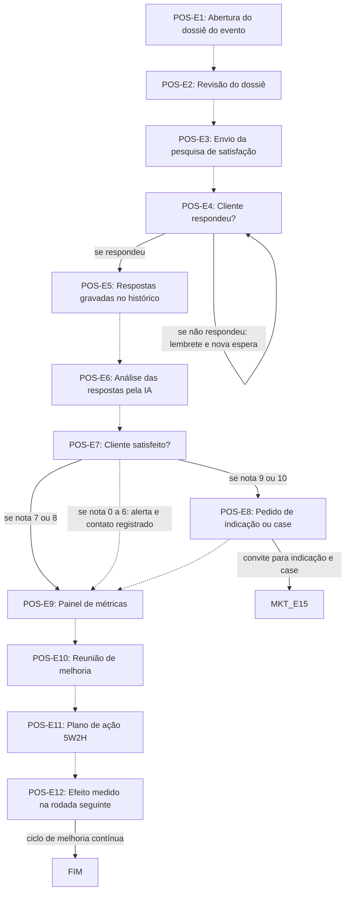

# Fluxo POS · Pós-feira

12 etapas em ordem de execução, com as decisões de Diego aplicadas. Montado por agentes a partir da Especificação e dos documentos de setor, e ainda não revisado por Diego nem pelo Pedro. Como ler: `ERP-CRM/FLUXOS/00_VISAO-GERAL.md`.

## 1. POS-E1 · Abertura do dossiê do evento `vigente`

- **O que acontece:** O sistema abre a aba Pós-feira com o dossiê do evento: termo de aceite e ressalvas, relatório do plantão técnico, relatório de conformidade, relatórios de produção e erros e observações do cliente.
- **Responsável:** Sistema
- **Perfis:** `SISTEMA`
- **Prazo:** não informado
- **Gatilho:** Desmontagem (MON-E15)
- **Próxima:** `POS-E2` _(pela ordem do documento)_
- **Em aberto:** O SET15 manda fotos selecionadas para o dossiê (MKT-E9), mas o SET14 não as lista. Qual número fica com o setor segue em aberto (item-22, UNI-01113).
- **Itens:** `UNI-00307`, `UNI-00307.01`, `UNI-00466`
- **Fonte:** DOC-091 §2 item 11; DOC-091 §5 Pós-feira; PLANDEM_FLX-SET14_POS_FEIRA_V01.md §02 Fase 1 e §03

## 2. POS-E2 · Revisão do dossiê `vigente`

- **O que acontece:** O responsável do pós-feira revisa o dossiê: o que foi bem e o que teve ressalva ou retrabalho.
- **Responsável:** Responsável do Pós-feira (não informado)
- **Perfis:** `PERF-POS-FEIRA`
- **Prazo:** não informado
- **Gatilho:** Dossiê aberto (POS-E1)
- **Próxima:** `POS-E3` _(pela ordem do documento)_
- **Decisões aplicadas:** `item-18`
- **Em aberto:** Responsável pelo Pós-feira: assistente comercial, vendedor do cliente ou outra pessoa (item-18, UNI-00893).
- **Itens:** `UNI-00467`
- **Fonte:** DOC-091 §5 Pós-feira; DOC-091 Respostas 31/10 Responsáveis; PLANDEM_FLX-SET14_POS_FEIRA_V01.md §02 Fase 1 e §07

## 3. POS-E3 · Envio da pesquisa de satisfação `vigente`

- **O que acontece:** O sistema envia a pesquisa de satisfação rápida por link sem login, por e-mail e WhatsApp, com oito perguntas e cerca de 3 minutos para responder.
- **Responsável:** Sistema
- **Perfis:** `SISTEMA`
- **Prazo:** sugestão do SET14, a validar: 2 dias após o fim da feira
- **Gatilho:** Dossiê revisado (POS-E2)
- **Próxima:** `POS-E4` _(pela ordem do documento)_
- **Em aberto:** Link sem login porque a aba do cliente fecha no fim da feira: a confirmar (UNI-00942). A Especificação §12 prevê relatório final e convite no Portal depois da feira; confirmar como isso convive com a aba fechada.
- **Itens:** `UNI-00308`, `UNI-00468`, `UNI-00676.01`, `UNI-00839`, `UNI-00942`
- **Fonte:** DOC-091 §5 Pós-feira; PLANDEM_FLX-SET14_POS_FEIRA_V01.md §02 Fase 2, §04 e §07

## 4. POS-E4 · Cliente respondeu? `vigente`

- **O que acontece:** Decisão sobre a resposta. Sem resposta, o sistema reenvia a pesquisa, e o assistente comercial ou o vendedor pede a resposta.
- **Responsável:** Sistema; assistente comercial ou vendedor
- **Perfis:** `SISTEMA`, `PERF-ASSISTENTE-COMERCIAL`, `PERF-VENDEDOR`
- **Prazo:** sugestão do SET14, a validar: lembrete no 5º dia e coleta encerrada no 10º dia
- **Gatilho:** Pesquisa enviada (POS-E3)
- **Próxima:** se respondeu: `POS-E5`; se não respondeu: lembrete e nova espera: `POS-E4`
- **Em aberto:** Não diz o que acontece com quem não responde até o fim da coleta, nem quando pede o assistente e quando pede o vendedor.
- **Itens:** `UNI-00308`, `UNI-00574`
- **Fonte:** DOC-091 §5 Pós-feira; PLANDEM_FLX-SET14_POS_FEIRA_V01.md §02 Fase 2, §05 e §07

## 5. POS-E5 · Respostas gravadas no histórico `vigente`

- **O que acontece:** As respostas ficam gravadas no histórico do cliente no Portal, visíveis para o vendedor na próxima venda.
- **Responsável:** Sistema
- **Perfis:** `SISTEMA`
- **Prazo:** não informado
- **Gatilho:** Cliente respondeu (POS-E4)
- **Próxima:** `POS-E6` _(pela ordem do documento)_
- **Itens:** `UNI-00308`, `UNI-00469`
- **Fonte:** DOC-091 §5 Pós-feira; PLANDEM_FLX-SET14_POS_FEIRA_V01.md §02 Fase 2

## 6. POS-E6 · Análise das respostas pela IA `vigente`

- **O que acontece:** A IA analisa as respostas: notas por etapa, temas, palavras-chave e sentimento dos comentários.
- **Responsável:** Agente de IA
- **Perfis:** `AGENTE-IA`
- **Prazo:** não informado
- **Gatilho:** Respostas gravadas (POS-E5)
- **Próxima:** `POS-E7` _(pela ordem do documento)_
- **Itens:** `UNI-00309`, `UNI-00470`
- **Fonte:** DOC-091 §5 Pós-feira; PLANDEM_FLX-SET14_POS_FEIRA_V01.md §02 Fase 3

## 7. POS-E7 · Cliente satisfeito? `vigente`

- **O que acontece:** Decisão pela nota de recomendação. Detrator (0 a 6): Diego e o vendedor são avisados e há contato com o cliente em até 48 horas, registrado no Portal.
- **Responsável:** Vendedor e diretoria comercial (Diego)
- **Perfis:** `PERF-DIRETORIA-COMERCIAL`, `PERF-VENDEDOR`
- **Prazo:** 48 horas
- **Gatilho:** Respostas analisadas (POS-E6)
- **Próxima:** se nota 9 ou 10: `POS-E8`; se nota 7 ou 8: `POS-E9`; se nota 0 a 6: alerta e contato registrado: `POS-E9` _(pela ordem do documento)_
- **Em aberto:** Quem liga ao detrator (UNI-00943; sugestão do SET14: o vendedor, com o Diego avisado). Depois do contato com o detrator, o documento não diz o caminho; o painel é leitura da sequência.
- **Itens:** `UNI-00093`, `UNI-00093.01`, `UNI-00309`, `UNI-00575`, `UNI-00943`
- **Fonte:** DOC-091 §5 Pós-feira; DOC-091 §7; PLANDEM_FLX-SET14_POS_FEIRA_V01.md §02 Fase 3 e §07

## 8. POS-E8 · Pedido de indicação ou case `vigente`

- **O que acontece:** Cliente promotor (nota 9 ou 10): o vendedor pede indicação ou autorização de case. Depoimento só com autorização por escrito.
- **Responsável:** Vendedor
- **Perfis:** `PERF-VENDEDOR`
- **Prazo:** não informado
- **Gatilho:** Nota 9 ou 10 (POS-E7)
- **Próxima:** convite para indicação e case: `MKT-E15`; `POS-E9` _(pela ordem do documento)_
- **Itens:** `UNI-00309`, `UNI-00471`, `UNI-00859.01`
- **Fonte:** DOC-091 §2 item 12; DOC-091 §5 Pós-feira; PLANDEM_FLX-SET14_POS_FEIRA_V01.md §02 Fase 3

## 9. POS-E10 · Reunião de melhoria `vigente`

- **O que acontece:** A IA sugere os 3 pontos mais citados, e a diretoria escolhe as prioridades.
- **Responsável:** Diretoria
- **Perfis:** `PERF-DIRETORIA-COMERCIAL`, `PERF-DIRETORIA-FINANCEIRA`
- **Prazo:** não informado
- **Gatilho:** Painel atualizado (POS-E9)
- **Próxima:** `POS-E11` _(pela ordem do documento)_
- **Em aberto:** Periodicidade não definida; sugestão do SET14: mensal nos 6 primeiros meses, depois trimestral.
- **Itens:** `UNI-00310`, `UNI-00473`, `UNI-00840`
- **Fonte:** DOC-091 §5 Pós-feira; PLANDEM_FLX-SET14_POS_FEIRA_V01.md §02 Fase 4 e §07

## 10. POS-E11 · Plano de ação 5W2H `vigente`

- **O que acontece:** O plano de ação é lançado no Portal em 5W2H, com responsável, prazo e indicador em cada ação.
- **Responsável:** Diretoria e responsáveis das ações
- **Perfis:** `PERF-DIRETORIA-COMERCIAL`, `PERF-DIRETORIA-FINANCEIRA`
- **Prazo:** não informado
- **Gatilho:** Prioridades escolhidas (POS-E10)
- **Próxima:** `POS-E12` _(pela ordem do documento)_
- **Itens:** `UNI-00310`, `UNI-00474`
- **Fonte:** DOC-091 §5 Pós-feira; PLANDEM_FLX-SET14_POS_FEIRA_V01.md §02 Fase 4 e §05

## 11. POS-E12 · Efeito medido na rodada seguinte `vigente`

- **O que acontece:** O efeito das ações é medido na próxima rodada de pesquisas: a nota da etapa subiu? a ação funcionou?
- **Responsável:** Diretoria e responsáveis das ações
- **Perfis:** `PERF-DIRETORIA-COMERCIAL`, `PERF-DIRETORIA-FINANCEIRA`
- **Prazo:** não informado
- **Gatilho:** Próxima rodada de pesquisas
- **Próxima:** ciclo de melhoria contínua: `FIM`
- **Itens:** `UNI-00310`, `UNI-00474`
- **Fonte:** DOC-091 §5 Pós-feira; PLANDEM_FLX-SET14_POS_FEIRA_V01.md §02 Fase 4 e §06

## 12. POS-E9 · Painel de métricas `vigente`

- **O que acontece:** O gerenciador de pesquisas atualiza o painel: NPS, CSAT por etapa, CES, recompra, taxa de resposta, tempo de retorno ao detrator e temas recorrentes, por etapa, setor, vendedor e feira, com tendência mês a mês.
- **Responsável:** Agente de IA (gerenciador de pesquisas)
- **Perfis:** `AGENTE-IA`
- **Prazo:** não informado
- **Gatilho:** Contínua: atualizado com as respostas das pesquisas
- **Próxima:** `POS-E10` _(pela ordem do documento)_
- **Em aberto:** Metas de NPS e de satisfação por etapa não definidas; sugestão do SET14: medir 3 meses antes de fixar.
- **Itens:** `UNI-00019.01`, `UNI-00310`, `UNI-00472`
- **Fonte:** DOC-091 §5 Pós-feira; DOC-091 §10; PLANDEM_FLX-SET14_POS_FEIRA_V01.md §02 Fase 4, §05 e §07

