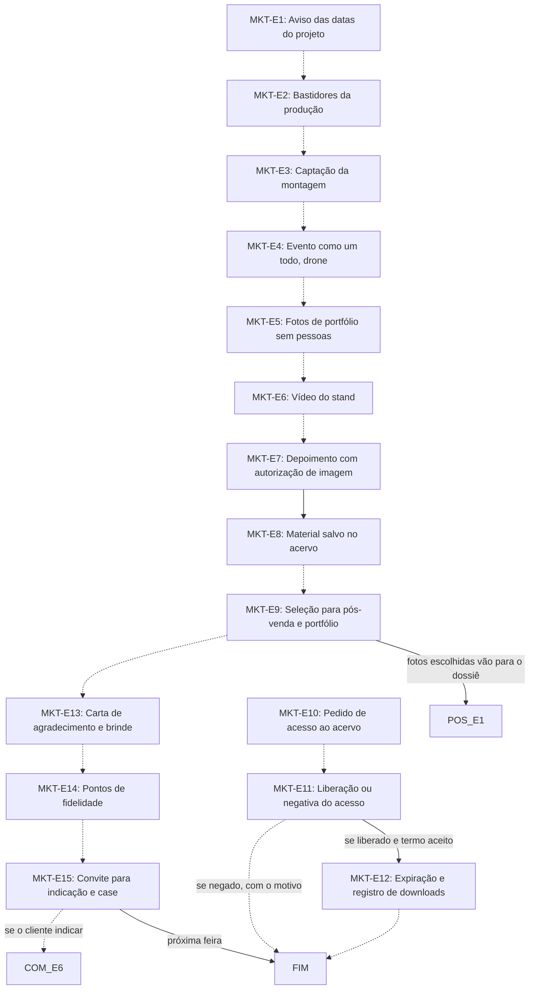

# Fluxo MKT · Marketing

15 etapas em ordem de execução, com as decisões de Diego aplicadas. Montado por agentes a partir da Especificação e dos documentos de setor, e ainda não revisado por Diego nem pelo Pedro. Como ler: `ERP-CRM/FLUXOS/00_VISAO-GERAL.md`.

## 1. MKT-E1 · Aviso das datas do projeto `vigente`

- **O que acontece:** O sistema avisa o Marketing das datas do projeto: produção, montagem, dia do cliente e feira.
- **Responsável:** Sistema
- **Perfis:** `SISTEMA`
- **Prazo:** não informado
- **Gatilho:** Cronograma publicado e setores notificados (PLA-E4 e PLA-E5), em paralelo ao Credenciamento
- **Próxima:** `MKT-E2` _(pela ordem do documento)_
- **Decisões aplicadas:** `item-18`
- **Em aberto:** Quem recebe o aviso: o responsável pelo Marketing será definido por Diego (item-18).
- **Itens:** `UNI-00311`, `UNI-00612`
- **Fonte:** DOC-091 §2 item 7; DOC-091 §5 Marketing; PLANDEM_FLX-SET15_MARKETING_V01.md §02 Fase 1

## 2. MKT-E2 · Bastidores da produção `ajustada`

- **O que acontece:** Fotos e vídeos dos bastidores: itens especiais e expertises de execução.
- **Responsável:** Marketing (responsável a definir por Diego)
- **Perfis:** `PERF-DIRETORIA-COMERCIAL`, `PERF-MARKETING`
- **Prazo:** não informado
- **Gatilho:** Período de produção nas datas do projeto (MKT-E1)
- **Próxima:** `MKT-E3` _(pela ordem do documento)_
- **Mudou em relação ao documento:** A Especificação (Respostas 31/10 e §8) citava a Érika no Marketing; pelo item-18, Diego define depois.
- **Decisões aplicadas:** `item-18`
- **Em aberto:** Quem faz a captação: equipe interna, fotógrafo e videomaker contratados, ou os dois (UNI-00944).
- **Itens:** `UNI-00311`, `UNI-00475`
- **Fonte:** DOC-091 §5 Marketing; PLANDEM_FLX-SET15_MARKETING_V01.md §02 Fase 1 e §03

## 3. MKT-E3 · Captação da montagem `ajustada`

- **O que acontece:** Captação da evolução do stand e do evento sendo montados.
- **Responsável:** Marketing (responsável a definir por Diego)
- **Perfis:** `PERF-DIRETORIA-COMERCIAL`, `PERF-MARKETING`
- **Prazo:** não informado
- **Gatilho:** Período de montagem nas datas do projeto (MKT-E1)
- **Próxima:** `MKT-E4` _(pela ordem do documento)_
- **Mudou em relação ao documento:** A Especificação (Respostas 31/10 e §8) citava a Érika no Marketing; pelo item-18, Diego define depois.
- **Decisões aplicadas:** `item-18`
- **Em aberto:** Quem faz a captação (UNI-00944).
- **Itens:** `UNI-00311`, `UNI-00475`
- **Fonte:** DOC-091 §5 Marketing; PLANDEM_FLX-SET15_MARKETING_V01.md §02 Fase 1 e §03

## 4. MKT-E4 · Evento como um todo, drone `ajustada`

- **O que acontece:** Captação do evento como um todo: rua, pórtico, entrada, pavilhão e volta de drone, mostrando a complexidade e a grandiosidade do evento.
- **Responsável:** Marketing (responsável a definir por Diego)
- **Perfis:** `PERF-DIRETORIA-COMERCIAL`, `PERF-MARKETING`
- **Prazo:** não informado
- **Gatilho:** Evento com a abertura pronta, nas datas do projeto (MKT-E1)
- **Próxima:** `MKT-E5` _(pela ordem do documento)_
- **Mudou em relação ao documento:** A Especificação (Respostas 31/10 e §8) citava a Érika no Marketing; pelo item-18, Diego define depois.
- **Decisões aplicadas:** `item-18`
- **Em aberto:** Drone: quem contrata o piloto habilitado e pede a autorização ao organizador da feira (UNI-00946).
- **Itens:** `UNI-00312`, `UNI-00476`, `UNI-00946`
- **Fonte:** DOC-091 §5 Marketing; PLANDEM_FLX-SET15_MARKETING_V01.md §02 Fase 2, §03 e §07

## 5. MKT-E5 · Fotos de portfólio sem pessoas `ajustada`

- **O que acontece:** Fotos de portfólio do stand pronto: limpo, bem iluminado e sem pessoas, de vários ângulos.
- **Responsável:** Marketing (responsável a definir por Diego)
- **Perfis:** `PERF-DIRETORIA-COMERCIAL`, `PERF-MARKETING`
- **Prazo:** não informado
- **Gatilho:** Stand pronto
- **Próxima:** `MKT-E6` _(pela ordem do documento)_
- **Mudou em relação ao documento:** A Especificação (Respostas 31/10 e §8) citava a Érika no Marketing; pelo item-18, Diego define depois.
- **Decisões aplicadas:** `item-18`
- **Em aberto:** O ditado dizia 100 pessoas, entendido como sem pessoas: a confirmar (UNI-00945). Melhor momento: sugestão do SET15 é o dia do cliente, depois da limpeza e antes da abertura.
- **Itens:** `UNI-00312`, `UNI-00477`, `UNI-00844`, `UNI-00945`
- **Fonte:** DOC-091 §5 Marketing; PLANDEM_FLX-SET15_MARKETING_V01.md §02 Fase 2, §03 e §07

## 6. MKT-E6 · Vídeo do stand `ajustada`

- **O que acontece:** Vídeo do stand sem pessoas: por fora, por dentro e em movimento, com destaques de inovação, equipamentos e tecnologia.
- **Responsável:** Marketing (responsável a definir por Diego)
- **Perfis:** `PERF-DIRETORIA-COMERCIAL`, `PERF-MARKETING`
- **Prazo:** não informado
- **Gatilho:** Stand pronto
- **Próxima:** `MKT-E7` _(pela ordem do documento)_
- **Mudou em relação ao documento:** A Especificação (Respostas 31/10 e §8) citava a Érika no Marketing; pelo item-18, Diego define depois.
- **Decisões aplicadas:** `item-18`
- **Em aberto:** Sem pessoas a confirmar (UNI-00945).
- **Itens:** `UNI-00312`, `UNI-00477`
- **Fonte:** DOC-091 §5 Marketing; PLANDEM_FLX-SET15_MARKETING_V01.md §02 Fase 2 e §03

## 7. MKT-E7 · Depoimento com autorização de imagem `ajustada`

- **O que acontece:** Depoimento do cliente em vídeo sobre a experiência com a Imagine e a expectativa com o evento, com autorização de uso de imagem.
- **Responsável:** Marketing (responsável a definir por Diego) e cliente
- **Perfis:** `PERF-DIRETORIA-COMERCIAL`, `PERF-MARKETING`, `PERF-CLIENTE`
- **Prazo:** não informado
- **Gatilho:** Durante o evento, nas datas do projeto (MKT-E1)
- **Próxima:** `MKT-E8`
- **Mudou em relação ao documento:** A Especificação (Respostas 31/10 e §8) citava a Érika no Marketing; pelo item-18, Diego define depois.
- **Decisões aplicadas:** `item-18`
- **Itens:** `UNI-00312`, `UNI-00478`
- **Fonte:** DOC-091 §5 Marketing; PLANDEM_FLX-SET15_MARKETING_V01.md §02 Fase 2 e §03

## 8. MKT-E8 · Material salvo no acervo `ajustada`

- **O que acontece:** O material é salvo no acervo do Portal, na pasta do projeto pelo código, com etiquetas: bastidores, evento, portfólio, vídeo, depoimento. Só o Marketing vê o acervo.
- **Responsável:** Marketing (responsável a definir por Diego)
- **Perfis:** `PERF-DIRETORIA-COMERCIAL`, `PERF-MARKETING`
- **Prazo:** não informado
- **Gatilho:** Material captado (MKT-E2 a E7)
- **Próxima:** `MKT-E9` _(pela ordem do documento)_
- **Mudou em relação ao documento:** A Especificação (Respostas 31/10 e §8) citava a Érika no Marketing; pelo item-18, Diego define depois.
- **Decisões aplicadas:** `item-18`
- **Em aberto:** Prazo para o material editado entrar no acervo depois da feira (UNI-00947).
- **Itens:** `UNI-00313`, `UNI-00479`, `UNI-00785.02`, `UNI-00947`, `UNI-01433`
- **Fonte:** DOC-091 §5 Marketing; DOC-091 §6 Acervo de marketing; PLANDEM_FLX-SET15_MARKETING_V01.md §02 Fase 3 e §04

## 9. MKT-E9 · Seleção para pós-venda e portfólio `ajustada`

- **O que acontece:** Seleção de material para o relatório de pós-venda e para o portfólio. As fotos escolhidas vão para o dossiê do Pós-feira.
- **Responsável:** Marketing (responsável a definir por Diego)
- **Perfis:** `PERF-DIRETORIA-COMERCIAL`, `PERF-MARKETING`
- **Prazo:** não informado
- **Gatilho:** Material no acervo (MKT-E8)
- **Próxima:** fotos escolhidas vão para o dossiê: `POS-E1`; `MKT-E13` _(pela ordem do documento)_
- **Mudou em relação ao documento:** A Especificação (Respostas 31/10 e §8) citava a Érika no Marketing; pelo item-18, Diego define depois.
- **Decisões aplicadas:** `item-18`
- **Em aberto:** O SET14 não lista essas fotos no dossiê, e não está dito em que momento elas entram.
- **Itens:** `UNI-00313`, `UNI-00480`, `UNI-01433`
- **Fonte:** DOC-091 §5 Marketing; PLANDEM_FLX-SET15_MARKETING_V01.md §02 Fase 3

## 10. MKT-E13 · Carta de agradecimento e brinde `ajustada`

- **O que acontece:** O Marketing envia uma carta de agradecimento e um brinde pós-evento, em reconhecimento pela confiança em contratar a Imagine.
- **Responsável:** Marketing (responsável a definir por Diego)
- **Perfis:** `PERF-DIRETORIA-COMERCIAL`, `PERF-MARKETING`
- **Prazo:** não informado
- **Gatilho:** Depois da feira
- **Próxima:** `MKT-E14` _(pela ordem do documento)_
- **Mudou em relação ao documento:** A Especificação (Respostas 31/10 e §8) citava a Érika no Marketing; pelo item-18, Diego define depois.
- **Decisões aplicadas:** `item-18`
- **Em aberto:** Orçamento do brinde por cliente ou por faixa de contrato (UNI-00949).
- **Itens:** `UNI-00314`, `UNI-00483`, `UNI-00949`
- **Fonte:** DOC-091 §5 Marketing; PLANDEM_FLX-SET15_MARKETING_V01.md §02 Fase 4 e §05

## 11. MKT-E14 · Pontos de fidelidade `ajustada`

- **O que acontece:** Os pontos do programa de fidelidade são lançados para o cliente, acumulados a cada contratação. Essa base também controla o programa de indicação.
- **Responsável:** Marketing (responsável a definir por Diego)
- **Perfis:** `PERF-DIRETORIA-COMERCIAL`, `PERF-MARKETING`
- **Prazo:** não informado
- **Gatilho:** Depois da feira
- **Próxima:** `MKT-E15` _(pela ordem do documento)_
- **Mudou em relação ao documento:** A Especificação (Respostas 31/10 e §8) citava a Érika no Marketing; pelo item-18, Diego define depois.
- **Decisões aplicadas:** `item-18`
- **Em aberto:** Regras de pontos, níveis e recompensas são sugestões a validar com o Financeiro (UNI-00950). O SET15 prevê extrato na aba do cliente, que fecha no fim da feira.
- **Itens:** `UNI-00314`, `UNI-00483`, `UNI-00950`, `UNI-01631`
- **Fonte:** DOC-091 §5 Marketing; DOC-091 §13; PLANDEM_FLX-SET15_MARKETING_V01.md §02 Fase 4 e §05

## 12. MKT-E15 · Convite para indicação e case `ajustada`

- **O que acontece:** Convite para indicar e para virar case; case só com autorização por escrito do cliente. A indicação entra no CRM com a origem do cliente indicador e o vendedor atende. Ela só conta depois do contrato assinado e do primeiro pagamento recebido.
- **Responsável:** Marketing (responsável a definir por Diego) e Comercial
- **Perfis:** `PERF-DIRETORIA-COMERCIAL`, `PERF-MARKETING`
- **Prazo:** não informado
- **Gatilho:** Cliente promotor convidado (POS-E8)
- **Próxima:** se o cliente indicar: `COM-E6` _(pela ordem do documento)_; próxima feira: `FIM`
- **Mudou em relação ao documento:** A Especificação (Respostas 31/10 e §8) citava a Érika no Marketing; pelo item-18, Diego define depois.
- **Decisões aplicadas:** `item-18`
- **Em aberto:** A Especificação diz que a indicação volta como origem de cliente no SET02, sem citar a etapa, e COM-E6 não lista indicação entre as origens. O SET15 paga a recompensa quando a indicação vira contrato; a Especificação §13 exige também o primeiro pagamento: seguida a Especificação. Regras a validar (UNI-00950) e compliance com a Maitê.
- **Itens:** `UNI-00314`, `UNI-00483`, `UNI-00859.01`
- **Fonte:** DOC-091 §2 item 12; DOC-091 §5 Marketing; DOC-091 §13; PLANDEM_FLX-SET15_MARKETING_V01.md §02 Fase 4 e §05

## 13. MKT-E10 · Pedido de acesso ao acervo `vigente`

- **O que acontece:** Um setor pede acesso a um material, informando o motivo e o prazo de que precisa.
- **Responsável:** Setor solicitante
- **Prazo:** não informado
- **Gatilho:** Contínua, sob demanda: um setor precisa de material do acervo
- **Próxima:** `MKT-E11` _(pela ordem do documento)_
- **Itens:** `UNI-00313`, `UNI-00481`, `UNI-01433`
- **Fonte:** DOC-091 §5 Marketing; PLANDEM_FLX-SET15_MARKETING_V01.md §02 Fase 3 e §04

## 14. MKT-E11 · Liberação ou negativa do acesso `ajustada`

- **O que acontece:** O Marketing libera por um período ou nega, com o motivo. O usuário aceita o termo de uso antes de abrir.
- **Responsável:** Marketing (responsável a definir por Diego)
- **Perfis:** `PERF-DIRETORIA-COMERCIAL`, `PERF-MARKETING`
- **Prazo:** não informado
- **Gatilho:** Pedido de acesso registrado (MKT-E10)
- **Próxima:** se liberado e termo aceito: `MKT-E12`; se negado, com o motivo: `FIM` _(pela ordem do documento)_
- **Mudou em relação ao documento:** A Especificação (Respostas 31/10 e §8) citava a Érika no Marketing; pelo item-18, Diego define depois.
- **Decisões aplicadas:** `item-18`
- **Em aberto:** Prazo padrão de acesso liberado (sugestão: 7 dias) e uso de marca d'água (UNI-00948).
- **Itens:** `UNI-00121.01`, `UNI-00313`, `UNI-00481`, `UNI-00948`, `UNI-01433`
- **Fonte:** DOC-091 §5 Marketing; PLANDEM_FLX-SET15_MARKETING_V01.md §02 Fase 3, §04 e §07

## 15. MKT-E12 · Expiração e registro de downloads `vigente`

- **O que acontece:** O acesso expira sozinho no fim do prazo, e cada visualização e download fica registrado.
- **Responsável:** Sistema
- **Perfis:** `SISTEMA`
- **Prazo:** fim do prazo definido pelo Marketing
- **Gatilho:** Acesso liberado com termo aceito (MKT-E11)
- **Próxima:** `FIM` _(pela ordem do documento)_
- **Itens:** `UNI-00120.02`, `UNI-00313`, `UNI-00482`, `UNI-01433`
- **Fonte:** DOC-091 §5 Marketing; PLANDEM_FLX-SET15_MARKETING_V01.md §02 Fase 3 e §04

