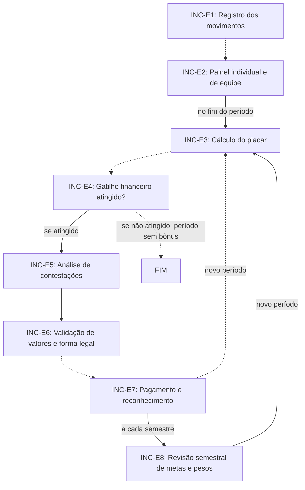

# Fluxo INC · Incentivo

8 etapas em ordem de execução, com as decisões de Diego aplicadas. Montado por agentes a partir da Especificação e dos documentos de setor, e ainda não revisado por Diego nem pelo Pedro. Como ler: `ERP-CRM/FLUXOS/00_VISAO-GERAL.md`.

## 1. INC-E3 · Cálculo do placar `vigente`

- **O que acontece:** No fim do período, o sistema calcula o placar de cada setor e pessoa: prazo 40%, qualidade 35%, eficiência 25%. Níveis: setor 50%, feira 30%, individual 20%.
- **Responsável:** Sistema
- **Perfis:** `SISTEMA`
- **Prazo:** fim do período (por feira ou por trimestre)
- **Gatilho:** Fim do período de apuração
- **Próxima:** `INC-E4` _(pela ordem do documento)_
- **Decisões aplicadas:** `item-23`
- **Em aberto:** O placar vale junto com o Índice de Desempenho do Setor, mas falta dizer o uso de cada um (item-23). Pesos a confirmar (UNI-00956) e período de apuração a definir (UNI-00957).
- **Itens:** `UNI-00490`
- **Fonte:** DOC-091 §5 Programa de incentivo; PLANDEM_PRG-001_PROGRAMA-INCENTIVO_V01.md §02 Fase 2, §03 e §08

## 2. INC-E4 · Gatilho financeiro atingido? `vigente`

- **O que acontece:** O bônus só existe se o resultado financeiro da empresa no período atingir a meta. Se não for atingido, só há reconhecimento não financeiro e plano de melhoria.
- **Responsável:** Sistema e líderes
- **Perfis:** `SISTEMA`, `PERF-LIDER-SETOR`
- **Prazo:** não informado
- **Gatilho:** Placar calculado (INC-E3)
- **Próxima:** se atingido: `INC-E5`; se não atingido: período sem bônus: `FIM` _(pela ordem do documento)_
- **Em aberto:** O documento não diz para onde segue o período sem bônus. O checklist só indica Portal e líderes na fase, sem dizer quem confere o gatilho.
- **Itens:** `UNI-00576`
- **Fonte:** DOC-091 §5 Programa de incentivo; PLANDEM_PRG-001_PROGRAMA-INCENTIVO_V01.md §02 Fase 2 e §03

## 3. INC-E5 · Análise de contestações `vigente`

- **O que acontece:** Os líderes analisam as contestações. O atraso causado por outro setor não conta contra quem recebeu a tarefa atrasada.
- **Responsável:** Líderes
- **Perfis:** `PERF-LIDER-SETOR`
- **Prazo:** não informado
- **Gatilho:** Gatilho financeiro atingido (INC-E4)
- **Próxima:** `INC-E6`
- **Itens:** `UNI-00491`
- **Fonte:** DOC-091 §5 Programa de incentivo; PLANDEM_PRG-001_PROGRAMA-INCENTIVO_V01.md §02 Fase 2 e §06

## 4. INC-E6 · Validação de valores e forma legal `vigente`

- **O que acontece:** A diretoria valida valores e enquadramento legal: prêmio, PLR ou bônus em contrato, conforme o vínculo de cada pessoa.
- **Responsável:** Diretoria (Maitê e Diego)
- **Perfis:** `PERF-DIRETORIA-FINANCEIRA`, `PERF-DIRETORIA-COMERCIAL`
- **Prazo:** não informado
- **Gatilho:** Contestações analisadas (INC-E5)
- **Próxima:** `INC-E7` _(pela ordem do documento)_
- **Em aberto:** Quantas pessoas são CLT e quantas são prestadoras (UNI-00954). Validação jurídica e contábil de cada forma de pagamento (UNI-00958).
- **Itens:** `UNI-00492`, `UNI-00958.01`
- **Fonte:** DOC-091 §5 Programa de incentivo; PLANDEM_PRG-001_PROGRAMA-INCENTIVO_V01.md §02 Fase 3 e §05

## 5. INC-E7 · Pagamento e reconhecimento `vigente`

- **O que acontece:** Pagamento por prêmio, PLR ou bônus em contrato, conforme o vínculo, e reconhecimento com o destaque da feira no Portal.
- **Responsável:** Financeiro
- **Perfis:** `PERF-FINANCEIRO`
- **Prazo:** prêmio por feira ou trimestre; PLR semestral; bônus em contrato por feira
- **Gatilho:** Valores e forma legal validados (INC-E6)
- **Próxima:** a cada semestre: `INC-E8`; novo período: `INC-E3` _(pela ordem do documento)_
- **Em aberto:** Tamanho do bônus e teto por pessoa (UNI-00953). Se a convenção coletiva já prevê PLR (UNI-00955).
- **Itens:** `UNI-00493`, `UNI-00493.01`
- **Fonte:** DOC-091 §5 Programa de incentivo; PLANDEM_PRG-001_PROGRAMA-INCENTIVO_V01.md §02 Fase 4, §05 e §07

## 6. INC-E8 · Revisão semestral de metas e pesos `vigente`

- **O que acontece:** Metas e pesos são revistos a cada semestre, com os dados do Portal e do pós-feira.
- **Responsável:** Diretoria
- **Perfis:** `PERF-DIRETORIA-COMERCIAL`, `PERF-DIRETORIA-FINANCEIRA`
- **Prazo:** a cada semestre
- **Gatilho:** Fim do semestre
- **Próxima:** novo período: `INC-E3`
- **Itens:** `UNI-00494`, `UNI-00630.01`
- **Fonte:** DOC-091 §5 Programa de incentivo; PLANDEM_PRG-001_PROGRAMA-INCENTIVO_V01.md §01 e §02 Fase 5

## 7. INC-E1 · Registro dos movimentos `vigente`

- **O que acontece:** O sistema registra os movimentos de cada usuário: notificação recebida, resposta, devolução, retrabalho, prazo cumprido ou perdido. Implantação: 3 meses só medindo e depois um piloto de 1 trimestre.
- **Responsável:** Sistema
- **Perfis:** `SISTEMA`
- **Prazo:** não informado
- **Gatilho:** Contínua: começa com as regras publicadas no Portal
- **Próxima:** `INC-E2` _(pela ordem do documento)_
- **Em aberto:** Quem administra o programa: Marketing, RH ou a Maitê (UNI-00952).
- **Itens:** `UNI-00488`
- **Fonte:** DOC-091 §5 Programa de incentivo; PLANDEM_PRG-001_PROGRAMA-INCENTIVO_V01.md §02 Fase 1, §06 e §08

## 8. INC-E2 · Painel individual e de equipe `vigente`

- **O que acontece:** Painel individual e de equipe atualizado todo dia, em que cada pessoa vê os próprios números e os do seu setor: tempo de resposta, data de corte cumprida, primeira vez certa, retrabalho e informação incompleta.
- **Responsável:** Sistema
- **Perfis:** `SISTEMA`
- **Prazo:** todo dia
- **Gatilho:** Contínua: atualizado todo dia com os movimentos (INC-E1)
- **Próxima:** no fim do período: `INC-E3`
- **Itens:** `UNI-00489`, `UNI-00631.01`
- **Fonte:** DOC-091 §5 Programa de incentivo; DOC-091 §10; PLANDEM_PRG-001_PROGRAMA-INCENTIVO_V01.md §02 Fase 1 e §04

